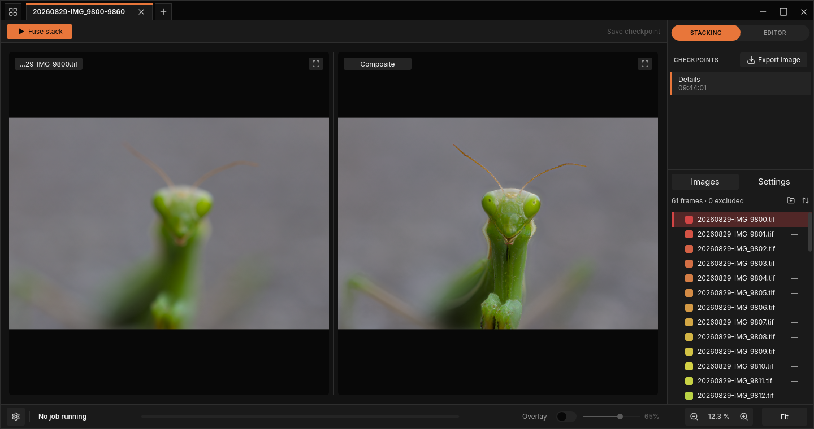

<p align="center">
  
</p>

<h1 align="center">FocusForge</h1>

<p align="center">A cross-platform focus stacking application with a full retouching editor.</p>

<p align="center">
  <a href="LICENSE"></a>
  
  <a href="https://github.com/jjjsood/FocusForge/actions/workflows/check.yml"></a>
  <a href="https://github.com/jjjsood/FocusForge/releases"></a>
</p>

<p align="center">
  
</p>


<p align="center">
  <a href="https://youtu.be/_Yl03_Xk66A"></a>
  <br>
  <a href="https://youtu.be/_Yl03_Xk66A">Watch the promo video</a>
</p>

## Features

**From shoot to sharp image**
- Drop in a focus bracket straight from the camera, camera RAW, TIFF or JPEG, and get one image sharp from front to back
- Shot several subjects in one session? FocusForge sorts the card into separate stacks for you; check the split before it runs
- Long brackets of high-resolution frames run on an ordinary computer: the whole stack never has to fit in memory, only one frame's working memory does (see [Hardware](#hardware))
- Shot handheld, or your lens breathes while focusing? Frames are lined up first and the edges trimmed to what every shot covers
- Flickering light or exposure drift between shots is evened out
- Three methods to choose from: Details as the all-rounder, Soft transitions for gentler blends between frames, Focus map for the most coherent source map to pick from
- Plan a bracket before shooting: the step calculator turns lens or objective, magnification, overlap and depth range into a focus step, frame count, duration and disk need, in the window or with `focusforge-cli step-plan`
- See which frames hold the sharpest areas: the Analytics overlay and `focusforge-cli sharp-areas` count them per image
- Fast on a graphics card, the same result without one; the window also starts where only a software renderer is available
- RAW stacks keep highlights above white until the final image is written

**Fixing what the stack got wrong**
- Halos, ghosting or a misplaced bristle? Brush in the right frame by hand with a soft brush
- A colour overlay shows which shot every part of the image came from, so you know where to paint from
- Unlimited undo, and every version of the edit kept: go back, try another direction, export any of them

**Working through a whole session**
- Use the desktop app, or script the same steps from the command line
- Pause, cancel and pick up long runs later without starting over
- Save your favourite settings as presets; re-run only the one stack you want to tweak
- A summary after each batch shows which stacks worked, so nothing goes missing quietly
- Problems and notices collect in one place, and reach you as a system notification while you're in another app

**Delivering the result**
- Export TIFF, PNG or JPEG with your camera metadata, colour profile and keywords intact
- Hand a RAW stack's result to a raw converter as a linear DNG, with exposure and white balance adjustable there
- If something breaks, FocusForge packs a privacy-safe report you can send in
- Learn when a newer release exists: a quiet notice at start, or `focusforge-cli check-update`

Details for each are in the [guides](docs/README.md).

## Install

Linux: install the matching `.deb` or run its AppImage from [Releases](https://github.com/jjjsood/FocusForge/releases), or build from source.
macOS: open the matching `.dmg` from [Releases](https://github.com/jjjsood/FocusForge/releases) and drag it to Applications, or build from source.
Windows: run the matching `.msi` from [Releases](https://github.com/jjjsood/FocusForge/releases), or build from source; no Visual C++ redistributable is needed. See [getting started](docs/getting-started.md) for paths.

## Hardware

The free RAM a run needs depends on the kind of frames and their size, not on how many there are. It is the **free** RAM that counts, not the installed RAM: FocusForge reads the available memory when a run starts (inside a container, the free memory under the container's limit), sets aside about 1.6 GB for what every run holds anyway, and plans its working memory with 65 % of the rest. With less than about 1.6 GB free nothing runs. If the free memory cannot be read, it plans with a fixed 1 GiB. `--max-host-memory` can only lower the working memory ([batch runs](docs/reference/batch-runs.md)).

Free RAM per workload, in decimal GB, rounded up:

| Frames | Run at all | Recommended | Scratch disk per frame |
|---|---|---|---|
| Camera RAW, 24–26 MP | 3.1 GB | 7.5 GB | 160 MB |
| Camera RAW, 45–61 MP | 4.1–5.0 GB | 11.7–15.3 GB | 280–370 MB |
| 16-bit TIFF, uncompressed | 1.7 GB | 3.3 GB | none |
| 16-bit TIFF, compressed | 1.7 GB; 2.6 GB (26 MP) to 3.9 GB (61 MP) if a frame is stored as one single strip | 3.8 GB (3.9 GB for a single-strip 61 MP frame) | none |
| JPEG, 24–61 MP | 3.0–5.2 GB | 3.8–5.2 GB | none |

- A retouch or edit session needs the same minimum as a stack run of the same frames. The window's preview buffers come on top. Exporting a retouched TIFF project held 24 MB beyond what the process holds anyway on a 4722 × 3100 result; a RAW project's export has not been measured.
- Camera RAW is the hungriest because every frame is developed in memory before it is stored: the minimum is the free RAM for one frame's develop pass, and the recommended figure lets four frames develop at once. RAW frames are developed to scratch files of width × height × 6 bytes each (the figures above are for the developed size). Scratch disk grows linearly with the frame count: 10 frames of 5088 × 3392 take 1.04 GB.
- Fewer frames cut scratch disk and run time but do not lower the free RAM one frame needs.
- Rule of thumb for a camera not listed: free RAM ≈ 1.6 GB + (raw pixels × 30 B + file size) ÷ 0.65, about 1.6 GB + 53 MB per advertised megapixel + 1.5 × the file size. Sensors read out roughly 15 % more pixels than advertised; `focusforge-cli info` prints the exact `raw=` size.
- Uncompressed TIFF is read in tiles and needs only a tile set (about 37 MB for 3-channel 16-bit frames) beyond the fixed part. A compressed TIFF needs its largest compressed block decoded; JPEG needs one frame decoded and widened. The recommended figures for these formats give the tiles in flight their full 1 GiB.

### Measured on one machine

32 threads, 64 GB RAM, RTX 5070 Ti. Peak memory held is the peak of memory the system cannot reclaim; memory-mapped frames and the file cache come on top and are given back under pressure. Frame sizes are in pixels.

| Run | Free RAM at start | Working memory | Peak memory held |
|---|---|---|---|
| 10 RAW frames, 5376 × 3574 raw, GPU | inside a 2.52 GB container | 586 MB | 1075 MB |
| the same | capped by `--max-host-memory` | 586 MB | 1035 MB |
| the same | capped | 2342 MB | 1718 MB |
| the same | capped | 4568 MB | 2967 MB |
| the same | 53.6 GB | 33.8 GB | 4009 MB |
| the same, CPU only | capped | 586 MB | 1587 MB |
| 10 TIFF frames, 4781 × 3136 16-bit, GPU | capped | 1 GiB | 919 MB |
| the same | capped | 4 GiB | 913 MB |
| the same, 32 frames | capped | 1 GiB | 912 MB |
| the same, CPU only | capped | 1 GiB | 1474 MB |
| Export of a retouched TIFF project, 4722 × 3100 | 53.8 GB | from free RAM | 24 MB |

The peak is mostly a fixed part, but with a GPU and RAW frames it grows with the working memory, from 1.0 GB at 586 MB to 4.0 GB at 33.8 GB. TIFF frames are read in tiles, so going from 10 to 32 frames changed the peak by −7 MB. More working memory also makes runs faster: the RAW stack took 25.7 s at 586 MB and 22.0 s at 2342 MB, the TIFF stack 11.3 s at 1 GiB and 9.4 s at 4 GiB. The 10-frame RAW set is accepted from about 2.46 GB of free RAM, or 2.52 GB inside a container, which holds about 58 MB itself; at 2.464 GB it is refused with the shortfall named.

### Graphics card

A GPU is optional and the result is the same without one. Under 256 MiB of VRAM FocusForge uses the CPU on its own. More VRAM keeps more tiles on the card: the GPU path asks for up to 8 GiB and backs off to what the card allows (`--max-vram` lowers it). It is also faster and holds less fixed memory: the RAW stack above took 69.5 s on the CPU against 25.7 s on the GPU, with a fixed part of 1563 MB against 807 MB.

### When a run is short of memory

FocusForge says how much more it needs. Close other programs, convert RAW or JPEG frames to TIFF, or, if you set a memory limit, raise it.

## Quick start

### Build

Rust, toolchain pinned to `1.95.0` (`rust-toolchain.toml`, picked up
automatically by `rustup`). `crates/gui` links Slint with
`renderer-femtovg-wgpu`, which has a hard dependency on fontconfig; on
Debian/Ubuntu-family hosts install the dev package before building:

```bash
sudo apt install libfontconfig1-dev
```

```bash
cargo build --release
```

Produces `target/release/focusforge-cli` and `target/release/focusforge-gui`,
with the GPU-accelerated fusion path compiled in by default. Pass
`--no-default-features` to exclude it; without it, `stack` always runs on the
CPU and `--cpu` does not exist as a flag.

### Inspect a stack

```bash
target/release/focusforge-cli info path/to/frames/
target/release/focusforge-cli info path/to/project.ffp
```

For a project file, prints stored project facts after structural and head
Z-Map validation without reading source frames. For a directory, prints one
block per frame. TIFF entries show size, depth, byte order, compression and
strip layout; RAW entries show decoder metadata without developing pixels. The
report ends with a frame count, total size and a uniform-layout verdict. Add
`--json` for the same report as machine-readable JSON.

### Stack a folder

```bash
target/release/focusforge-cli stack path/to/frames/ --algorithm laplacian
target/release/focusforge-cli export path/to/frames/frames.ffp -o out.tif --zmap zmap.tif
```

`stack` aligns the frames and fuses them into a project beside the frames
(one `.ffp` file per detected stack); `export` then renders that project
into `out.tif` and writes its per-pixel source map `zmap.tif`. Name the
output `out.png` or `out.jpg` for those formats. Alignment and the
auto-crop that precedes fusion are both on by default (`--no-align` /
`--no-crop` turn them off); `focusforge-cli align` reports the same
transforms on their own, before any fusion runs. See
[`docs/guide/stacking.md`](docs/guide/stacking.md) for the other algorithms
and their parameters, and [`docs/reference/batch-runs.md`](docs/reference/batch-runs.md)
for stacking a folder that holds more than one stack.

The Mantis photographs and derived comparison image are used only within this
project; see [their image rights notice](docs/assets/README.md).

### GUI

```bash
target/release/focusforge-gui --open path/to/frames/
```

Opens the same folder into a window instead of the command line, one tab
per detected stack. See [`docs/guide/gui.md`](docs/guide/gui.md).

## Network use

FocusForge makes one network request: at start, in the background, it asks
the release server whether a newer final release exists. The request is a
single HTTPS GET that waits at most 5 seconds and carries only the client
name `FocusForge/<version>`: no identifier, setting or file data. Nothing is
downloaded or installed, and a failed check stays silent. Turn it off with
**Settings → About → Check for updates at start**; with it off no request is
made. **Check now** and `focusforge-cli check-update` run the same check on
demand.

## Documentation

The user manual is an mdBook whose source is in [`docs/`](docs/README.md). It
covers focus stacking and shooting practice, [getting started](docs/getting-started.md),
the window, stacking, alignment, retouching, checkpoints, export and
settings, troubleshooting and a glossary. The appendix is the reference for
every `focusforge-cli` subcommand, the project format and the TIFF layouts it
reads and writes.

## Contributing

Open pull requests against `develop`. See [`CONTRIBUTING.md`](CONTRIBUTING.md) for layout, tests and the contribution gate;
[Code of Conduct](CODE_OF_CONDUCT.md), [Security policy](SECURITY.md) and [changelog](CHANGELOG.md) set community standards.

## License

GPL-3.0-only. See [LICENSE](LICENSE). FocusForge is GPLv3 because Slint
is used under its GPLv3 licensing option, which is what makes the whole
application GPLv3 rather than a more permissive license; dependency licenses
are held to a compatible allowlist and enforced by `cargo deny check
licenses`.
This software is based in part on the work of the Independent JPEG Group,
carried by the `jpeg-encoder` crate's JPEG export path.
