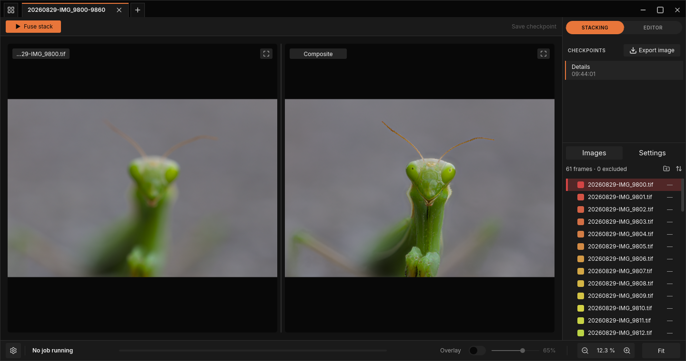

<p align="center">
  
</p>

<h1 align="center">FocusForge</h1>

<p align="center">A cross-platform focus stacking application with a full retouching editor.</p>

<p align="center">
  <a href="LICENSE"></a>
  
  <a href="https://github.com/jjjsood/FocusForge/actions/workflows/check.yml"></a>
  <a href="https://github.com/jjjsood/FocusForge/releases"></a>
</p>

<p align="center">
  
</p>


## Features

- Fuses a directory of TIFF or supported RAW frames into a focus-stacked project
  (`focusforge-cli stack`), out-of-core so the stack never has to fit in RAM
- Detects and proposes how a mixed folder of frames splits into separate
  stacks by capture time and directory structure, printed before the run and
  overridable or saved to a file for editing and reuse
- Aligns handheld or breathing frames before fusing them, recovering shift,
  rotation and scale drift and cropping the result to the region every frame
  covers (`focusforge-cli align` reports the same transforms on their own)
- Three fusion methods — Details, Soft transitions and Focus map — each
  producing a Z-Map naming the source frame behind every output pixel
- Evens out brightness differences between frames before fusing, on by
  default and bounded by a maximum gain, with a notice for any frame held at
  the bound
- Exports any checkpoint of a project as a TIFF, PNG or JPEG image
  (`focusforge-cli export`), with per-format bit depth, compression, JPEG
  quality and chroma subsampling, and EXIF, ICC, XMP and IPTC carried over;
  rendered from the stored composite, separately from the run that produced it
- Keeps every retouch as a checkpoint in a branching history: list,
  restore, branch from, export and delete checkpoints in the window or with
  `focusforge-cli history`
- Reports outcome, sharpness and Z-Map coverage per stack after a run
  (`focusforge-cli review`), so a failed stack in a batch is a visible record
  rather than a missing file
- Retouches the result with soft brush strokes from a chosen frame — brush,
  pipette and a rainbow source overlay, unlimited undo with redo discarded
  on a new edit — headless via `focusforge-cli retouch` or with a mouse in
  the window's editor mode
- Reusable parameter bundles (presets) and a re-run flag that fuses only the
  stacks you name, so tuning one stack after a batch run costs one re-run,
  not the whole folder again
- Cancellable, pausable and resumable runs — Ctrl-C stops a run cleanly,
  SIGUSR1 pauses one in place on Unix, and `--resume` picks a cancelled stack
  back up without redoing finished work
- Directory-wide stack inspection (`focusforge-cli info`) — dimensions, depth,
  byte order, compression, layout and a uniform-layout check across every
  frame, plain text or `--json`
- Reads 16-bit unsigned chunky TIFF frames stored uncompressed, with LZW, or
  with Deflate, in strip or tiled layouts; flags unsupported layouts by name
  instead of silently misreading them
- Fuses the `laplacian` algorithm on a GPU automatically when one is
  available, falling back to the CPU cleanly when it isn't; either path
  produces the same result, proven to match within 1 LSB at 16-bit
- A single parameter schema drives every algorithm's settings; `focusforge-cli
  algorithms` lists what's registered, prints a schema, and validates
  `--set key=value` overrides against it
- Keeps a structured log of every run and, on a crash, a report of what led
  to it, all local to your own machine; `focusforge-cli diagnostics`
  packages the evidence into one redacted ZIP, and the next start after a
  crash tells you it's there
- A window (`focusforge-gui`) alongside the CLI: open a folder or a saved
  project into a tab, view the selected source frame beside the composite,
  choose a method and edit its parameters in Prepare, Fuse, Align and
  Finish sections, switch alignment on or off, run, pause, cancel or retry a fuse,
  and switch into editor mode to retouch the result, browse its
  checkpoints and export an image in the format you choose
- Choose List, Image list or Large previews for the source panel; the chosen presentation persists with the rest of the window settings
- Keeps every failure and processing notice in a notification center behind a bell, and raises an operating-system banner when the window is in the background

## Install

Linux: install the matching `.deb` or run its AppImage from [Releases](https://github.com/jjjsood/FocusForge/releases), or build from source.
macOS: open the matching `.dmg` from [Releases](https://github.com/jjjsood/FocusForge/releases) and drag it to Applications, or build from source.
Windows: run the matching `.msi` from [Releases](https://github.com/jjjsood/FocusForge/releases), or build from source. See [getting started](docs/getting-started.md) for paths.

## Quick start

### Build

Rust, toolchain pinned to `1.95.0` (`rust-toolchain.toml`, picked up
automatically by `rustup`). `crates/gui` links Slint with
`renderer-femtovg-wgpu`, which has a hard dependency on fontconfig; on
Debian/Ubuntu-family hosts install the dev package before building:

```bash
sudo apt install libfontconfig1-dev
```

There is no code-side workaround for a missing fontconfig on this renderer.

```bash
cargo build --release
```

Produces `target/release/focusforge-cli` and `target/release/focusforge-gui`,
with the GPU-accelerated fusion path compiled in by default. Pass
`--no-default-features` to exclude it; without it, `stack` always runs on the
CPU and `--cpu` does not exist as a flag.

### CLI

### Inspect a stack

```bash
target/release/focusforge-cli info path/to/frames/
target/release/focusforge-cli info path/to/project.ffp
```

For a project file, prints stored project facts after structural and head
Z-Map validation without reading source frames. For a directory, prints one
block per frame. TIFF entries show size, depth, byte order, compression and
strip layout; RAW entries show decoder metadata without developing pixels. The
report ends with a frame count, total size and a uniform-layout verdict. Add
`--json` for the same report as machine-readable JSON.

RAW frames use `rawler` as the only decoder. Files it cannot read return an
error; there is no decoder fallback.

### Stack a folder

```bash
target/release/focusforge-cli stack path/to/frames/ --algorithm laplacian
target/release/focusforge-cli export path/to/frames/frames.ffp -o out.tif --zmap zmap.tif
```

`stack` aligns the frames and fuses them into a project beside the frames
(one `.ffp` file per detected stack); `export` then renders that project
into `out.tif` and writes its per-pixel source map `zmap.tif`. Name the
output `out.png` or `out.jpg` for those formats. Alignment and the
auto-crop that precedes fusion are both on by default (`--no-align` /
`--no-crop` turn them off); `focusforge-cli align` reports the same
transforms on their own, before any fusion runs. See
[`docs/guide/stacking.md`](docs/guide/stacking.md) for the other algorithms
and their parameters, and [`docs/guide/batch-runs.md`](docs/guide/batch-runs.md)
for stacking a folder that holds more than one stack.

The Mantis photographs and derived comparison image are used only within this
project; see [their image rights notice](docs/assets/README.md).

### GUI

```bash
target/release/focusforge-gui --open path/to/frames/
```

Opens the same folder into a window instead of the command line, one tab
per detected stack. See [`docs/guide/gui.md`](docs/guide/gui.md).

## Documentation

See [`docs/`](docs/README.md) for [getting started](docs/getting-started.md)
and the guides (the window, stacking,
alignment, retouching, checkpoint history, batch runs, diagnostics) and the
reference for every `focusforge-cli` subcommand, the project format and the
TIFF layouts it reads and writes.

## Contributing

See [`CONTRIBUTING.md`](CONTRIBUTING.md) for layout, tests and the contribution gate;
[Code of Conduct](CODE_OF_CONDUCT.md), [Security policy](SECURITY.md) and [changelog](CHANGELOG.md) set community standards.

## License

GPL-3.0-only. See [LICENSE](LICENSE). FocusForge is GPLv3 because Slint
is used under its GPLv3 licensing option, which is what makes the whole
application GPLv3 rather than a more permissive license; dependency licenses
are held to a compatible allowlist and enforced by `cargo deny check
licenses`.

This software is based in part on the work of the Independent JPEG Group,
carried by the `jpeg-encoder` crate's JPEG export path.
