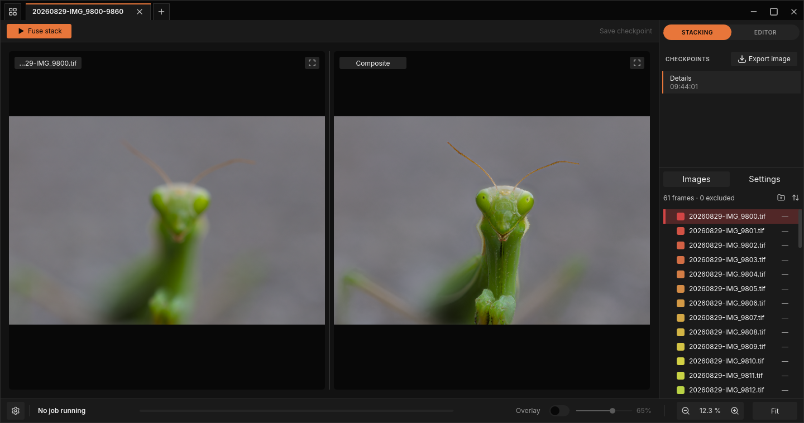

<p align="center">
  
</p>

<h1 align="center">FocusForge</h1>

<p align="center">A cross-platform focus stacking application with a full retouching editor.</p>

<p align="center">
  <a href="LICENSE"></a>
  
  <a href="https://github.com/jjjsood/FocusForge/actions/workflows/check.yml"></a>
  <a href="https://github.com/jjjsood/FocusForge/releases"></a>
</p>

<p align="center">
  
</p>


<p align="center">
  <a href="https://youtu.be/_Yl03_Xk66A"></a>
  <br>
  <a href="https://youtu.be/_Yl03_Xk66A">Watch the promo video</a>
</p>

## Features

**From shoot to sharp image**
- Drop in a focus bracket straight from the camera, camera RAW, TIFF or JPEG, and get one image sharp from front to back
- Shot several subjects in one session? FocusForge sorts the card into separate stacks for you; check the split before it runs
- Long brackets of high-resolution frames run on an ordinary computer, however much memory the stack would need
- Shot handheld, or your lens breathes while focusing? Frames are lined up first and the edges trimmed to what every shot covers
- Flickering light or exposure drift between shots is evened out
- Three methods to choose from: Details as the all-rounder, Soft transitions for gentler blends between frames, Focus map for the most coherent source map to pick from
- Plan a bracket before shooting: the step calculator turns lens or objective, magnification, overlap and depth range into a focus step, frame count, duration and disk need, in the window or with `focusforge-cli step-plan`
- See which frames hold the sharpest areas: the Analytics overlay and `focusforge-cli sharp-areas` count them per image
- Fast on a graphics card, the same result without one; the window also starts where only a software renderer is available
- RAW stacks keep highlights above white until the final image is written

**Fixing what the stack got wrong**
- Halos, ghosting or a misplaced bristle? Brush in the right frame by hand with a soft brush
- A colour overlay shows which shot every part of the image came from, so you know where to paint from
- Unlimited undo, and every version of the edit kept: go back, try another direction, export any of them

**Working through a whole session**
- Use the desktop app, or script the same steps from the command line
- Pause, cancel and pick up long runs later without starting over
- Save your favourite settings as presets; re-run only the one stack you want to tweak
- A summary after each batch shows which stacks worked, so nothing goes missing quietly
- Problems and notices collect in one place, and reach you as a system notification while you're in another app

**Delivering the result**
- Export TIFF, PNG or JPEG with your camera metadata, colour profile and keywords intact
- Hand a RAW stack's result to a raw converter as a linear DNG, with exposure and white balance adjustable there
- If something breaks, FocusForge packs a privacy-safe report you can send in
- Learn when a newer release exists: a quiet notice at start, or `focusforge-cli check-update`

Details for each are in the [guides](docs/README.md).

## Install

Linux: install the matching `.deb` or run its AppImage from [Releases](https://github.com/jjjsood/FocusForge/releases), or build from source.
macOS: open the matching `.dmg` from [Releases](https://github.com/jjjsood/FocusForge/releases) and drag it to Applications, or build from source.
Windows: run the matching `.msi` from [Releases](https://github.com/jjjsood/FocusForge/releases), or build from source; no Visual C++ redistributable is needed. See [getting started](docs/getting-started.md) for paths.

## Quick start

### Build

Rust, toolchain pinned to `1.95.0` (`rust-toolchain.toml`, picked up
automatically by `rustup`). `crates/gui` links Slint with
`renderer-femtovg-wgpu`, which has a hard dependency on fontconfig; on
Debian/Ubuntu-family hosts install the dev package before building:

```bash
sudo apt install libfontconfig1-dev
```

```bash
cargo build --release
```

Produces `target/release/focusforge-cli` and `target/release/focusforge-gui`,
with the GPU-accelerated fusion path compiled in by default. Pass
`--no-default-features` to exclude it; without it, `stack` always runs on the
CPU and `--cpu` does not exist as a flag.

### Inspect a stack

```bash
target/release/focusforge-cli info path/to/frames/
target/release/focusforge-cli info path/to/project.ffp
```

For a project file, prints stored project facts after structural and head
Z-Map validation without reading source frames. For a directory, prints one
block per frame. TIFF entries show size, depth, byte order, compression and
strip layout; RAW entries show decoder metadata without developing pixels. The
report ends with a frame count, total size and a uniform-layout verdict. Add
`--json` for the same report as machine-readable JSON.

### Stack a folder

```bash
target/release/focusforge-cli stack path/to/frames/ --algorithm laplacian
target/release/focusforge-cli export path/to/frames/frames.ffp -o out.tif --zmap zmap.tif
```

`stack` aligns the frames and fuses them into a project beside the frames
(one `.ffp` file per detected stack); `export` then renders that project
into `out.tif` and writes its per-pixel source map `zmap.tif`. Name the
output `out.png` or `out.jpg` for those formats. Alignment and the
auto-crop that precedes fusion are both on by default (`--no-align` /
`--no-crop` turn them off); `focusforge-cli align` reports the same
transforms on their own, before any fusion runs. See
[`docs/guide/stacking.md`](docs/guide/stacking.md) for the other algorithms
and their parameters, and [`docs/reference/batch-runs.md`](docs/reference/batch-runs.md)
for stacking a folder that holds more than one stack.

The Mantis photographs and derived comparison image are used only within this
project; see [their image rights notice](docs/assets/README.md).

### GUI

```bash
target/release/focusforge-gui --open path/to/frames/
```

Opens the same folder into a window instead of the command line, one tab
per detected stack. See [`docs/guide/gui.md`](docs/guide/gui.md).

## Network use

FocusForge makes one network request: at start, in the background, it asks
the release server whether a newer final release exists. The request is a
single HTTPS GET that waits at most 5 seconds and carries only the client
name `FocusForge/<version>`: no identifier, setting or file data. Nothing is
downloaded or installed, and a failed check stays silent. Turn it off with
**Settings → About → Check for updates at start**; with it off no request is
made. **Check now** and `focusforge-cli check-update` run the same check on
demand.

## Documentation

The user manual is an mdBook whose source is in [`docs/`](docs/README.md). It
covers focus stacking and shooting practice, [getting started](docs/getting-started.md),
the window, stacking, alignment, retouching, checkpoints, export and
settings, troubleshooting and a glossary. The appendix is the reference for
every `focusforge-cli` subcommand, the project format and the TIFF layouts it
reads and writes.

## Contributing

Open pull requests against `develop`. See [`CONTRIBUTING.md`](CONTRIBUTING.md) for layout, tests and the contribution gate;
[Code of Conduct](CODE_OF_CONDUCT.md), [Security policy](SECURITY.md) and [changelog](CHANGELOG.md) set community standards.

## License

GPL-3.0-only. See [LICENSE](LICENSE). FocusForge is GPLv3 because Slint
is used under its GPLv3 licensing option, which is what makes the whole
application GPLv3 rather than a more permissive license; dependency licenses
are held to a compatible allowlist and enforced by `cargo deny check
licenses`.
This software is based in part on the work of the Independent JPEG Group,
carried by the `jpeg-encoder` crate's JPEG export path.
