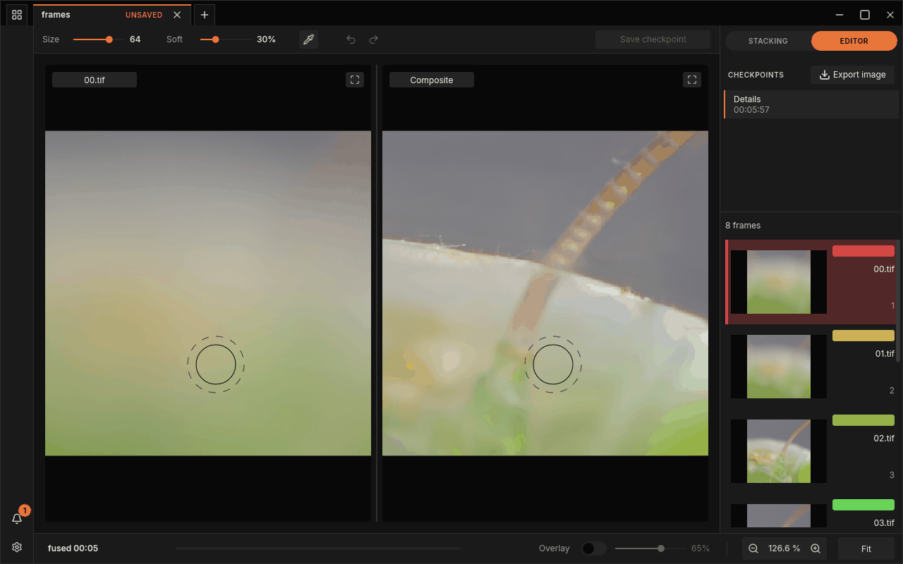

# The FocusForge Manual

*A stack of eight frames of a praying mantis, fused and open in the editor.*

FocusForge turns a series of photographs focused at different distances — a
*focus stack* — into one image that is sharp from front to back. It lines the
frames up, picks the sharpest part of each, blends them into one composite and
then lets you repair by hand whatever the automatic result got wrong. It runs
on Linux, macOS and Windows, uses a graphics card when there is one and gives
the same result without one.

This manual is for photographers. You do not need to have stacked before: the
first part teaches the technique, the second walks through every function of
the program, and the help section answers the questions that come up along the
way.

## How this manual is organised

**[Part I — Focus stacking](stacking/depth-of-field.md)** explains the
photography. Why a macro shot is only sharp in a thin slice, how many frames a
subject needs and how far apart they should be, which aperture to choose, how
to light and support a stack, and how to recognise and avoid the typical
failures: halos, ghosts from movement and soft bands between frames. Read it
before your first shoot, or whenever a result looks wrong and you want to know
why.

**[Part II — Using FocusForge](getting-started.md)** explains the program,
window first. It starts with installing FocusForge and fusing your first stack,
then tours the window, the Images panel and every stacking setting, the
retouching editor, checkpoints and saving, exporting, working with several
projects, and the settings window.

**[Help](troubleshooting.md)** collects the messages FocusForge can show you,
what each one means and what to do about it, and a
[glossary](glossary.md) of the terms the manual uses.

**[Appendix](reference/cli.md)** is the reference material: every command and
option of `focusforge-cli` for scripting the same steps from a terminal, batch
runs from the command line, and the formats of the project file and of the
TIFF files FocusForge reads and writes.

## The quickest way in

1. [Install FocusForge](getting-started.md).
2. Shoot a stack — the [pre-shoot checklist](stacking/shooting-practice.md)
   lists what to check before you press the shutter.
3. Follow [Your first stack](guide/first-stack.md): open the folder, click
   **Fuse stack**, keep the result and export it.

> **Tip:** The screenshots in this manual all show the same eight-frame stack
> of a praying mantis that ships with FocusForge's source code, so what you
> see on the page is what you get when you open those frames yourself.

## Conventions

- **Bold** text names something you click or read in the window, spelled
  exactly as the window spells it: **Fuse stack**, **Keep**, **Export image**.
- `Monospace` text is something you type, a file name or a command-line option.
- Notes, tips and warnings are set apart:

> **Note:** extra background that helps you understand what is going on.

> **Warning:** something that can cost you work if you miss it.

FocusForge is free software under the GNU General Public License, version 3.
Building it from source and contributing are described in
[`CONTRIBUTING.md`](https://github.com/jjjsood/FocusForge/blob/main/CONTRIBUTING.md)
in the repository; this manual is about using it.
