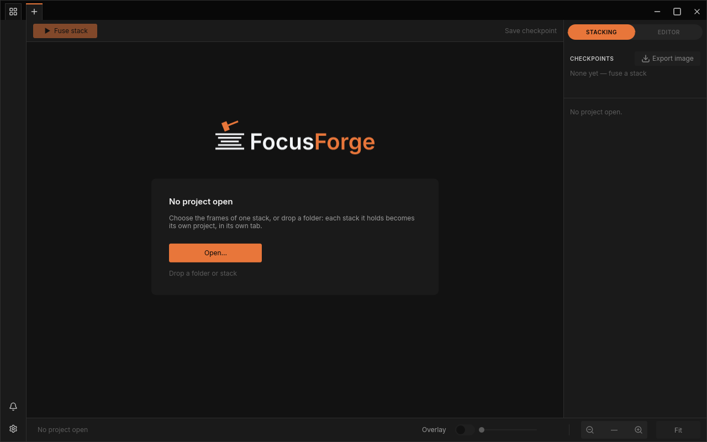

# Installing FocusForge

FocusForge comes as one package per operating system. Each package holds the
desktop application, which this manual describes, and the `focusforge-cli`
command-line program, which does the same work from a terminal.

FocusForge is always available from source. Release packages are optional:
use one only when the release you want actually provides it for your system,
otherwise follow [Build from source](#build-from-source) below.

## What to download

Open the [Releases page](https://github.com/jjjsood/FocusForge/releases),
choose a release and download the file for your computer. `<version>` stands
for the release number, for example `0.1.0`.

| Your computer | File | What it is |
|---|---|---|
| Linux (Debian, Ubuntu and relatives), 64-bit Intel/AMD | `focusforge_<version>_amd64.deb` | A package your system installs, with a menu entry |
| Any other 64-bit Intel/AMD Linux | `FocusForge-<version>-x86_64.AppImage` | One file that runs without installing |
| Mac with Apple silicon (M1 and later) | `FocusForge-<version>-aarch64.dmg` | A disk image holding `FocusForge.app` |
| Windows, 64-bit | `FocusForge-<version>-x86_64.msi` | An installer |

> **Note:** A release lists only the files it was built with. If the file for
> your system is missing, build from source instead; nothing in this manual
> depends on how you installed.

## Linux

### The `.deb` package

Install it with your package manager, from the folder you downloaded it to.
Replace `<version>` with the release number before pasting the command:

```bash
sudo apt install "./focusforge_<version>_amd64.deb"
```

**FocusForge** then appears in your desktop's application menu, under
Graphics or Photography. The package installs the window as
`/usr/bin/focusforge-gui`, the command-line program as
`/usr/bin/focusforge-cli`, and its shared resources (menu entry, icons,
manual pages, completions) under `/usr/share`.

### The AppImage

An AppImage needs no installation. Make it executable once, then run it:

```bash
chmod +x "FocusForge-<version>-x86_64.AppImage"
"./FocusForge-<version>-x86_64.AppImage"
```

Running the AppImage opens the window. It contains the command-line program
internally at `usr/bin/focusforge-cli` (visible after extracting the
AppImage); it does not install that path on your system.

## macOS

1. Open `FocusForge-<version>-aarch64.dmg`.
2. Drag `FocusForge.app` to `Applications`.
3. Start **FocusForge** from Applications or Launchpad.

The command-line program sits inside the app at
`/Applications/FocusForge.app/Contents/MacOS/focusforge-cli`, and the shared
resources are below `/Applications/FocusForge.app/Contents/Resources/share`.

> **Note:** If macOS refuses to open the app on its first start because it
> cannot verify the developer, open **System Settings → Privacy & Security**,
> find the message about FocusForge and choose to open it anyway. You only
> do this once.

## Windows

Run `FocusForge-<version>-x86_64.msi` and follow its prompts. Afterwards
**FocusForge** is in the Start menu.

The installer puts everything in `$env:ProgramFiles\FocusForge`: the window
as `focusforge-gui.exe`, the command-line program as `focusforge-cli.exe`
and the shared resources below `$env:ProgramFiles\FocusForge\share`. It does
not add the folder to `PATH`, so call the command-line program by its full
path.

> **Note:** If Windows SmartScreen stops the installer, choose
> **More info**, then **Run anyway**.

## Build from source

Building from source works on every system FocusForge supports and is the way
to go when no package fits. It needs the Rust toolchain; the exact steps,
including the one system library Linux needs, are in the repository's
[build instructions](https://github.com/jjjsood/FocusForge#build). The build
produces `target/release/focusforge-gui` (the window) and
`target/release/focusforge-cli`. Start the window with:

```bash
target/release/focusforge-gui
```

## First launch

Start FocusForge from your application menu, Launchpad or Start menu (or
run `focusforge-gui` in a terminal). The window opens with no project:



*The window on its first start, ready for a stack.*

From here, [Your first stack](guide/first-stack.md) walks you through opening
your frames, fusing them and keeping the result.

> **Tip:** On Linux, when you start FocusForge from a launcher that shows a
> busy cursor, the window tells the desktop as soon as it has appeared, so the
> busy cursor ends right away. (It uses the startup token the launcher passes
> in `DESKTOP_STARTUP_ID` or `XDG_ACTIVATION_TOKEN`.)

## For the command line

Everything the window does with a stack can also be scripted with
`focusforge-cli`. For example, after installing the `.deb`:

```bash
focusforge-cli stack path/to/frames/ --algorithm laplacian
```

Every package contains 15 manual pages, including `focusforge-cli-stack(1)`,
and completion scripts for Bash, Zsh, Fish and PowerShell. On Linux their
paths are:

```text
/usr/share/man/man1/focusforge-cli*.1.gz
/usr/share/bash-completion/completions/focusforge-cli
/usr/share/zsh/vendor-completions/_focusforge-cli
/usr/share/fish/vendor_completions.d/focusforge-cli.fish
/usr/share/powershell/completions/_focusforge-cli.ps1
```

For an extracted AppImage, replace `/usr/share` with `usr/share`; for macOS,
replace it with `/Applications/FocusForge.app/Contents/Resources/share`; for
Windows, replace it with `$env:ProgramFiles\FocusForge\share`.

Read a manual page without changing the system man database:

```bash
man -M /usr/share/man focusforge-cli-stack
```

Load a completion script for the current shell session:

```bash
# Bash
source /usr/share/bash-completion/completions/focusforge-cli
```

```zsh
# Zsh
fpath=(/usr/share/zsh/vendor-completions $fpath); autoload -Uz compinit; compinit
```

```fish
# Fish
source /usr/share/fish/vendor_completions.d/focusforge-cli.fish
```

```powershell
# PowerShell, in an existing pwsh session
. /usr/share/powershell/completions/_focusforge-cli.ps1
# Windows package:
. "$env:ProgramFiles\FocusForge\share\powershell\completions\_focusforge-cli.ps1"
```

Copy or source only the script for the shell you use, and check the package
path on your operating system before you add it to a shell profile. Every
command and option is described in the
[command-line reference](reference/cli.md).
