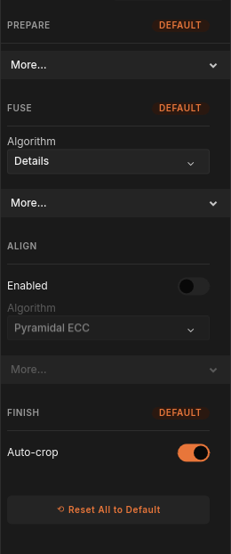
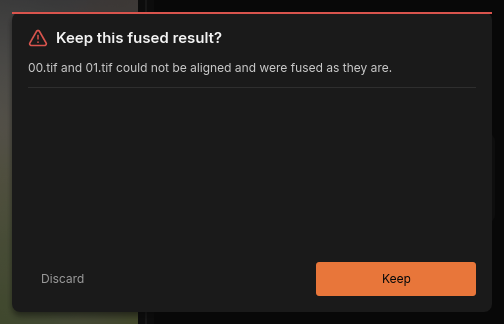

# Alignment

No two frames of a focus stack line up perfectly. The camera drifts a little
on the tripod or between handheld shots, and most lenses change the image
size slightly as focus moves, an effect called
[focus breathing](../glossary.md#focus-breathing). Fused as they are, such
frames give doubled edges and smeared detail.
[Alignment](../glossary.md#alignment) fixes this before fusing: FocusForge
moves every frame so that it lines up with one
[reference frame](../glossary.md#reference-frame). It is on by default and
needs no attention for most stacks. This page explains the **ALIGN** section
of the dock's **Settings** tab (see [Stacking settings](stacking.md) for the
tab as a whole) and what to do when a frame cannot be aligned.

## What alignment does

When you click **Fuse stack**, alignment runs after the brightness of the
frames has been evened out and before they are fused. The bottom bar reads
**Aligning** with the number of frames done (such as "3 of 8") and an
estimated time remaining.

For every frame, FocusForge:

1. **Picks the frame to compare with.** By default every frame is compared
   with its neighbour, step by step, on the way to the middle frame of the
   stack (see [Chain or Anchor](#chain-or-anchor)).
2. **Finds the movement.** It compares the two frames on a small, coarse
   version first, then refines the result on ever larger versions up to full
   size (an image [pyramid](../glossary.md#pyramid)). It looks for a shift,
   and with the default **Rotation + Scale** mode also a change of size and a
   small rotation. Where enough matching features can be found, it starts from
   a quick feature-based estimate; otherwise from no movement at all. Before
   the final, full-size comparison both frames are smoothed very slightly, so
   that the different blur of two frames focused at different depths does not
   pull the result off.
3. **Checks the answer.** A result that does not hold up across the frame, or
   whose match is too weak to be trusted, is rejected, and the frame counts as
   not aligned (see
   [When a frame cannot be aligned](#when-a-frame-cannot-be-aligned)).
4. **Moves the frame** into place for fusing. Your source files are not
   changed.

Finally, **Auto-crop** in the **FINISH** section trims the result to the area
every aligned frame covers.

On a 61-frame macro stack, alignment recovers up to 159 pixels of drift in
**Translation only** mode, and up to 199 pixels when the frames also breathe
in scale and rotation.

## The ALIGN settings


*The ALIGN section with its More... bar open, at the defaults.*

**ALIGN** shows the **Enabled** switch and the **Algorithm** menu; the rest
sits under its **More...** bar. **Pyramidal ECC** is the only alignment
method, so the menu has one entry.

| Setting | Range | Default | What it does |
|---|---|---|---|
| **Enabled** | on / off | on | Lines every frame up with the reference frame before fusing. Off fuses the frames exactly as they were read. |
| **Algorithm** | **Pyramidal ECC** | **Pyramidal ECC** | The alignment method. |
| **Mode** | **Translation only**, **Rotation + Scale** | **Rotation + Scale** | Which movements are corrected: a shift only, or a shift plus a change of size and a small rotation. |
| **Max Iterations** | 1 to 1000 | 400 | How many refinement steps alignment may take at each size of the pyramid. |
| **Epsilon (px)** | 0.000000001 to 1 | 0.0001 | How small, in pixels, the last refinement step must be before alignment counts a frame as settled. |
| **Pyramid Depth** | 0 to 16 | worked out from the frame size | How many smaller versions of the frame are compared before the full-size one. |
| **Reference Policy** | **Anchor**, **Chain** | **Chain** | Whether every frame is compared directly with the reference frame, or step by step through its neighbours. |
| **Reference Frame** | **First**, **Middle**, **Last** | **Middle** | Which frame the others are lined up with. |

## Choose a mode

| Mode | Use it for |
|---|---|
| **Rotation + Scale** (default) | Stacks focused with the lens's focus ring or by the camera's own focus bracketing, where the image grows or shrinks a little from frame to frame; handheld stacks, which also twist slightly. When in doubt, use this. |
| **Translation only** | A stack shot on a focus rail with a lens that does not breathe, where the only movement is a small drift. It solves for less, so it is cheaper. Also worth a try when **Rotation + Scale** reports frames it could not align. |

To change it: open **More...** under **ALIGN**, click the **Mode** field and
choose an entry.

## Chain or Anchor

**Reference Policy** decides what each frame is compared with:

- **Chain** (default) compares each frame with its neighbour, step by step
  towards the reference frame. Neighbouring frames look alike, so this holds
  up even when the first and last frames of a long stack look very different
  (one sharp at the front, the other at the back). Frames are solved one
  after the other.
- **Anchor** compares every frame directly with the reference frame, all at
  the same time. It is much faster on a machine with many processor cores:
  on a 61-frame stack of 44.8-megapixel frames, about 6 seconds instead of
  about 40 with **Chain**. Use it for short stacks or stacks whose frames
  all look similar, when speed matters.

## Choose the reference frame

**Reference Frame** picks the frame that stays where it is; every other frame
is moved onto it. The result therefore has the framing and image size of the
reference frame, and an exported image carries the camera data (EXIF) of
that frame.

- **Middle** (default) keeps the distance to the farthest frame as small as
  possible, which suits most stacks.
- **First** or **Last** when one end of the stack has the framing you want,
  for example when the image size changes a lot across a long focus-ring stack
  and you want the result at the size of the nearest or farthest focus.

## Fine-tuning: Max Iterations, Epsilon and Pyramid Depth

These three control how hard alignment works. Their defaults suit everything
from small frames to very large ones; leave them unless you have a reason.

- **Max Iterations** caps the refinement steps at each pyramid size. Frames
  that settle earlier stop early and cost nothing extra; on a 61-frame stack
  of 44.8-megapixel frames, no size ever needed more than 202 steps. A frame
  that reaches the cap is not rejected: it keeps the best position found so
  far.
- **Epsilon (px)** is the precision at full size: alignment stops refining
  once a step moves the frame's corners by less than this many pixels. The
  smaller versions stop at 100 times this value. The default, a ten-thousandth
  of a pixel, is already far finer than you can see; a larger value makes
  alignment a little faster and less exact. The slider spans several powers of
  ten, marked `1e-9` to `1`.
- **Pyramid Depth** sets how many smaller versions are compared before the
  full-size frame. Its default is worked out from your frames: the deepest
  pyramid whose smallest version is still at least 64 pixels on its shorter
  side. 512-pixel frames get 3; frames shorter than 127 pixels are aligned at
  full size only (0). A deeper pyramid can catch larger movements but has
  less detail to work with at its coarsest step.

## Switch alignment off



*Alignment switched off: the rest of the ALIGN section is greyed.*

Click the **Enabled** switch under **ALIGN** to turn alignment off. The rest
of the section greys out and keeps its values. The next fuse then uses the
frames exactly as they were read, and the result keeps the full frame.

Switch it off when:

- the frames are already lined up, for example because you aligned them in
  another program and exported them;
- the camera and subject were truly fixed and the lens does not breathe, and
  you want to save the time alignment takes;
- alignment makes things worse, for example on a subject made of a repeating
  pattern, and you want to compare.

Switching alignment off (or off and on again) removes the **ALIGN**
section's **DEFAULT** badge; **Reset All to Default** brings it back (see
[Reset All to Default](stacking.md#reset-all-to-default)).

## Alignment is reused

Aligning is often the slowest part of a fuse, so FocusForge keeps each
alignment it computes. When you fuse the same frames again after changing
only the fusion method or its settings under **FUSE**, the stored alignment
is used and the bottom bar briefly reads
**Aligning** with "from cache" instead of a frame count. The second fuse is
then much quicker.

The stored alignments are recognised by the content of the frames, so they
are found again even when the files were moved or renamed; frames you reshoot
are aligned afresh. **Clear cache** (Stage cache) in the **Storage** section of
[the settings window](settings-window.md) deletes them.

## When a frame cannot be aligned



*Two frames of the sample stack could not be aligned.*

A frame that cannot be aligned does not stop the fuse. FocusForge uses it
unmoved, exactly where it was in the camera (this is called an identity
fallback), finishes the run and then asks **Keep this fused result?**, naming
the frames it could not align (past five, the rest are counted). The dialog
needs an answer: **Escape** does not close it.

- **Keep** keeps the result. A notification "N frames unaligned" (or
  "1 frame unaligned") records it; see
  [Projects, notifications and quitting](batch-runs.md).
- **Discard** throws the result away. The project stays as it was before the
  fuse.

An unaligned frame only matters where it contributed to the result. Very
blurred frames, such as the first frames of a stack focused on the background,
often cannot be aligned because they hold little detail, but they also
contribute little; that is what happens in the sample stack above, and its
result is fine. Before you decide, look at the result for doubled edges or
smeared detail, and use the Z-Map overlay to see where the named frames were
used (see
[See where each pixel came from](gui.md#see-where-each-pixel-came-from)).

If the result shows the problem:

1. Click **Discard**.
2. Try one change at a time and fuse again:
   - Leave the named frames out with **Exclude** in
     [the Images panel](images-panel.md), when they add nothing the
     neighbouring frames do not.
   - Switch **Mode** to **Translation only** when the stack was shot on a rail
     and does not breathe.
   - Switch **Reference Policy** between **Chain** and **Anchor**.
3. If the frames are already lined up, switch alignment off.

## What alignment cannot fix

Alignment moves each frame as a whole: it shifts, scales and rotates it. It
cannot fix:

- part of the subject moving relative to the rest (an antenna, a leaf in the
  wind);
- a change of perspective when the camera tilts or swings between frames;
- every frame of heavily defocused or very long series (on the order of 64
  frames): some may end up not aligned, and on such stacks even a frame that
  is reported as aligned is worth checking in the result;
- strongly repeating patterns, which can match in more than one position.
  Such frames are normally reported as not aligned rather than placed wrongly.

[Shooting a stack](../stacking/shooting-practice.md#what-alignment-absorbs)
explains how to shoot so that alignment has an easy job, and
[Common failure images](../stacking/failure-images.md#motion-between-frames)
shows what movement looks like in a result.

## From the command line

The same aligner runs in `focusforge-cli stack`, where alignment and the
auto-crop that follows it are both on by default, and on its own in
`focusforge-cli align`, which reports each frame's recovered movement without
fusing anything:

```bash
focusforge-cli align path/to/frames/
```

Each row reports the frame's recovered translation, scale and rotation, an
iteration count, and `rho`, the correlation the solver optimized, in
`[-1, 1]` (not a pixel distance). The last line is the auto-crop rectangle
`stack` would apply: the largest axis-aligned rectangle every warped frame
covers.

The **ALIGN** settings are the `pyramidal-ecc` parameters `mode`
(`translation`, `rotation-scale`), `max-iterations`, `epsilon-px`,
`pyramid-depth`, `reference-policy` (`anchor`, `chain`) and
`reference-frame` (`first`, `middle`, `last`). `align` takes them with
`--set`, `stack` with `--align-set`:

```bash
focusforge-cli align path/to/frames/ --set mode=translation
focusforge-cli align path/to/frames/ --set reference-policy=anchor
focusforge-cli stack path/to/frames/ --algorithm laplacian --align-set mode=translation
```

`focusforge-cli algorithms pyramidal-ecc` prints every parameter with its
range, default and description. See
[`reference/cli.md`](../reference/cli.md#align) for every `align` flag and
[`reference/cli.md`](../reference/cli.md#stack) for every `stack` flag.

### Frame status

Each frame's row ends in the status its solve reached:

- `converged`: the step size fell below `epsilon-px`.
- `hit-cap`: `max-iterations` ran out while the steps were still shrinking.
- `stalled`: `max-iterations` ran out with the steps flat or oscillating; the
  best-correlation transform is kept. A middle pyramid level that loses
  correlation (typical of a defocused frame) also counts as `stalled`: it
  hands its best fit to the next finer level, which refines it.
- `diverged(<reason>)`: the frame did not register. `validation-failed`
  (JSON) is one reason: the fit converged, but the same transform leaves a
  large residual at most of the usable patches away from the fit region, so
  it is rejected rather than trusted. `weak-match` is another: the final
  correlation is below 0.2, so the best match found is a wrong optimum and is
  rejected. Heavy defocus and long series can also end in
  `correlation-decreased`. The other reasons are in
  [`reference/cli.md`](../reference/cli.md#align).

A pyramid level whose status is worse than the others sets the frame's
status. Only `diverged` is a registration failure: `stalled`, `hit-cap` and
`converged` frames never fail a strict run. The full-resolution level gets
four times the sample budget of the coarse levels.

The feature-based starting estimate is accepted when its matches agree over
enough of the frame: spread across at least 6 cells of a 4x4 grid, or, when
clustered in as few as 2 cells, when at least 75% of the matches support it.
Otherwise the solve starts from the identity. The finest level of both frames
is smoothed with three light low-pass passes before the final solve; coarser
levels are not smoothed, and a solve region within the smoothing reach of the
frame edge reads the finest level unsmoothed.

### Registration failures use identity fallback

A frame that ends `diverged` keeps an identity transform and the run
continues, with the frame marked as a fallback in the report. Pass `--strict`
to make `stack` or `align` exit 1 and name every failed frame. `--no-align`
skips the stage when the frames are already registered. If the aligned frames
share no usable overlap, `stack` stops with an error that says so; `--no-crop`
keeps the full frame extent instead.

### Reuse and hardware

`stack` stores each computed alignment in the stage cache, keyed on the
frames, the alignment parameters, the failure policy and the solver revision,
so a repeated run, or a re-fuse in the window with only fusion settings
changed, skips the solve. Frames are identified by their content, and an
alignment cached by an older solver revision is recomputed. `--no-cache`
forces a recompute; [Batch runs from the command line](../reference/batch-runs.md)
describes the cache.

Large pyramid levels run on the GPU when a usable adapter is present; the rest
of the solve is on the CPU. `--cpu` keeps everything on the CPU and
`--max-vram <SIZE>` lowers the device memory budget. If the device is lost
mid-run, the whole alignment is redone on the CPU, so every frame comes from
one backend. Both JSON reports name the backend in `align_backend`.

### Checking a result visually

```bash
focusforge-cli align path/to/frames/ --write-warped .scratch/warped/
```

Writes one warped TIFF per input frame into the given directory, at the
frame's own source dimensions and uncropped, so the region the auto-crop
would cut is still visible. Use it, or compare each frame's transform with its
neighbours', to check stacks where `converged` alone does not prove a correct
fit.

### Skipping it

```bash
focusforge-cli stack path/to/frames/ --algorithm laplacian --no-align
```

`--no-align` fuses the frames unwarped; `--no-crop` keeps alignment on but
leaves the output at the full frame extent instead of cropping to the common
region. In the window the same two choices are the **Enabled** switch under
**ALIGN** and **Auto-crop** under **FINISH** (see
[Stacking settings](stacking.md#finish-trim-the-edges)).
