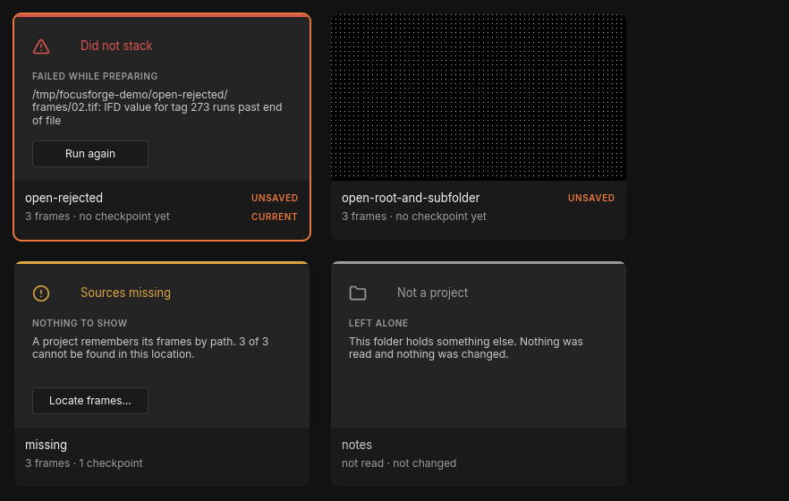
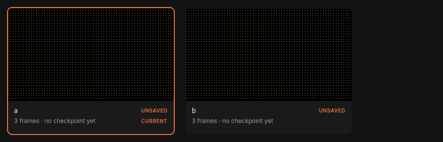
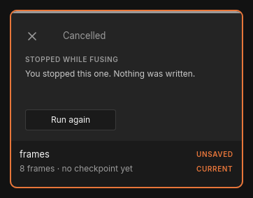
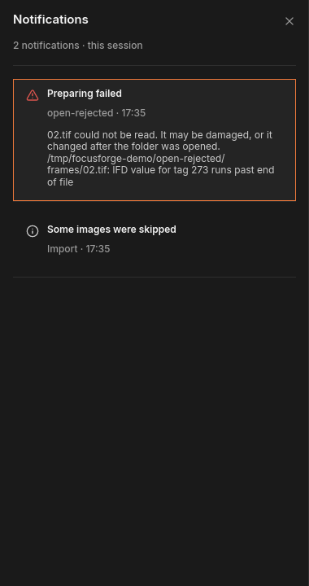
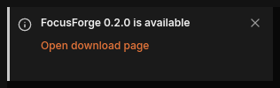
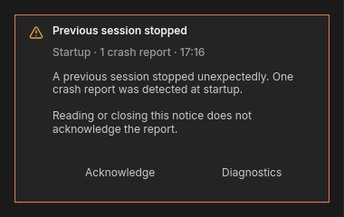
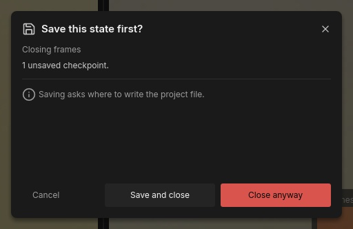
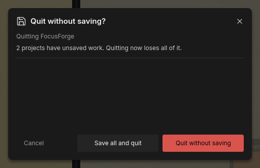

# Projects, notifications and quitting

FocusForge keeps every [stack](../glossary.md#stack) you open as a [project](../glossary.md#project)
in a tab of its own, so you can work on several at once. This chapter shows
how to keep track of them in the **Projects** overview, what happens when you
open a folder that holds several stacks, how to fuse several projects one
after another, what the cards of a failed or cancelled run mean, where the
window keeps its messages, and what it asks before you close a project or quit
with unsaved work.

## The Projects overview

The overview lists every open project as a card and holds the file actions:
new, open, save and close.

*The Projects overview: one card per open project, the file actions and the recent list on the left.*

### Open and close the overview

1. Click **Projects**, the square-grid button at the left end of the tab strip.
   The overview covers everything below the tab strip.
2. To close it, click **Projects** again or press Escape. The header says so
   too: "The same button closes it again; Esc does too."

While the overview is open, the toolbar, the canvas and the dock are hidden
behind it. The tab strip stays usable: you can still select or close a tab.
The overview does not open while a dialog, such as the
**Keep this fused result?** question, is waiting for an answer.

### Read a project card

Each card shows a picture of the project, its name and a second line with the
number of frames and [checkpoints](../glossary.md#checkpoint), for example
"8 frames · 1 checkpoint" or "8 frames · no checkpoint yet". While the
project is fusing, the second line names the stage instead, such as
"8 frames · aligning, 6 of 8", and a thin progress bar runs along the bottom of
the picture.

Two small labels can sit beside the name:

| Label | Meaning |
|---|---|
| **UNSAVED** | The project has no project file yet, or holds work that is not in its file: a checkpoint, brush strokes or a deletion you have not saved. A folder you have just opened always carries it. The tab shows the same label. |
| **CURRENT** | This is the project of the selected tab. |

Above the cards, the heading reads "Open projects" with a count such as
"2 open". Once a folder could not be opened as a project at all (see
[Cards that need attention](#cards-that-need-attention)), the heading reads
"Projects" and the count names both, for example "4 · 1 did not open".

### Switch to another project

Click a project's card. FocusForge selects its tab and closes the overview.
Clicking a tab in the tab strip does the same without the overview.

### Close a project from its card

Rest the pointer on a card: a close button (**Close**, an ×) appears at its
top-right corner. Click it to close that project. **Close project** in the
rail closes the current project the same way. The overview stays open, so you
can close several projects in a row.

A project that would lose work asks first, with the question described in
[Close a project](#close-a-project); anything else closes at once. When the
last project is closed, the overview reads "No projects open", and the window
behind it shows "No project open" with an **Open…** button.

### New, open, save and close

The rail on the left of the overview holds four file actions. Their shortcuts
work anywhere in the window, also while the overview is closed:

| Action | Shortcut | What it does |
|---|---|---|
| **New project** | Ctrl+N | Asks for a folder of frames and opens it as a new project. A folder that holds several stacks asks how to split it first. |
| **Open project…** | Ctrl+O | Asks for a saved project file (`.ffp`) and opens it in a new tab. |
| **Save project** | Ctrl+S | Saves the current project. Dimmed while the current project has nothing to write. See [Saving a project](history.md#saving-a-project) for where a first save goes. |
| **Close project** | Ctrl+W | Closes the current project, asking first if it would lose work. |

These four shortcuts are fixed: they are not part of the keyboard bindings you
can change in the settings window (see
[Fixed shortcuts](settings-window.md#fixed-shortcuts)), and they do nothing while a question or the
settings window is open.

### Reopen a recent project

Under **RECENT**, the rail lists the last five projects you saved or opened
from a project file, newest first. Each row shows the project's name, when you
last used it ("today", "yesterday" or a date such as "21 Aug") and its
folder. Click a row to open that project, or to switch to its tab if it is
already open; the overview closes. The list is kept between sessions.

## Cards that need attention

A card that could not do its job shows a coloured headline, a short reason and,
where there is something to do, a button.

*A failed run, a project whose frames moved, and a subfolder that holds no stack.*

| Headline | Second line on the card | What happened | Button |
|---|---|---|---|
| Did not stack | FAILED WHILE PREPARING (or the stage it failed in) | The last fuse of this project failed. The card shows the error. | **Run again** |
| Cancelled | STOPPED WHILE FUSING (or the stage you stopped in) | You cancelled the fuse: "You stopped this one. Nothing was written." | **Run again** |
| Sources missing | NOTHING TO SHOW | The saved project cannot find its frames: "A project remembers its frames by path. 3 of 3 cannot be found in this location." | **Locate frames…** |
| Not a project | LEFT ALONE | A folder that holds no stack, such as a subfolder with notes in it: "This folder holds something else. Nothing was read and nothing was changed." | none |

"Did not stack", "Cancelled" and "Sources missing" belong to an open project:
the card still switches to its tab when you click it. A "Not a project" card
has no project behind it; clicking it does nothing, and it disappears once the
same folder opens successfully.

**Locate frames…** asks for the folder where the frames are now and checks
that they are the same frames before the project uses them; see
[Locate frames…](first-stack.md#locate-frames) in *Your first stack*.

### Run a stack again

**Run again** on a "Did not stack" or "Cancelled" card starts that project's
fuse again, from the beginning, with the frames and settings of the run that
stopped. It does not continue where the earlier run stopped, but alignment
already worked out for the same frames is reused from the cache, so the second
run is often quicker. When it finishes, the usual **Keep this fused result?**
question appears.

- **Run again** does nothing while any fuse is running, in this project or
  another one. Wait for that run to end, or cancel it, then click again.
- If the project holds brush strokes that are not in a checkpoint yet, the
  window first asks "Save your edits first?" with **Save and fuse** and
  **Fuse anyway**, because a new fuse would lose them (see
  [Fusing again](history.md#fusing-again-save-your-edits-first)).
- The card keeps its headline until a run of this project succeeds.

## Several stacks at once

### A folder with several stacks

When you open a folder that holds more than one stack, the window asks how to
split it, for example "This folder holds 2 stacks of 3 frames each." The
question and its answers are explained in
[A folder with several stacks](first-stack.md#a-folder-with-several-stacks).

If you answer **Open as 2 projects** (the number follows your folder), each
stack opens as a project of its own: one tab and one card per stack. A stack
that sits in its own subfolder takes that subfolder's name. **Open as one
project** keeps every frame in a single project instead.

*One folder, two stacks: each opens as its own project.*

You can also open several folders one after another. Each becomes a tab of its
own, and the last one you opened is the current one.

### Fuse several projects one after another

Only one fuse runs at a time. While one project is fusing, **Fuse stack** on
any other tab reads **Queued**: click it and that project waits in line, with
its place shown in the bottom bar ("Queued (2)"). The tab strip marks the
fusing tab with a small play triangle and a waiting tab with three dots. How
the line works, and how to take a project out of it, is explained in
[Fuse several stacks: the queue](first-stack.md#fuse-several-stacks-the-queue).

Each project asks its own **Keep this fused result?** question when its fuse
ends, and only while its tab is selected, so you can let several projects fuse
one after another and answer the questions afterwards, in any order. Use the
overview to see which projects are done: a card that gained a checkpoint reads
"1 checkpoint" once you have kept its result.

### Stop a run: the Cancelled card

**Cancel** in the toolbar stops a running fuse (see
[Pause, resume and cancel](first-stack.md#pause-resume-and-cancel)). Nothing is
written and the project stays as it was before the run. Its card in the
overview then reads "Cancelled", with the stage you stopped in and a
**Run again** button.

*A fuse cancelled while fusing. **Run again** starts it again.*

## Notifications

Anything the window has to tell you outside a dialog is kept as a
notification: a failed fuse ("Setup failed", "Alignment failed",
"Preparing failed", "Fusing failed", "Developing failed" or "Writing failed")
or a failed save ("Save failed"), a notice from a run such as
"Brightness not fully matched" for each frame whose brightness could not be fully
matched, "3 frames unaligned" when you keep a result with frames that could not
be aligned, "Some images were skipped" when an opened folder held something
else, and the crash notice described below. Notifications last for the
session; closing the window clears them.

### The bell and its number

The bell sits at the bottom of the narrow icon bar on the left edge of the
window, just above the **Settings** gear. A number on the bell counts the
notifications that arrived since you last opened the notification center; it
disappears once you open the center.

### Read the notification center

1. Click the bell (**Notifications**). The notification center slides in beside
   the icon bar and lists every notification of the session, newest first.
2. Click a row to select it. The selected row has an orange outline and shows
   the full message; the other rows show only their title and context line.
3. To close the center, click the bell again, click the × at its top right
   (**Close notifications**), or press Escape.

Each row has an icon for its kind (information, warning, failure or crash), a
title and a context line: where it came from ("Import", "Save" or "Startup";
nothing for a fuse), the project, the frame or file it concerns, and the time,
for example "Import · 00:19".

*The notification center, newest first, with the selected row showing its full message.*

Opening the center marks every notification as read. Reopening it keeps the
row you selected last. With no notifications yet, it reads "No notifications
yet" and "Messages will remain here for this session."

You can also use the keyboard once you have clicked a row: Up and Down move the
selection, Return or Space shows or hides the selected row's message, and
Escape closes the center. The bell and the center work with no project open.

The center and the Projects overview do not show together: opening the
overview closes the center, and clicking the bell while the overview is open
closes the overview and opens the center.

### Toasts

When a new notification arrives while the window is in front and neither the
center nor the overview is open, it also appears as a toast at the top left of
the canvas, under the toolbar:

- Toasts appear one at a time, oldest first. Each stays 6 seconds, a crash
  notice 10 seconds. Resting the pointer on a toast keeps it up.
- Click the toast or its **Open notification** text to open the center with
  that notification selected.
- Click the × (**Dismiss notification**) to close only the toast; the
  notification stays in the center and on the bell's number.

While the center or the overview is open, no toast appears. What arrives
meanwhile is counted on the bell and is not shown as a toast later.

### The update notice

Once per start, in the background, FocusForge asks whether a newer release
exists (see [Updates](settings-window.md#updates)). A newer one adds a
notification titled "FocusForge `<version>` is available" with the context
line "Startup · `<time>`" and the message "FocusForge `<version>` has been
released. Download page: `<link>`". It also appears as a toast with the link
**Open download page**:

*The update notice as a toast.*

Click **Open download page** (or the toast) to open the release page in your
browser; the toast then closes and the notification stays in the center. The
notice appears at most once per start and never when the check finds nothing
newer, fails or is switched off.

### Banners while the window is in the background

When every FocusForge window is behind other applications, a new notification
appears once as a banner from your operating system instead of a toast. The
banner carries only the title and a short context line; the full message stays
in the center. Moving between the main window and a detached image window does
not count as leaving, and no banner is shown while the Projects overview is
open. Dismissing a banner changes nothing in FocusForge.

On Linux the banners go through the desktop's notification service. They are
credited to FocusForge when `assets/focusforge.desktop` is installed as
`~/.local/share/applications/focusforge.desktop`. Without a notification
service there are no banners, and everything else works as usual.

### The crash notice

If FocusForge stopped unexpectedly last time and left a
[crash report](../glossary.md#crash-report), the next start adds a notification
titled "Previous session stopped", with the context line
"Startup · 1 crash report". Select it to read the message and its two buttons.

*The crash notice. Reading it does not mark the report as dealt with; the two buttons do.*

| Button | What it does |
|---|---|
| **Acknowledge** | Marks the crash report as dealt with, so the notice does not come back at the next start. The row then reads "Acknowledged" and the button is dimmed. |
| **Diagnostics** | Acknowledges the report the same way and opens the settings window on its Diagnostics section, where you can package a [bundle](../glossary.md#diagnostics-bundle) to send with a bug report. See [After a crash](diagnostics.md#after-a-crash). |

Reading the notice, letting its toast run out or closing the center does not
acknowledge anything: "Reading or closing this notice does not acknowledge the
report." Until you acknowledge it, the notice returns at every start.

If the report cannot be marked, the row says "Could not acknowledge report.
Evidence remains unreported. Try the explicit action again." If the folder with
the crash reports cannot be read at all, the notice is titled
"Crash reports unavailable", and **Diagnostics** still works.

## Close a project

You can close a project in four ways: the × on its tab, the × on its card in
the overview, **Close project** in the overview's rail, or Ctrl+W for the
current project.

A project that would lose nothing closes at once. That includes a folder you
opened but never fused (its frames stay where they are) and a project with
nothing changed since you last saved it.

A project with work that is not in a project file asks "Save this state
first?". The dialog names the project ("Closing frames") and what would be
lost, for example "1 unsaved checkpoint." or "2 unsaved brush strokes". For a
project that was never saved it adds "Saving asks where to write the project
file."; for one opened from a file it names that file.

*Closing a fused project that has not been saved yet.*

| Button | What it does |
|---|---|
| **Cancel** | Keeps the project open with everything in it. |
| **Save and close** | Saves the project, asking where for a first save, then closes it. If you cancel the file dialog, the project stays open. |
| **Close anyway** | Closes the project. Everything that was not saved is gone. |

The × at the dialog's top-right corner (**Close dialog**) and the Escape key
do the same as **Cancel**. While the question is open, the rest of the window
does not respond.

## Quit FocusForge

Quit with the × (**Close**) at the right end of the tab strip, or the way your desktop
closes windows (for example Alt+F4). If no project would lose work, the window
closes at once.

Otherwise FocusForge asks "Quit without saving?" ("Quitting FocusForge") and
says how many projects would lose work, for example "2 projects have unsaved
work. Quitting now loses all of it." A project counts when it holds an unsaved
checkpoint, brush strokes, a deletion not yet saved, or a fused result still
waiting for your **Keep** or **Discard**.

*Quitting with two projects that hold unsaved work.*

| Button | What it does |
|---|---|
| **Cancel** | Keeps the window and every project open. |
| **Save all and quit** | Asks where to save each project that has never been saved, then saves every project with unsaved work in turn; a project opened from a file is saved back to that file. The window closes after the last save. If you cancel a file dialog or a save fails, quitting is called off and what was already saved stays saved. |
| **Quit without saving** | Closes the window. Everything that was not saved is lost. |

> **Warning:** **Quit without saving** cannot be undone. A fused result you
> have not kept and saved is gone, and so are unsaved brush strokes.

As with the close question, the corner × (**Close dialog**) and Escape act as
**Cancel**.

> **Tip:** Before a long break, open the Projects overview: every card that
> carries **UNSAVED** after you have fused or retouched it holds work that
> only exists in memory. Save it with **Save project** (Ctrl+S).

## From the command line

`focusforge-cli stack` can fuse a whole folder of stacks in one go, with
presets, re-runs of single stacks, resuming and a review of the results. That
material is in the appendix:
[Batch runs from the command line](../reference/batch-runs.md).

### Presets

Bundling the algorithm and its parameter values into a TOML file for
`--preset`: see [Presets](../reference/batch-runs.md#presets).

### The stage cache

How alignment results are kept and reused between command-line runs: see
[The stage cache](../reference/batch-runs.md#the-stage-cache).

### Reviewing the results

Reading the outcome of every stack in a batch with `focusforge-cli review`:
see [Reviewing the results](../reference/batch-runs.md#reviewing-the-results).
