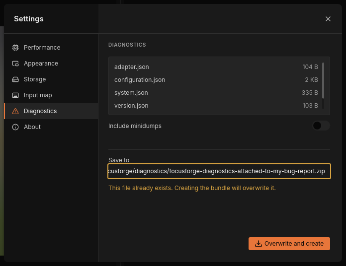

# Diagnostics and crash reports

FocusForge keeps a record of what it does, and if it ever crashes, it keeps
evidence of that too. All of it stays on your own computer: nothing is sent
anywhere, ever. When you ask someone for help, for example in a bug report,
you package that record into one ZIP file, the
[diagnostics bundle](../glossary.md#diagnostics-bundle), and attach it
yourself.

This page explains what FocusForge keeps, what happens after a crash, and how
to make a bundle from the **Diagnostics** section of the
[settings window](settings-window.md). The command-line way to make the same
bundle is at the end.

## What FocusForge keeps

### The log

Every session of the window, and every run of `focusforge-cli`, adds to one
log file, `focusforge.jsonl`, in the `logs` folder of FocusForge's data
folder. It holds one line per event: every warning and refusal, what a fuse
did and at which stage, which graphics adapter was used, and why a setting
fell back to its default. When the file reaches 8 MiB it is renamed to
`focusforge.1.jsonl` and a new one starts; at most five old files are kept,
so the log never takes more than about 48 MiB.

The data folder depends on your system:

| System | Data folder |
| --- | --- |
| Linux | `~/.local/share/focusforge` (or `$XDG_DATA_HOME/focusforge`) |
| macOS | `~/Library/Application Support/focusforge` |
| Windows | `%APPDATA%\focusforge\data` |

The **Storage** section of the settings window shows the exact folders on
your computer; see [Storage](settings-window.md#storage).

> **Tip:** When the settings window tells you a problem is "named in the
> log" (a refused key binding, a memory limit in the settings file that does not
> parse), search `focusforge.jsonl` for `WARN`. If you start
> `focusforge-gui` from a terminal, the same warnings also appear there.

### Crash reports

If FocusForge fails in a way it can catch itself, it writes a [crash report](../glossary.md#crash-report)
into the `crashes` folder next to `logs`: the error message, where in the
program it happened, and a short recording of the most recent log activity,
so a crash you cannot repeat still comes with context.

A harder crash, one the program cannot catch (a segmentation fault, an
abort), is recorded differently. Before doing any work, FocusForge starts a
small watcher process beside itself. If the main process dies, the watcher
writes a minidump (a snapshot of the crashed
program's memory) and a small file naming the program, its version, the
process number and the signal that ended it.

Either way, the evidence stays in the `crashes` folder until you package it.

## After a crash

The next time you start the window after a crash, FocusForge tells you once,
as the notification **Previous session stopped**, for example "A previous
session stopped unexpectedly. One crash report was detected at startup." It
appears as a pop-up message at the top left of the canvas and stays in the notification center for the session.
How the notification center works, and the notice's two actions, is in
[Notifications](batch-runs.md#notifications). In short:

- **Acknowledge** marks the listed crashes as reported, so the notice does
  not come back.
- **Diagnostics** does the same and opens the settings window on the
  **Diagnostics** section, ready to make a bundle.
- Reading the notice, letting its pop-up message expire or closing the notification
  center does not mark anything: the notice comes back at the next start.

Creating a bundle also marks every crash it packaged as reported. If the
crash folder cannot be read, the notice reads **Crash reports unavailable**
instead; you can still make a bundle.

`focusforge-cli` prints a one-line reminder before doing anything else
instead, for example:

```
1 earlier run crashed -- run focusforge-cli diagnostics to package the evidence
```

## Make a diagnostics bundle

1. Click **Settings** (the gear at the bottom of the icon bar on the left
   edge of the window), then **Diagnostics**. Or start FocusForge with
   `focusforge-gui --settings-section diagnostics`.
2. Wait until the file list has filled in (see below).
3. Leave **Include minidumps** off unless someone asks for minidumps.
4. Check the **Save to** path, or type another one.
5. Click **Create bundle**.
6. Attach the ZIP file to your bug report or e-mail.


*The Diagnostics section once the file list has been gathered.*

### Read the file list

The list at the top shows exactly the files the bundle will hold, each with
its size: in whole bytes below a kilobyte (a small file reads "312 B"), in
whole kilobytes below a megabyte, with one decimal above. The list scrolls inside its box when it
holds more rows than fit.

FocusForge gathers the list in the background, from the moment it starts,
so the section may show "Collecting…" for a moment before the list fills
in. It gathers the list again when you switch **Include minidumps**.
**Create bundle** stays unavailable until the list is complete; the switch
and the **Save to** field can be used meanwhile.

| Entry | What it holds |
| --- | --- |
| `adapter.json` | the graphics adapter FocusForge last selected and its limits, read from the log |
| `configuration.json` | the settings a new run would use right now, and where each value came from, including which `settings.toml` was read (the one under `--config-dir` when you gave it) |
| `system.json` | the operating system, processor cores and memory figures |
| `version.json` | the FocusForge version and build, the creation time, and any files left out |
| `logs/…` | `focusforge.jsonl` and its older rotated files |
| `crashes/…` | the crash reports and crash records, if there are any |

If FocusForge finds neither a log nor a crash report, the list says "No logs
or crash evidence were found." The four generated entries are still
included.

### Include minidumps

Minidumps are left out by default, because they cannot be cleaned of
personal information (see [What the bundle leaves out](#what-the-bundle-leaves-out)).
Switch **Include minidumps** on only when the person helping you asks for
them. FocusForge then gathers the list again, adds every minidump in the
crash folder, and marks each one "· not redacted" after its size. A warning
appears under the switch: "Not redacted — binary memory contents. Marked in
the list above."


*With **Include minidumps** on, every minidump is marked "not redacted".*

### Choose where to save

**Save to** proposes a new file named after the current date and time, such
as `focusforge-diagnostics-20261104T093015Z.zip`, in a `diagnostics` folder
inside the data folder. The field is narrower than the path; click into it
and press End to see the file name. You can type any other path, for example
one on your desktop. FocusForge creates missing folders when it writes.

### Create the bundle

Click **Create bundle**. The button reads **Writing…** and a progress bar
runs while the file is written in the background; the window stays usable.
Then the line under **Save to** says what happened:

- "Bundle created successfully." — the ZIP is at the path shown. FocusForge
  already proposes a new dated name for the next bundle, so clicking
  **Create bundle** again never overwrites the one you just made.
- "Could not write the bundle. Nothing was written." — the path could not be
  written (a folder you may not write to, a full disk, a path without a file
  name). Nothing is left behind; choose another path and try again.

If the path you typed already exists, FocusForge says so before writing
anything: the field turns amber, the line reads "This file already exists.
Creating the bundle will overwrite it." and the button becomes **Overwrite
and create**. Click it to replace the file, or change the path to keep the
old one.



*A path that already exists: the button changes to **Overwrite and create**.*

> **Note:** After a bundle is written the field shows the next dated name in
> the data folder, also when you typed a path of your own. Type your path
> again if you want the next bundle there.

## What the bundle leaves out

FocusForge builds the bundle from a fixed list: the log files, the crash
folder's reports and, only when you ask, its minidumps, plus the four
generated entries. Nothing else from the data folder goes in, and no image
data is ever included, whatever else lies in those folders.

Every text entry is cleaned on the way in: your home folder's path is
replaced by `[home]` and your user name by `[user]`, wherever they occur.

A minidump is binary memory from the crashed program. It can hold file and
module paths, and fragments of whatever the program was handling, so it
cannot be cleaned that way. That is why it is off by default and marked
"not redacted" when you include it.

## From the command line

`focusforge-cli diagnostics` makes the same bundle without the window:

```
focusforge-cli diagnostics [-o out.zip] [--include-minidumps] [--force]
```

It prints the planned file list first, then writes the ZIP: by default a
dated `focusforge-diagnostics-….zip` in the current folder, or the path given
with `-o`. `--include-minidumps` adds the minidumps with a warning. A path
that already exists is refused unless you add `--force`. Like the window, it
marks the crashes it packaged as reported. All flags are in the
[command-line reference](../reference/cli.md#diagnostics).
