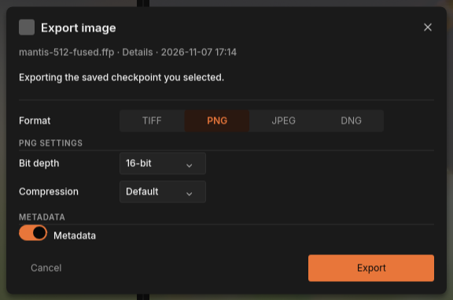
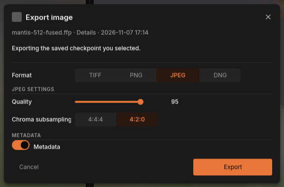
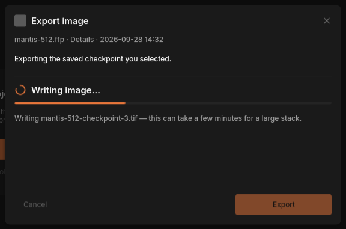
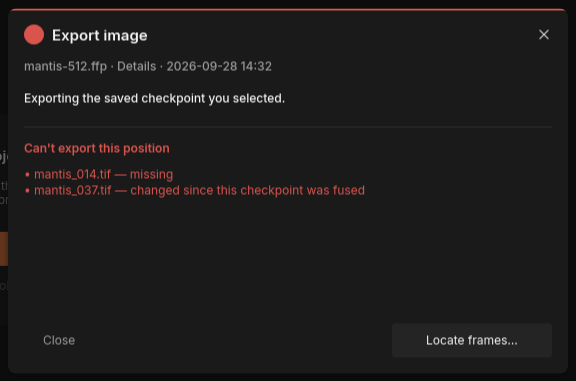

# Exporting an image

A [project](../glossary.md#project) keeps your result as [checkpoints](../glossary.md#checkpoint), which only FocusForge can read.
To print, publish or keep editing the result in another program, export it as
an image file: TIFF, PNG or JPEG, or DNG for a project stacked from camera RAW
files.

An export writes the version you are looking at. Choose the checkpoint first
in the CHECKPOINTS list (see [Checkpoints and saving](history.md)), then
export it. Exporting changes nothing in the project.

## Open the export dialog

1. Fuse a [stack](../glossary.md#stack) and keep the result, or open a saved project.
2. Click the checkpoint you want in the CHECKPOINTS list, or stay in the
   editor with the strokes you are working on.
3. Click **Export image** in the heading of the CHECKPOINTS list.

**Export image** is greyed out until the tab has a result, for example while
the first fuse is still running or its "Keep this fused result?" question is
open.

The dialog opens with two lines under its title, "Export image". The first,
greyed line names the project and the version; the second says in a sentence
what will be written:

| The sentence | When you see it |
|---|---|
| "Exporting the saved checkpoint you selected." | A checkpoint that is already in the project file. |
| "Exporting the unsaved fuse result held in this tab." | A fused result you kept but have not saved in a project yet. |
| "Exporting the unsaved retouch checkpoint held in this tab." | A checkpoint you made with **Save checkpoint** that is not in the project file yet. |
| "Exporting your current unsaved retouch edits." | Strokes you have painted and not kept as a checkpoint. The image includes them. |

You do not have to save the project or keep your strokes as a checkpoint
before exporting: the dialog writes exactly what the **Composite** pane shows.


*The export dialog for a saved checkpoint, with the TIFF settings it starts with.*

## Choose a format

Click **TIFF**, **PNG**, **JPEG** or **DNG** in the **Format** row. The
settings below it change to that format's own.

| Format | Choose it for | Keeps every detail? |
|---|---|---|
| TIFF | Further editing, archiving, printing. The safest choice. | Yes (at 16-bit) |
| PNG | Lossless files that web browsers and most programs open. | Yes (at 16-bit) |
| JPEG | Sharing, the web, e-mail. Small files. | No: always 8-bit, compressed with some loss |
| DNG | A stack of camera RAW files that you want to develop in a raw converter. | Yes (see [A DNG of a RAW project](#a-dng-of-a-raw-project)) |

### TIFF settings

| Setting | Choices | Starts at | What it does |
|---|---|---|---|
| **Bit depth** | 16-bit, 8-bit | 16-bit | 16-bit keeps every sample of the result image; 8-bit rounds each sample, the same way JPEG does. |
| **Compression** | None, LZW, Deflate | None | None writes the file uncompressed. LZW and Deflate make it smaller and are both lossless. |

Click a field to open its list, then click a choice. Escape closes an open
list without closing the dialog.

### PNG settings



*PNG has the same two settings as TIFF, with different compression choices.*

| Setting | Choices | Starts at | What it does |
|---|---|---|---|
| **Bit depth** | 16-bit, 8-bit | 16-bit | As for TIFF. |
| **Compression** | Fast, Default, Best | Default | PNG is always lossless; this only trades writing time for file size. |

### JPEG settings



*JPEG trades a little quality for a much smaller file.*

| Setting | Choices | Starts at | What it does |
|---|---|---|---|
| **Quality** | 1 to 100 | 95 | 1 is the smallest and worst file, 100 the largest and best. JPEG is always 8-bit. |
| **Chroma subsampling** | 4:4:4, 4:2:0 | 4:2:0 | 4:4:4 keeps colour at full resolution; 4:2:0 halves it in both directions for a smaller file. |

> **Tip:** For a JPEG that will be looked at closely, such as a print proof
> or a large web image, choose 4:4:4. Fine coloured detail (iridescent scales,
> thin coloured hairs) survives it better. For a small web image 4:2:0 is
> fine.

### DNG settings

DNG has no settings. Under DNG SETTINGS the dialog says "No settings: 16-bit,
uncompressed, in the camera's own colour." It is for a project stacked from
camera RAW files; [A DNG of a RAW project](#a-dng-of-a-raw-project) says what
the file holds.

## Metadata

The METADATA section has one switch, **Metadata**, and it starts turned on.

- **On:** the image carries the camera information (EXIF: make, model,
  exposure and capture time) of the frame the stack was [aligned](../glossary.md#alignment) to, with the
  exported image's own size, the program and the export time written in. It
  also embeds the colour profile (ICC) of the [source frames](../glossary.md#source-frame); for RAW frames,
  a built-in sRGB profile.
- **Off:** the image carries no metadata and no colour profile.

> **Note:** Keep **Metadata** on unless you have a reason not to. Without the
> colour profile, other programs have to guess the image's colours. Turn it
> off when you want to share an image without the camera details.

Other metadata of the source frames, such as keywords and captions written by
another program (XMP and IPTC), is not carried from the window: it describes
the frame, not the stacked result. The command line can carry it when you ask
for it (see [From the command line](#from-the-command-line)).

## Write the file

1. Click **Export**.
2. The system's save dialog, titled "Export image", opens. It proposes the
   tab's name with the format's extension (`.tif`, `.png` or `.jpg`), in the
   project's folder, or in the frames folder for a project that was never
   saved: for example `mantis-512-fused.tif` next to `mantis-512-fused.ffp`.
3. Choose the folder and name and confirm. A name without the format's
   extension gets it added.

If you cancel the save dialog, you are back in the export dialog with your
choices as they were.

While the file is written, the dialog shows "Writing image…" with the file's
name. A small image is written in a moment; a large stack can take a few
minutes.



*Writing a large image. The project name and file name in this picture are examples.*

When the file is written, the dialog closes by itself. Closing the dialog
while it writes (with its close button or Escape) does not stop the export:
the file is still written.

The format and its settings are remembered once an export succeeds: the next
export, in this or a later session, starts with the same format, settings and
**Metadata** switch.

## Cancel without exporting

**Cancel**, the close button at the dialog's top-right corner, and Escape all
close the dialog without writing anything. They also discard the choices you
made in it: the next time you open the dialog, it starts again with the
remembered choices of your last successful export (TIFF, 16-bit, no
compression and **Metadata** on, if you have never exported).

## When an export is refused

Sometimes an export cannot be written. The dialog then turns into a red
"Can't export this position" with one line per reason, instead of writing a
damaged or wrong file.



*An export refused because two source frames are gone or changed. The names in this picture are examples.*

**Missing or changed frames.** A fused result is stored in the project and
can always be exported. A retouched one is rebuilt from your source frames,
because the strokes paint their pixels; FocusForge reads those frames again
and checks that they are the same files. If one was moved, deleted or edited
since, the dialog lists each one as "— missing" or "— changed since this
checkpoint was fused".

- **Locate frames…** lets you choose the folder the frames are in now. It is
  accepted only if the files in it are the ones the project recorded; the
  export is then retried to the same file name without asking again.
- **Close** closes the dialog without exporting.

**Other reasons** close only with **Close**:

| The dialog says | What to do |
|---|---|
| "JPEG can't be bigger than 65,535 pixels on a side. This image is …" | JPEG cannot store larger images. Export as TIFF or PNG. |
| "PNG and JPEG can only save grey or colour (RGB) images; this one has extra channels." | Export as TIFF. |
| "DNG needs a project stacked from camera RAW files; this one was stacked from TIFF or JPEG images." | Export as TIFF, PNG or JPEG. |
| "DNG can't describe this image's colour: …" followed by the reason | The first source frame has no camera colour description, for example a monochrome sensor. Export as TIFF. |
| "Can't write …" followed by the path and the reason | Choose another folder or free some disk space, then export again. |
| "Some export settings aren't valid: …" | Close the dialog, open it again and choose the settings again. |

## From the command line

`focusforge-cli export` writes any checkpoint of a project as an image,
without the window. It takes the same formats and settings as the dialog, as
flags:

```bash
focusforge-cli export frames.ffp -o result.tif
focusforge-cli export frames.ffp --checkpoint <checkpoint-id> -o result.jpg --jpeg-quality 90 --jpeg-subsampling 444
focusforge-cli export frames.ffp -o result.png --png-bits 8 --zmap zmap.tif
```

- Without `--checkpoint` it exports the project's head, the checkpoint the
  project currently ends on; `focusforge-cli history list` prints every id.
- The format follows the extension of `-o`, or `--format tiff|png|jpeg`.
- Metadata is chosen piece by piece: `--exif` and `--icc` (on by default),
  `--xmp` and `--iptc` (off by default; IPTC is never written to PNG).
- `--zmap` writes the [Z-Map](../glossary.md#z-map) as an image as well.
  Retouch strokes are not included in it: it is the fusion's own map.

### A DNG of a RAW project

For a project whose sources are all camera RAW, `-o result.dng` (or
`--format dng`) writes a linear DNG:

```bash
focusforge-cli export frames.ffp -o result.dng
```

The file holds the fused result in the camera's own colour space, with the
camera's colour matrices and as-shot white balance, and with the highlights
above white kept as they are. A raw converter opens it and develops it with
exposure, white balance and highlight recovery still open. A DNG has no
format options. The window's export dialog offers DNG too, in the **Format**
row.

`export` refuses a DNG it cannot write, before any pixel is rendered, and
writes nothing:

| `error:` line | Cause |
|---|---|
| `<path>: a DNG holds camera RAW data, and this project's sources are not camera RAW` | The project was stacked from TIFF or JPEG frames. Export TIFF, PNG or JPEG instead. |
| `<path>: cannot write a DNG: <reason>` | The first source frame cannot describe a camera colour space, for example a monochrome sensor or a file without a colour matrix or an as-shot white balance. |
| `--format tiff conflicts with out.dng's extension, which names dng` | `--format` names one format and the extension of `-o` another. Drop one of the two. |

Every flag is in the [command-line reference](../reference/cli.md#export).
