# Your first stack

This chapter takes you from a folder of frames to a finished, kept result:
open the frames, fuse them, and decide whether to keep what came out. Along
the way it explains every message FocusForge can show when a folder or a
project will not open, and how to pause, cancel or retry a fuse.

If you have not installed FocusForge yet, start with
[Installing FocusForge](../getting-started.md).

## What you need

- **The frames of one [stack](../glossary.md#stack)**: the photographs you
  shot at different focus distances, all of the same scene. FocusForge reads
  **TIFF** files (`.tif`, `.tiff`; 8-bit or 16-bit), **JPEG** files (`.jpg`,
  `.jpeg`) and **camera RAW** files (`.dng`, `.cr2`, `.cr3`, `.nef`, `.arw`,
  `.raf`, `.orf`, `.rw2` and many more). Frames are read upright: a frame
  stored sideways, as many cameras do, is turned by its orientation tag.
- **One folder per stack** is the easiest way to work. A folder that holds
  several stacks is fine too; FocusForge asks how to split it (see
  [A folder with several stacks](#a-folder-with-several-stacks)).
- **Two or more frames.** A single frame has nothing to combine with, so
  **Fuse stack** stays greyed out. One TIFF, JPEG or camera RAW file still
  opens, as a one-frame project (see
  [Camera RAW, JPEG and compressed TIFF](#camera-raw-jpeg-and-compressed-tiff)).

FocusForge never changes or moves your frames. Everything it makes is kept
in the window until you save it as a [project](../glossary.md#project) file.

## Open a folder

There are several ways to open a stack. All of them end the same way: one
new tab per stack.

### From the start page

When no project is open, the window shows a start page with one button:


*The start page, shown whenever no project is open or the **+** tab is selected.*

1. Click **Open…**. Your system's file chooser opens, titled "Open images".
2. Go to the folder with your frames and select all of them (usually
   `Ctrl+A`, or `Cmd+A` on a Mac). The chooser can show TIFF frames, JPEG
   frames or camera RAW files.
3. Confirm. The frames open in a new tab, sorted by file name.

**Open…** opens exactly the files you picked, and nothing else from their
folder. Pick files of one kind from one folder: a choice that mixes kinds or
folders is refused (see
[When a folder or project will not open](#when-a-folder-or-project-will-not-open)).

### Drop a folder or frames onto the window

Drag a folder, or a set of frames, from your file manager onto the start
page. A folder is read the same way as with **New project** below, so a
folder with several stacks asks how to split it. The caption under **Open…**
reads "Drop a folder or stack"; where your system cannot deliver drops to
the window, it reads "Dropping is unavailable on native Wayland" instead.

> **Note:** Dropping onto a tab that already holds a project does not open a
> second project: it adds the dropped frames to that tab's stack (see
> [The Images panel](images-panel.md)). To open a new project while other
> tabs are open, click the **+** tab first and drop onto its start page. A
> dropped project file (`.ffp`) always opens as its own tab.

### Choose a folder: New project

Press `Ctrl+N`, or click **New project** in the side rail of the projects
overview (open it with **Projects**, the grid button at the left end of the
tab strip). A folder chooser opens, titled "Choose a folder". Choose the
folder that holds your frames (or a folder of several stacks) and confirm.

### Reopen a saved project: Open project…

Press `Ctrl+O`, or click **Open project…** in the projects overview's side
rail, and choose a `.ffp` file. The project opens with its frames and
every [checkpoint](../glossary.md#checkpoint) you saved. Saving
and the projects overview are explained in
[Checkpoints and saving](history.md) and
[Projects, notifications and quitting](batch-runs.md).

### From a terminal

`focusforge-gui --open path/to/frames/` starts the window with that folder
or project already open; see [Starting from a terminal](#starting-from-a-terminal).

### What you see after opening

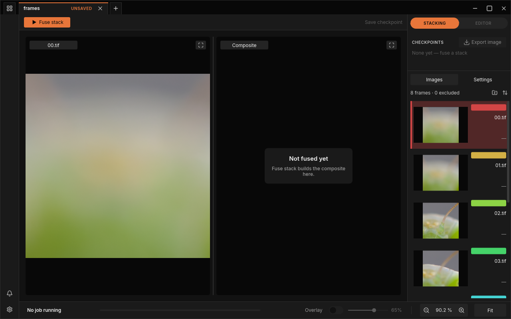

*A freshly opened stack, ready to fuse.*

- The **tab** is named after the folder. Its **UNSAVED** chip means the
  project has not been saved to a file yet.
- The left pane shows the frame selected in the **Images** list on the
  right, labelled with its file name; the list header counts the frames
  ("8 frames · 0 excluded").
- The right pane, **Composite**, shows the card "Not fused yet" with the line
  "Fuse stack builds the composite here."
- The **CHECKPOINTS** list reads "None yet — fuse a stack", and
  **Export image** and the **Overlay** switch stay greyed out until you have
  a result.
- The bottom bar reads "No job running".

[The window](gui.md) tours every part of this screen.

While a large folder is being read, the window keeps responding and a
"Loading…" indicator with a spinner appears over the canvas once the load
has taken longer than half a second. The new tab appears once the load has
landed.

### How FocusForge reads a folder

- **A folder that holds a `frames` subfolder** is read through it: the
  frames in `frames/` form the stack, other subfolders are not looked at, and
  loose TIFF files beside `frames/` (a reference image, for example) are
  ignored.
- **Subfolders without frames** (notes, sidecar files) are skipped. The
  window records this as a notification titled "Some images were skipped",
  whose message reads, for example, "1 subfolder skipped:" followed by the
  folder's path, and lists each skipped folder in the projects overview as a
  "Not a project" card. The frames themselves open normally.

## A folder with several stacks

When you open a folder (with **New project**, by dropping it, or with
`--open`), FocusForge proposes how its frames split into stacks:

- **Every subfolder that holds frames is a stack of its own.** A folder you
  sorted by hand is never mixed up or cut apart.
- **Within one folder, a pause of more than a minute** between two frames'
  capture times starts a new stack. Frames of one stack are usually seconds
  apart; two subjects are usually minutes apart.
- **Camera RAW, JPEG and TIFF files** in the same folder always form separate
  stacks.

If the folder holds exactly one stack, it opens straight away. If it holds
more, the window asks first:

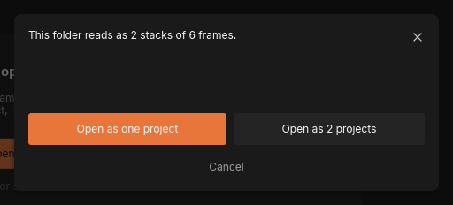

*A folder with two subfolders of three frames each.*

The question counts the frames of each stack: "This folder holds 2 stacks of
3 frames each.", or "This folder holds 2 stacks (3 and 4 frames)." when the
stacks differ in size. Choose one answer:

| Button | What happens |
|---|---|
| **Open as one project** | All the frames open as one stack in one tab. Use it when FocusForge split a stack you shot in one go (for example after a long pause mid-stack). |
| **Open as N projects** | Each proposed stack opens in its own tab, named after its subfolder. |
| **Cancel** (or the **x** at the top right) | Nothing opens. |

While the question is up, the rest of the window does not react.

## Camera RAW, JPEG and compressed TIFF

- **Camera RAW** frames open exactly like TIFF frames: a folder of RAW
  files is a stack. One stack is always one kind of file, so RAW, JPEG and
  TIFF files in the same folder become separate stacks.
- **JPEG** frames open and fuse like TIFF frames. A JPEG holds 8 bits per
  colour, which FocusForge widens to its 16-bit range.
- **Compressed TIFF** files (LZW or Deflate, in strips or tiles, either byte
  order) open and fuse like uncompressed ones, and so do 8-bit TIFF files.
  Uncompressed 16-bit TIFFs open fastest. A TIFF compressed with JPEG
  (`Compression=7`) is not read. See
  [Choose a file format](../stacking/shooting-practice.md#choose-a-file-format).
- **One file** opens as a one-frame project named after the file (`00.tif`
  gives a tab named `00`). The frame list reads "1 frame · 0 excluded" and
  **Fuse stack** is greyed out, so you can look at a frame or check how it is
  read.

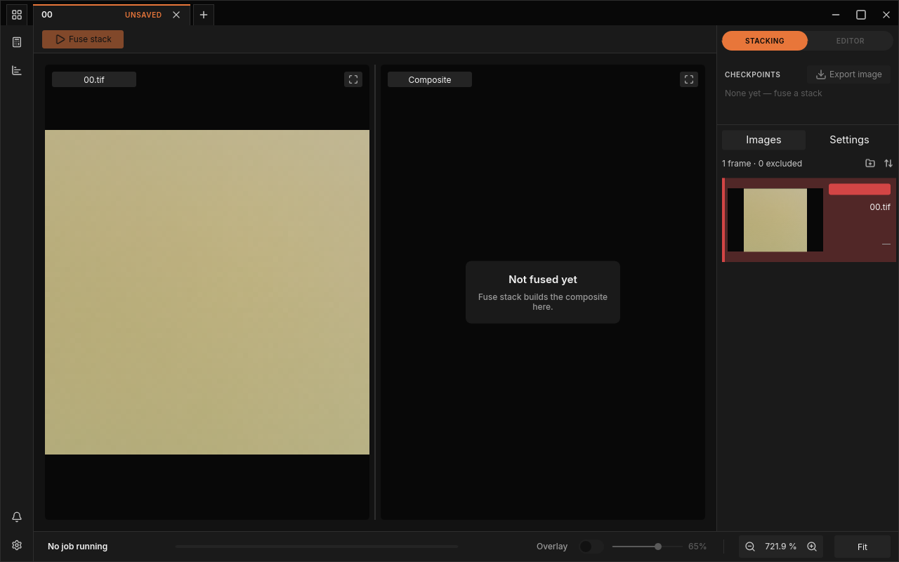

*One TIFF file opened as a one-frame project.*

## When a folder or project will not open

A path that cannot be opened never closes the window and never changes the
tab you are on: a dialog says what is wrong, and everything you already had
open stays as it was. Dialogs that offer a **Cancel** (or a **Close** for an
already opened project) also have an **x** at their top right that does the
same.

### "No frames here"

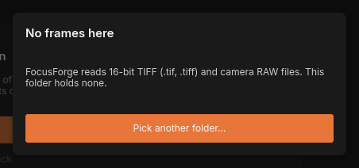

*A folder without any frames FocusForge can read.*

The folder holds no TIFF, JPEG or camera RAW files, so there is nothing to
stack. The dialog reads "FocusForge reads TIFF (.tif, .tiff), JPEG (.jpg,
.jpeg) and camera RAW files. This folder holds none."

- Click **Pick another folder…** to choose a different folder right away.
- Click **Cancel**, or press `Escape`, to close the dialog without choosing.

The projects overview also lists the folder as a "Not a project" card
("LEFT ALONE", "not read · not changed"): FocusForge did not touch it.

The same dialog appears when files you picked or dropped cannot form one
stack, with one of these messages:

| Message | What to do |
|---|---|
| "These files mix camera RAW and TIFF. A stack is one kind of file." (the kinds named are the ones you picked: "camera RAW and JPEG", or "camera RAW, JPEG and TIFF") | Pick files of one kind: only RAW, only JPEG or only TIFF. |
| "These files are in different folders. A stack's frames share one folder." | Move the frames into one folder, or open the folder that holds them with **New project**. |

### "These frames cannot be read"

A TIFF frame that FocusForge cannot read is refused when the folder or the
files are opened, before any tab exists, instead of failing later at
**Fuse stack**. The dialog has one button, **Close**, and names the file, never
the folder:

| Message | Meaning |
|---|---|
| "`<name>` is a BigTIFF file, which FocusForge cannot read. Save the frames as standard TIFF and open them again." | The frame is a BigTIFF file (the 64-bit variant of TIFF). |
| "`<name>` uses a TIFF layout FocusForge cannot read. Save the frames as standard 8- or 16-bit TIFF and open them again." | The frame is stored in a layout other than standard 8- or 16-bit grey or colour TIFF. |
| "`<name>` is not a TIFF file, though its name says so." | The file ends in .tif or .tiff but does not start like a TIFF file. |
| "`<name>` is damaged: its TIFF header does not read." | The start of the file is unreadable. |
| "`<name>` could not be read: …" | The file could not be opened or read; the operating system's reason follows. |

The projects overview lists the folder as a "Not a project" card. Re-export
the frames from your raw converter or photo editor as standard TIFF, then
open them again.

### "A frame is no longer there"

Pressing **Fuse stack** on a project whose frame has been moved or deleted
shows this dialog with the path of the missing file. On a project saved to a
file it offers **Locate frames…**, which asks for the folder that holds the
frames now, next to **Cancel**; on a project that was never saved it offers
**Close** only.

### "This project cannot be opened"

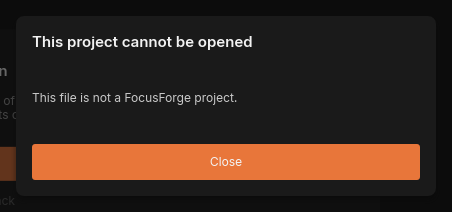

*A file with the project extension that is not a FocusForge project.*

The file you opened ends in `.ffp` but cannot be read as a project. The
message says why:

| Message | Meaning |
|---|---|
| "This file is not a FocusForge project." | The file is something else that was given the `.ffp` name. |
| "The file was cut short — it ends before the project does." | The file is incomplete, for example after an interrupted copy or a full disk. |
| "The project file is damaged: part of its saved history no longer reads back as it was written." | The file was changed or corrupted after FocusForge wrote it. |
| "The file could not be read: …" | The system refused to read it; the rest of the message gives the reason (a missing permission, for example). |

Click **Close** or press `Escape`. If you still have the frames, open their
folder and fuse again: that makes a new project. A project written by an
older FocusForge that lacks records the current version needs is refused
the same way, and re-fusing its frames makes a current project. A RAW
project saved by an older FocusForge, which kept a clipped result, shows the
"damaged" message too; open the RAW frames and fuse again.

## Damaged or moved projects

A project file remembers which frames it was made from: by where they were,
and by a fingerprint of their content. When you reopen a project, FocusForge
checks both. If the frames have moved or changed since, one of two dialogs
appears.

### "The frames are no longer there"

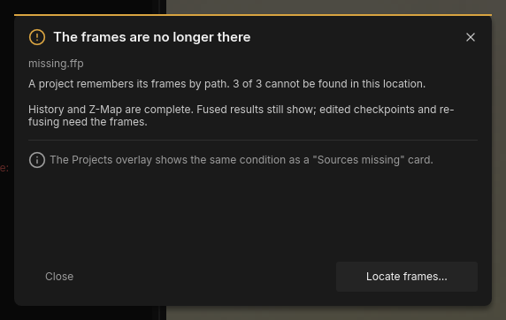

*A project whose frames were moved or deleted.*

The project opens, but some or all of its frames cannot be found where it
recorded them. The dialog counts them, for example "A project remembers its
frames by path. 3 of 3 cannot be found in this location.", and explains what
still works: "History and Z-Map are complete. Fused results still show;
edited checkpoints and re-fusing need the frames."

- Click **Locate frames…** and choose the folder the frames are in now.
- Click **Close** to keep working without them. You can still look at the
  fused results. In the **Images** list, each missing frame reads "Source
  missing", and the left pane reads "Cannot show this frame:" with the
  file name. The projects overview shows the project with a "Sources missing"
  card, whose **Locate frames…** you can use later.

### "The source frames are not the same"

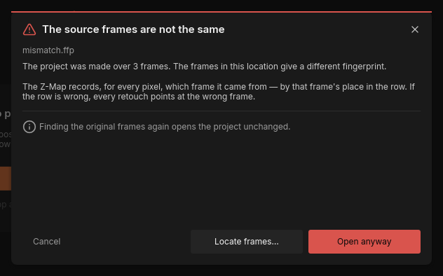

*A project whose frames were changed or replaced.*

Files with the right names are where the project expects them, but their
content is not what the project was made from: they were edited, re-exported
or swapped for other frames. The dialog reads "The project was made over 3
frames. The frames in this location give a different fingerprint." and warns
why that matters: the project's [Z-Map](../glossary.md#z-map) records, for
every pixel, which frame it came from by that frame's place in the row. If
the row is wrong, every retouch points at the wrong frame.

| Button | What happens |
|---|---|
| **Locate frames…** | Choose the folder holding the original frames. "Finding the original frames again opens the project unchanged." |
| **Open anyway** | Opens the project with the frames as they are now. Use it only if you know the frames still match (for example, you only changed their metadata). |
| **Cancel** (or the **x**) | Nothing opens. |

### Locate frames…

**Locate frames…** opens a folder chooser. FocusForge accepts the folder only
when its files have the names the project recorded *and* their content
matches the recorded fingerprint, so a folder of different frames with the
same names cannot slip in. When the folder fits, the project opens unchanged
(or its missing frames come back) and you can retouch and fuse again.

When it does not fit, a dialog titled "These are not the project's frames"
says why, for example "3 of 3 cannot be found in this folder" or "2 of 3
frames in this folder differ from the ones this project was made over".
Click **Close** or press `Escape`, then try another folder.

> **Note:** If you press **Fuse stack** on a project whose frames are gone,
> the fuse does not start. A dialog names the missing file: "… is no longer
> on disk. This project cannot be fused again until it is back." Put the
> frames back, or use **Locate frames…** on the project's "Sources missing"
> card in the projects overview.

The command-line side of damaged projects (accepting changed frames, exit
codes) is in [Troubleshooting](../troubleshooting.md#source-frames-changed-since-this-project-was-written).

## Fuse the stack

With the frames open:

1. Optionally look at the **Settings** tab in the dock. The defaults suit
   most stacks; [Stacking settings](stacking.md) explains every setting.
2. Click **Fuse stack** in the toolbar.
3. Watch the bottom bar. The window stays fully usable while the stack is
   being fused.


*A fuse in progress.*

While the run is going, the toolbar shows **Pause** and **Cancel**, the tab
shows a small play mark, and the **Images** list and **Settings** tab are
dimmed: they apply to the next fuse, not the running one. The bottom bar
shows what the run is doing:

| Stage | What happens | Step shown |
|---|---|---|
| **Developing** | Develops each camera RAW frame once, before anything else; the stage does not appear for TIFF or JPEG frames | "3 of 8" (frames done) |
| **Preparing** | Measures each frame's brightness and evens out exposure differences between frames | "3 of 8" (frames done) |
| **Aligning** | [Alignment](../glossary.md#alignment): shifts, scales and turns the frames so they line up | "5 of 8" (frames done), or "from cache" when an earlier run's alignment of the same frames is reused |
| **Fusing** | Picks the sharpest parts of every frame and blends them into the [composite](../glossary.md#composite) | — |
| **Writing** | Stores the finished result | — |

For a camera RAW stack the bar reads **Developing** first, with the number of
frames developed; the other stages reuse the developed frames. A stage is
skipped when its setting is off; [Stacking settings](stacking.md) and
[Alignment](alignment.md) say which.

> **Tip:** You can pan, zoom and look at frames while a fuse runs. The fuse
> slows down a little while you do, so the view stays smooth.

## Keep or discard the result

When the run is done, one of two things happens.

**Every frame lined up:** the result is kept straight away. It becomes the
project's first checkpoint, and the window switches to the
[editor](retouch.md) to show it.

**Some frames could not be aligned:** FocusForge still fuses them, as they
were shot, and then asks whether the result is worth keeping:

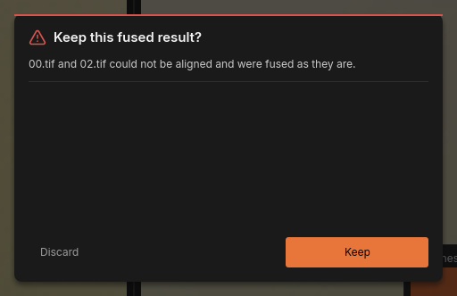

*The question after a fuse in which two frames could not be aligned.*

The dialog names the frames, for example "00.tif and 02.tif could not be
aligned and were fused as they are." (past five names it counts the rest). A
frame that did not line up can leave a double edge or a soft patch where it
contributed, but often the result is fine, especially when the frame was
barely out of place.

- Click **Keep** to keep the result. It becomes a checkpoint, the bottom bar
  reads "fused" with the time (for example "fused 16:34"), and the window
  switches to the editor so you can look at it closely. A notification
  records how many frames stayed unaligned, for example "2 frames unaligned"
  with the message "Kept the fused result with 2 frames unaligned."
- Click **Discard** to throw it away. Nothing is added; the tab is back to
  "No job running" and "Not fused yet", ready for another try with other
  settings (see [Alignment](alignment.md)).

The question belongs to its tab: it shows only while that tab is selected,
and until you answer it, clicking other tabs or **Projects** does nothing.
It has no **x** and `Escape` does not close it; you choose one of the two.

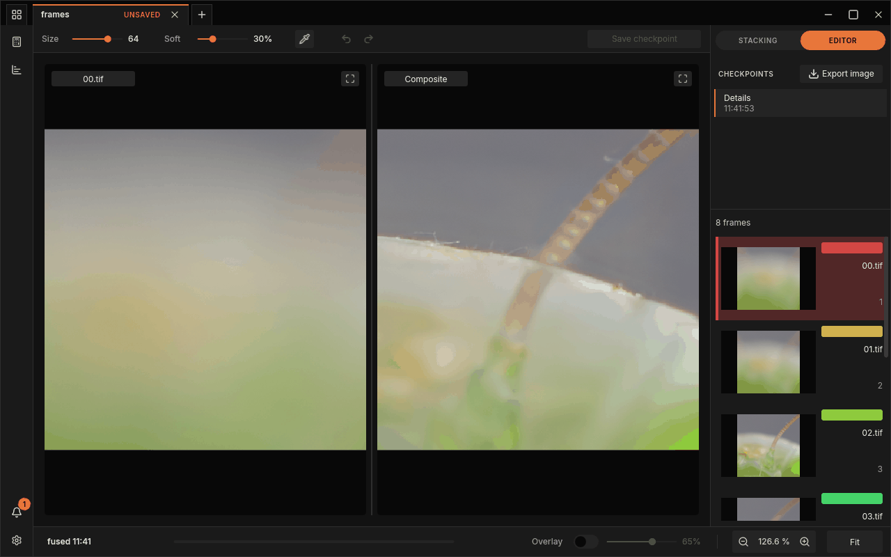

*After **Keep**: the result is the project's first checkpoint, shown in the editor.*

Every fuse you keep adds another checkpoint, so you can fuse again with other
settings and compare. A fuse with alignment switched off (the **Enabled**
switch under ALIGN in the **Settings** tab) is always kept without the
question.

> **Warning:** A kept result lives in the tab until you save the project;
> the tab's **UNSAVED** chip reminds you. Save with `Ctrl+S` before you close
> the window; see [Checkpoints and saving](history.md).

## Pause, resume and cancel

You can stop a running fuse at any time from the toolbar.


*A paused fuse: **Resume** takes the place of **Pause**.*

- **Pause** holds the run at the next frame or step it finishes. The button
  turns into **Resume**, the bottom bar reads "Paused". A paused run keeps everything it has done so far.
- **Resume** carries on where the run stopped.
- **Cancel** stops the run, paused or not. A greyed-out **Cancelling…**
  button shows for a moment, then **Fuse stack** comes back. Nothing is
  written and earlier checkpoints are untouched. The projects overview keeps
  a "Cancelled" card ("You stopped this one. Nothing was written.") with a
  **Run again** button; see
  [Projects, notifications and quitting](batch-runs.md).

## Fuse several stacks: the queue

FocusForge fuses one stack at a time. If you press **Fuse stack** on another
tab while a fuse is running, that tab waits in line:

- Before you press it, the button on the waiting tab already reads
  **Queued**, as a hint that it will not start at once.
- Once pressed, the tab shows a **…** mark, the bottom bar reads its place in
  line, for example "Queued (2)" (the running fuse counts as 1), and the
  toolbar offers only **Cancel**.

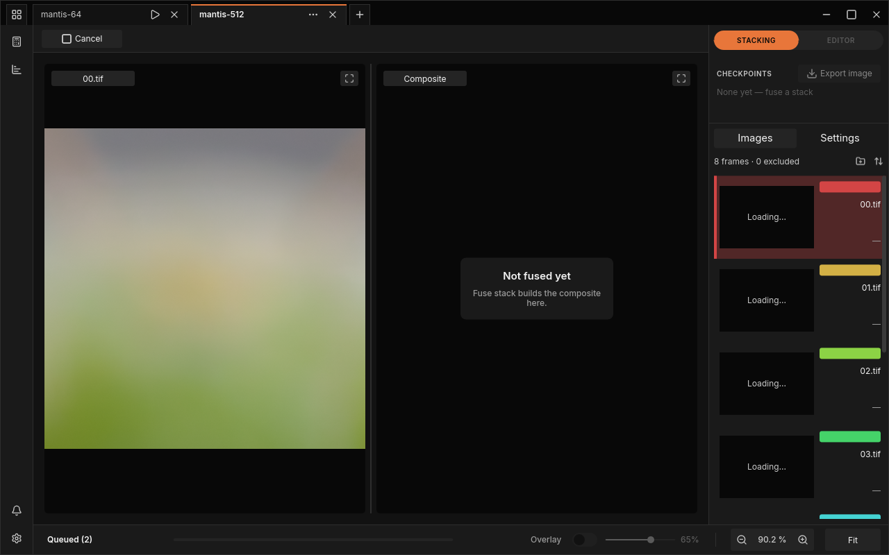

*The second tab waits while the first one is fused.*

The waiting tab starts on its own as soon as the running fuse has finished,
also when the finished one is waiting for its **Keep** or **Discard**
answer. To stop both, cancel the waiting tab first: cancelling the running
one lets the next in line start.

## When a fuse fails

A fuse can fail, for example when a frame's file is damaged. The run then
stops and says so:

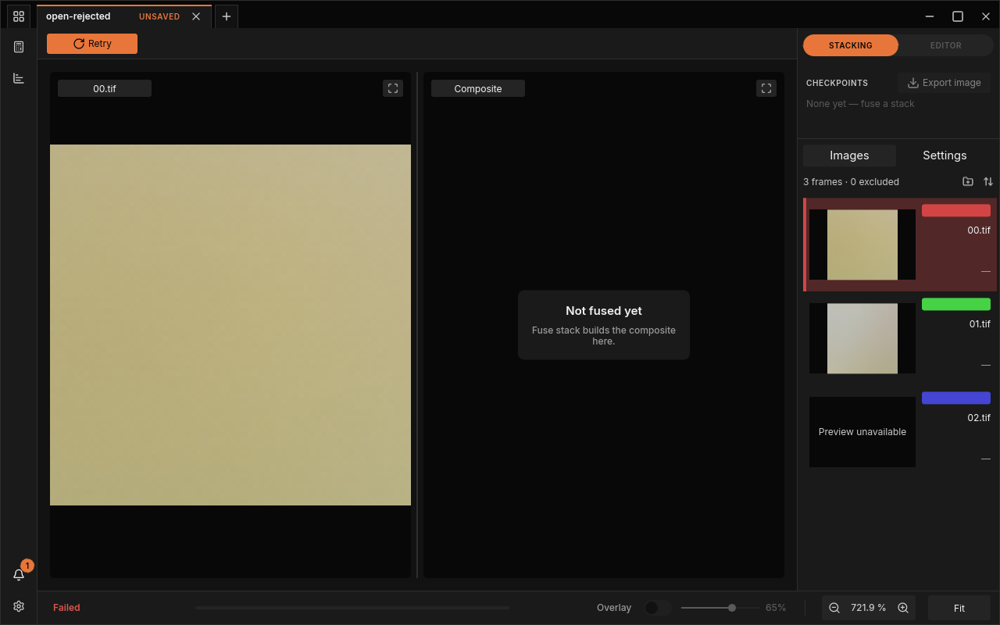

*A fuse that failed because one frame's file is cut short.*

- The bottom bar reads "Failed", in red.
- **Retry** takes the place of **Fuse stack**. It starts the same fuse again.
- A notification names the step that failed: "Setup failed" (the frames or
  the settings could not be used), "Alignment failed", or "Preparing failed",
  "Fusing failed", "Developing failed" or "Writing failed". Its message opens
  with a sentence naming the unreadable file, for example "02.tif could not
  be read. It may be damaged, or it changed after the folder was opened.",
  followed by the reason on the next line. The project's card reads, for
  example, "FAILED WHILE ALIGNING". The notification
  shows as a short pop-up message while the window is in front, and stays in
  the notification center behind the bell, where its full message names the
  file and the reason.
- The projects overview shows the project with a "Did not stack" card.

A full disk is one cause of "Setup failed". Before the first stage starts, a
fuse checks that the volumes it writes to have room for the run, and refuses
when one does not. The full message then reads, for example,
"`<dir>` has `N` bytes (`X` GB) free, but the run needs `M` bytes (`Y` GB)
there", with one such sentence per volume, joined by "; ". Free space on that
volume, or choose a folder on a volume with more room, then press **Retry**.

**Retry** only helps when the cause was passing (a network drive that was
briefly away, for example). For a damaged frame, look for a frame row that
reads "Preview unavailable" in the **Images** list, exclude or remove that
frame (see [The Images panel](images-panel.md)) and fuse again.

> **Note:** If the graphics device the window uses disappears (a driver
> reset, a GPU unplugged), the canvas stops updating and the window closes
> itself a moment later rather than hanging. See
> [Diagnostics and crash reports](diagnostics.md) for where that is logged.

## Starting from a terminal

`focusforge-gui` opens the window; with `--open` it opens a folder or a
project straight away:

```bash
focusforge-gui --open path/to/frames/
```

A folder proposes stacks exactly as **New project** does, and opens each
stack as its own tab (after asking, if there are several); a `.ffp` path
reopens a saved project. `--open` can be given more than once: each path is
opened in turn, the next one waiting for the one before it to finish. A path
that fails to open shows the same dialog as in the window, rather than
closing it. Paths without `--open` are accepted too, so
`focusforge-gui frames/ other/` opens like a drop of those paths; this is what
a file manager's "Open with" passes.

Other options start the window in a chosen state; `focusforge-gui --help`
lists them all.

| Option | Effect |
|---|---|
| `--fuse-tabs 0,1` | Selects those tabs in turn and presses **Fuse stack** on each once `--open` has loaded, so give one `--open <folder>` per stack (a folder that reads as several stacks first asks how to split it, and until that is answered no tab exists for the option to select). An index repeated, as in `0,0`, waits until the earlier run has settled and its **Keep** or **Discard** question is answered. |
| `--projects-overlay` | Opens the projects overview. With `--open` it stays open after the load lands; with `--fuse-tabs` it opens once the last run settles. |
| `--toolbar-state idle\|running\|paused\|cancelling\|failed` | Shows that transport state in the toolbar until a real run starts. |
| `--save-folder <DIR>` | Writes every project save and image export into this existing folder under its proposed name, with no save dialog. |
| `--settings-section <TAB>` | Opens the settings window on that tab (`performance`, `appearance`, `storage`, `input-map`, `diagnostics` or `about`); see [The settings window](settings-window.md). |
| `--config-dir <DIR>` | Reads and writes `<DIR>/focusforge/settings.toml` instead of the settings file in your user folder; see [The settings window](settings-window.md). |

The remaining options in `--help` (screenshots, previews, slowed runs and the
like) exist for checking the window's own behaviour and are not needed for
everyday work.

## Next steps

- [The window](gui.md): every part of the screen, tabs, panes, zoom and the
  overlay that shows which frame each pixel came from.
- [Stacking settings](stacking.md): the settings behind **Fuse stack**, and
  when to change them.
- [Retouching](retouch.md): fix [halos](../glossary.md#halo) and other flaws by painting from the
  right frame.
- [Exporting an image](export.md): write the result as TIFF, PNG or JPEG, or as DNG for a camera RAW project.
