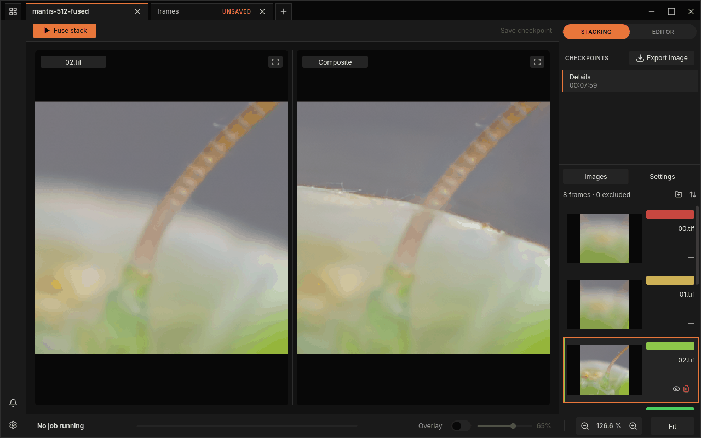
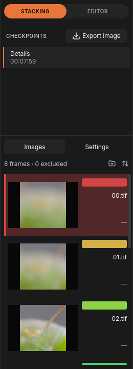
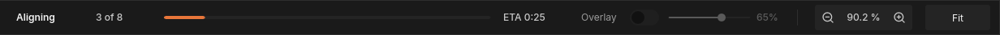
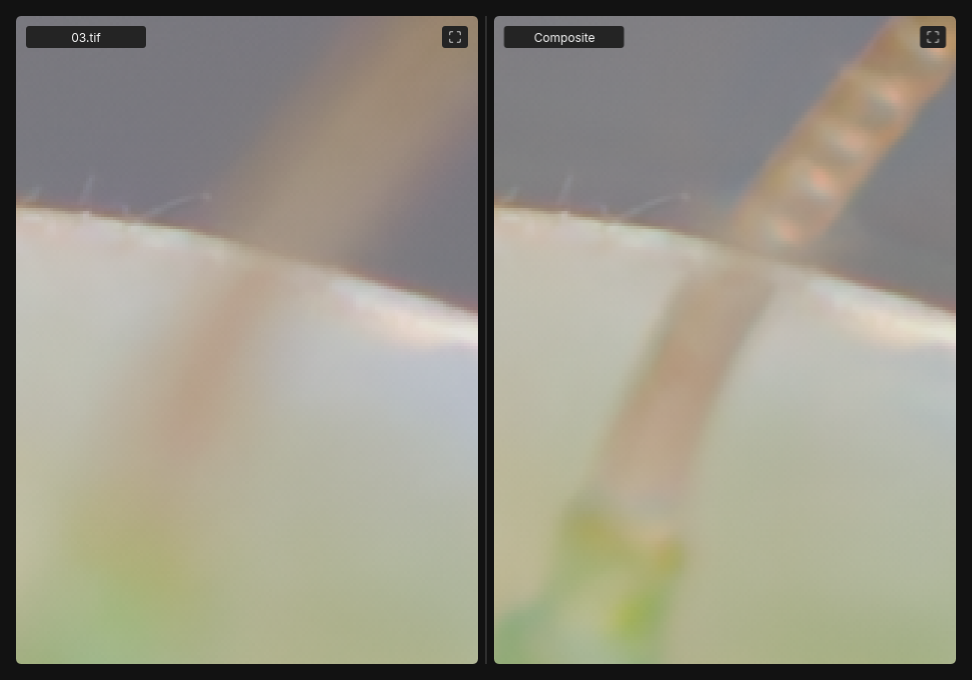
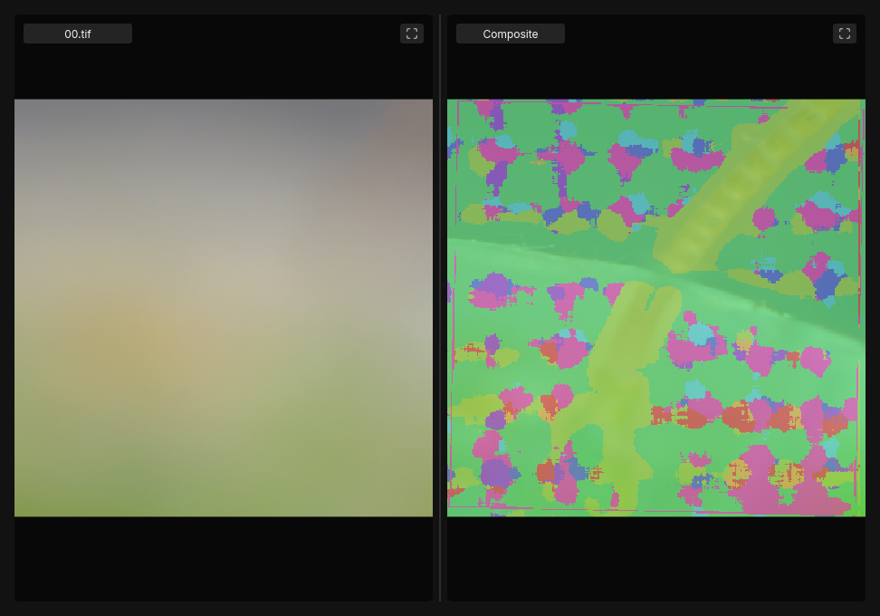
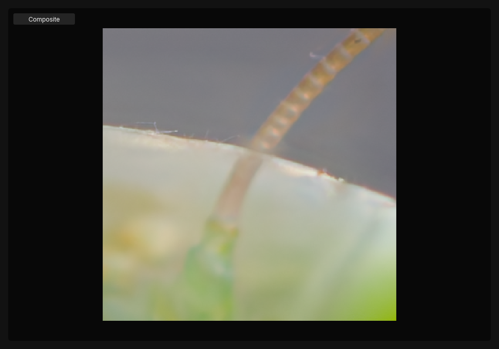
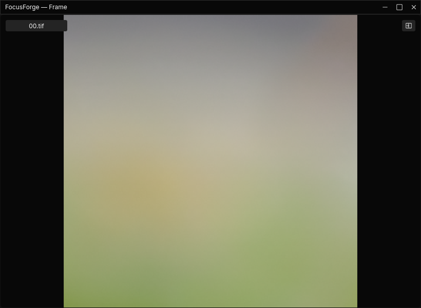

# The window

This chapter is a guided tour of the FocusForge window: what each area is
for, how to move around a picture, how to keep several stacks open at once
and how to give one image its own window on a second screen. It assumes you
have opened a stack at least once; if not, start with
[Your first stack](first-stack.md).

The frame list on the right has a chapter of its own,
[The Images panel](images-panel.md).

## The window at a glance

*Two projects open as tabs; the active one has already been fused.*

Going round the window clockwise from the top left:

| # | Where | What it is |
|---|---|---|
| 1 | Top left corner | **Projects** button (four small squares): opens the projects overview, where every open project is a card. |
| 2 | Top edge | The **tab strip**: one tab per open project, then a **+** tab for opening another. |
| 3 | Top right corner | **Minimize**, **Maximize** and **Close** for the whole window. |
| 4 | Below the tabs | The **toolbar**. In stacking it holds **Fuse stack** and, during a run, **Pause** and **Cancel**; in the editor it holds the brush controls. |
| 5 | Middle left | The **Frame** pane. Its label shows the file name of the frame you selected, here `02.tif`. |
| 6 | Middle right | The **Composite** pane: the fused result, once there is one. |
| 7 | Right edge, top | The **STACKING** / **EDITOR** switch. |
| 8 | Right edge | The **CHECKPOINTS** list with the **Export image** button. |
| 9 | Right edge, lower half | The **Images** and **Settings** tabs of the dock, with the frame list showing. |
| 10 | Bottom edge | The **bottom bar**: what the window is doing, the progress of a run, the **Overlay** switch and the zoom controls. |
| 11 | Left edge, bottom | The **Notifications** bell and the **Settings** gear, which opens the settings window. |

The sections below take these areas one at a time.

## Tabs: one project each

Every stack you open becomes a project in its own tab. A tab shows the
project's name and, on the right, an **x** that closes it. Next to the name
you may see:

- **UNSAVED** — the project holds something that is not yet written to a
  project file. See [Checkpoints and saving](history.md).
- A small **play** mark while that tab's stack is being fused, and a
  **…** mark while it waits in line behind another tab's run. The
  **UNSAVED** chip comes back once the run has finished.

The last box in the strip, **+**, is a tab of its own: click it to get the
empty start page with **Open…**, from which you open another stack (see
[Your first stack](first-stack.md#open-a-folder)). When there are more
tabs than fit, arrows appear at the ends of the strip to scroll through them.

The tab strip is also the window's title bar: drag an empty part of it to
move the window.

### Work on two projects at once

Each tab keeps its own frames, its own selected frame, its own settings, its
own checkpoints and its own zoom. Switching tabs never mixes them up.

1. Open the first stack, then open a second one (with **+** and **Open…**,
   or by dropping a folder onto the **+** tab).
2. Click a tab to bring it to the front. The dock, the panes and the bottom
   bar now show that project only.
3. Click the other tab to go back. The frame you had selected there is
   still selected, and the view is where you left it.

The screenshot above shows the same stack open twice: once as a saved,
fused project (`mantis-512-fused`) and once freshly opened (`frames`, still
**UNSAVED**). The tab title is the project's name; when two folders have the
same name, the header of the frame list (for example "8 frames · 0
excluded") is a quick way to tell the tabs apart.

> **Tip:** Fusing runs one tab at a time. If you press **Fuse stack** on a
> second tab while the first is still fusing, the second waits in line and
> starts on its own when the first is done.

For an overview of every open project as cards, and for closing tabs and
quitting, see [Projects, notifications and quitting](batch-runs.md).

## The toolbar

The toolbar changes with what you are doing:

- **In stacking**, it holds **Fuse stack**. While a run is going, the button
  becomes **Pause** and **Cancel**, and **Resume** once paused; a failed run
  offers **Retry**. [Your first stack](first-stack.md) walks through a run.
- **In the editor**, it holds the brush: **Size**, **Soft**, the pipette,
  undo and redo, and **Save checkpoint**. See [Retouching](retouch.md).

> **Note:** In stacking, the right end of the toolbar shows a greyed-out
> "Save checkpoint" caption. It is only a label: it does nothing when
> clicked. Checkpoints are saved from the editor, and every fuse you keep
> becomes one automatically.

## The two panes

The canvas in the middle of the window shows two images side by side:

- **The Frame pane** (left) shows one source frame: the one selected in the
  [Images panel](images-panel.md). Its label is the frame's file name, for
  example `00.tif`. Click another row in the list to look at another frame.
- **The Composite pane** (right) shows the [composite](../glossary.md#composite),
  the fused result. Before the first fuse it shows "Not fused yet" and
  "Fuse stack builds the composite here." After a fuse it shows the checkpoint
  selected in **CHECKPOINTS**.

The two panes always show the same part of the picture at the same zoom: pan
or zoom in one, and the other follows. That makes it easy to compare a
detail in one frame with the same detail in the result.

While you zoom out or pan quickly, each pane first shows a coarse version of
the whole image and sharpens it a moment later, so you never see empty edges.

## The dock

*The dock of a fused project, in stacking.*

The dock runs down the right side of the window. From top to bottom:

1. **STACKING / EDITOR.** The two halves switch between preparing and fusing
   a stack (**STACKING**) and retouching its result (**EDITOR**). **EDITOR**
   stays dimmed until the tab holds a fused result. After you keep a fuse the
   window changes to the editor by itself; click **STACKING** to get the
   frame list and the settings back. See [Retouching](retouch.md).
2. **CHECKPOINTS.** Every fused or retouched result you kept, newest first,
   named after the [fusion method](../glossary.md#fusion-method) and the time.
   Before the first fuse it reads "None yet — fuse a stack". Click a row to
   show that result in the **Composite** pane. **Export image** saves the
   result you are looking at as a TIFF, PNG or JPEG file. See
   [Checkpoints and saving](history.md) and [Exporting an image](export.md).
3. **Images** and **Settings.** Two tabs that share the lower part of the
   dock:
   - **Images** lists the frames of the stack. See
     [The Images panel](images-panel.md).
   - **Settings** holds everything the next fuse on this tab will use. See
     [Stacking settings](stacking.md).

   In the editor, these two tabs give way to a read-only list of the frames
   (see [In the editor](images-panel.md#in-the-editor)).

While a tab's stack is being fused, its **Images** and **Settings** tabs are
dimmed: you can look, but changes wait until the run is over. With no
project open (the **+** tab), the dock reads "No project open."

## The bottom bar

*The bottom bar while a stack is being aligned.*

From left to right:

- **Status.** "No project open" on the **+** tab, "No job running" when
  nothing is happening, the current stage while a stack is fused (for example
  "Aligning"), and "fused" with the time once a run you kept has finished.
- **Progress.** During a run: frames done (such as "3 of 8"), a progress bar
  and an estimated time remaining ("ETA"). [Your first stack](first-stack.md)
  explains the stages.
- **Overlay.** A switch and a strength slider for the Z-Map overlay; see
  [See where each pixel came from](#see-where-each-pixel-came-from).
- **Zoom.** **Zoom out**, the zoom readout, **Zoom in**, and **Fit**; see the
  next section.

## Zoom and pan

The zoom controls sit at the right end of the bottom bar.

| Control | What it does |
|---|---|
| **Fit** | Shows the whole picture in both panes. The readout then shows the fit zoom, for example "90.2 %". |
| **Zoom in** | One step closer, about the middle of the view. |
| **Zoom out** | One step back, about the middle of the view. |
| Readout | The current zoom in percent; "—" when no project is open. 100 % means one image pixel per screen pixel. |

Zoom moves along fixed steps. Below the fit zoom there is exactly one step,
half of it, which shows the picture smaller with dark space around it.
Above the fit zoom the steps are 100 %, 150 %, 200 %, 300 %, 400 % and
500 % (those that are larger than the fit zoom). 500 % is the top: **Zoom in**
does nothing more there, and **Zoom out** does nothing more at half the fit
zoom. A very small image that already fits at more than 500 % cannot be
zoomed in at all.

*Fit, then Zoom in three times: both panes at 300 %, showing the same spot.*

With the mouse:

- **Scroll wheel:** zooms in or out at the pointer, so the spot under the
  pointer stays put. This is the quickest way to inspect a detail.
- **Middle-button drag**, or **hold Space and drag** with the left button:
  pans the picture. Both panes move together.
- **Shift + scroll wheel:** pans sideways (in the editor, it changes the
  brush size instead).

Click **Fit** at any time to get the whole picture back.

### Step through the frames from the canvas

- **Ctrl + scroll wheel** over the canvas steps to the previous or next
  frame in the **Frame** pane, without reaching for the list. A plain scroll
  over a row of the Images list does the same.
- **Alt + click** on the composite selects the frame that pixel came from,
  so the **Frame** pane shows the source of that spot. This needs a fused
  result.

## See where each pixel came from

After a fuse, FocusForge knows which frame each pixel of the result was
taken from. That record is the [Z-Map](../glossary.md#z-map). The
**Overlay** switch in the bottom bar paints it over the **Composite** pane,
one colour per frame. The colours are the same ones the
[Images panel](images-panel.md#the-frame-list) shows next to each frame name.

*The overlay on at 65 %: each colour marks the frame that part of the result came from.*

1. Make sure the tab holds a fused result. Before the first fuse, the
   **Overlay** switch and its slider are dimmed and do nothing.
2. Click the **Overlay** switch. Its knob moves to the right and the
   composite is tinted.
3. Drag the slider beside it to change how strongly the colours cover the
   picture. It starts at 65 %; the percentage is shown next to it.
4. Click the switch again to turn the overlay off. The slider greys out but
   keeps its position for next time.

Use it to check a fuse. Along the subject, each colour should cover the
part of it that was sharp in that frame. A colour you did not expect on a
fine edge points at a frame worth a closer look. Speckled patches in a
smooth, blurred background are normal: no frame is sharp there, so the
choice between them hardly matters.
The overlay only tints the view; it is never part of a saved project's image
or an exported file. The **Frame** pane is never tinted.

> **Tip:** In the editor the same colours tell you which frame your brush
> paints from. See [Retouching](retouch.md).

## Put a pane in its own window

On a second monitor it can help to see the source frame and the result at
full size each. Either pane can move into a window of its own.

1. Click the small square icon with four corner marks at the top right of a
   pane (**Undock pane**).
2. A second window opens with that pane. Its title bar reads
   "FocusForge — Frame" or "FocusForge — Composite".
3. The other pane now fills the whole canvas of the main window.

*The main window keeps the Composite pane; its undock icon is hidden while the other pane is out.*

*The Frame pane in its own window. The icon at the top right brings it back.*

Both windows still show the same part of the picture at the same zoom; when
their shapes differ, the spare space stays black. Drag the second window by
its title bar, and minimize or maximize it with the buttons at its top
right.

To bring the pane back, either click the icon at the top right of its pane
(**Dock pane**) or close the second window with its **x**. The main window shows both panes again.

> **Note:** Only one pane can be in its own window at a time. While one is
> out, the other pane's undock icon is hidden rather than dimmed.

On Linux, the second window uses X11 or XWayland when `DISPLAY` is set,
otherwise native Wayland when `WAYLAND_DISPLAY` is set.

## Keyboard and mouse bindings

The canvas responds to these inputs by default:

| Input | In stacking | In the editor |
|---|---|---|
| Scroll wheel | Zoom at the pointer | Zoom at the pointer |
| Ctrl + scroll wheel | Previous / next frame | Previous / next frame |
| Shift + scroll wheel | Pan sideways | Brush size |
| Middle-button drag, or Space + left drag | Pan | Pan |
| Alt + left click | Select the frame under the pointer | Select the frame under the pointer |
| Left drag | — | Paint |
| Ctrl + Z / Ctrl + Shift + Z | — | Undo / redo |

The settings window's **Input map** tab lists the bindings in effect and
where each came from; you can change them in the settings file. See
[The settings window](settings-window.md#input-map).

A few keys are fixed and work anywhere in the window:

| Key | Does |
|---|---|
| Ctrl + N | New project (asks for a folder) |
| Ctrl + O | Open a project file |
| Ctrl + S | Save the project |
| Ctrl + W | Close the project in the active tab |
| Escape | Closes the dialog in front, otherwise the projects overview, and closes the settings window |
| Up / Down | Select the previous / next frame, when the frame list has the keyboard focus (click a row first) |

While the settings window is open, the main window behind it does not react
to clicks or zoom; close the settings window first.

> **Note:** The window stays responsive while it loads frames, saves or
> blends a brush stroke. While you pan, zoom or paint, a running fuse briefly
> slows down so the view stays smooth, and picks up speed again a quarter of
> a second after you stop.

## Where to find the rest

Earlier versions of this page also described launching, fusing, saving and
the settings window. Those topics now have chapters of their own:

### Launch options

Opening folders and projects, the empty start page, dropping files and the
`focusforge-gui` start-up flags: [Your first stack](first-stack.md).

### Fusing a stack

**Fuse stack**, the run's stages, **Pause**, **Cancel**, **Retry** and the
**Keep** or **Discard** question: [Your first stack](first-stack.md).

### Settings

The dock's **Settings** tab (PREPARE, FUSE, ALIGN, FINISH):
[Stacking settings](stacking.md) and [Alignment](alignment.md).

### Retouching a result

The editor, the brush and the pipette: [Retouching](retouch.md).

### Saving a project

### Checkpoints

The **CHECKPOINTS** list, **Save project** and the **UNSAVED** chip:
[Checkpoints and saving](history.md).

### Exporting an image

**Export image** and its dialog: [Exporting an image](export.md).

### Switching between projects

The projects overview, closing a tab and quitting with unsaved work:
[Projects, notifications and quitting](batch-runs.md).

### Notifications

The bell, the notification center, toasts and desktop banners:
[Projects, notifications and quitting](batch-runs.md).

### The settings window

### The settings file

Performance, Appearance, Storage, Input map, Diagnostics and About, and the
`settings.toml` file behind them: [The settings window](settings-window.md).
