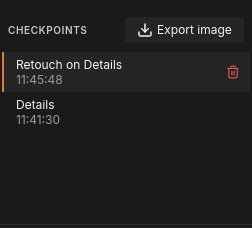
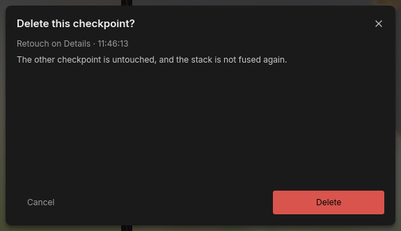
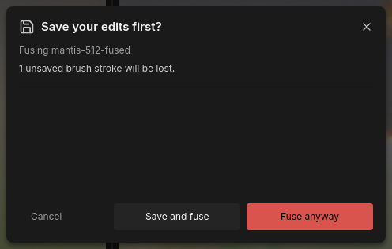
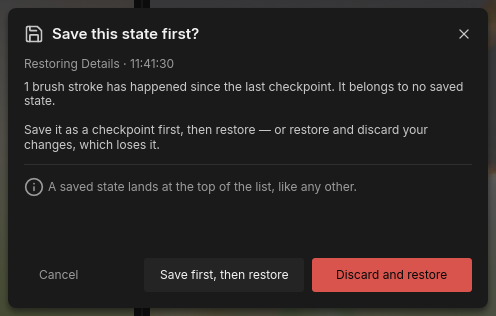
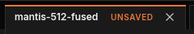

# Checkpoints and saving

Every result you keep in FocusForge becomes a
[checkpoint](../glossary.md#checkpoint): a version of the image you can go
back to. Each fuse you keep adds one, and each set of strokes you keep with
**Save checkpoint** adds one on top of the checkpoint it was painted on. Any
checkpoint can be shown again, exported, or used as the starting point for
new strokes, so trying something never costs you the version you already
liked.

Checkpoints are stored in the [project](../glossary.md#project) file (`.ffp`) when you save the
project. A retouched checkpoint stores its strokes, not a second copy of the
image, so it adds very little to the file.

## The CHECKPOINTS list

The CHECKPOINTS list sits in the dock, under the **STACKING** / **EDITOR**
switch, in both modes. It lists the active tab's checkpoints, newest first.
Each row shows the [fusion method](../glossary.md#fusion-method) and the time the checkpoint was made. A
retouched checkpoint reads "Retouch on" followed by the fusion method of the
result it was painted on, for example "Retouch on Details".
When the list spans more than one day, the rows are grouped under day
headings: TODAY, YESTERDAY, then the date.



*Two checkpoints: a fused result (bottom) and a retouched version of it (top, selected). The pointer is over the top row, so its trash icon shows.*

The row you are looking at has a raised background and an accent bar at its
left edge. Before the first fuse, the list reads "None yet — fuse a stack".

The **Export image** button in the list's heading writes the checkpoint you
are looking at as an image file; see [Exporting an image](export.md).

## Go back to a checkpoint

Click a row. The panes show that checkpoint, and **Export image** and the
editor now work on it.

If you have strokes that are not in a checkpoint yet, the window asks first
(see [Fusing or restoring over unsaved strokes](#fusing-or-restoring-over-unsaved-strokes)).

## Branch from an older checkpoint

Checkpoints form a tree, not a single line. To try a different repair without
losing the one you made:

1. Click the older checkpoint you want to start from, for example the plain
   fused result.
2. Paint in the editor (see [Retouching](retouch.md)).
3. Click **Save checkpoint**.

The new checkpoint is built on the row you clicked, not on the newest one.
Both versions stay in the list, newest first, and each can be shown, exported
or painted on again.

## Keep strokes as a checkpoint

In the editor, **Save checkpoint** (at the right end of the toolbar) keeps
the strokes you have made as a new checkpoint at the top of the list. The new
row flashes briefly. The button is available while there are strokes that
are not in a checkpoint yet, and greyed out otherwise. See
[Keep your strokes: Save checkpoint](retouch.md#keep-your-strokes-save-checkpoint).

## Delete a checkpoint

1. Point at the row. A red trash icon appears at its right edge.
2. Click the trash icon.
3. The dialog "Delete this checkpoint?" names the checkpoint by fusion method
   and time and says what stays. Click **Delete**.



*Deleting one of two checkpoints. Cancel, the close button at the top right and Escape all delete nothing.*

- The last remaining checkpoint cannot be deleted: with only one row in the
  list, the trash icon does not appear.
- If you delete the checkpoint you are looking at, the window shows the
  newest remaining one, unless you have unsaved strokes on screen.
- Like a new checkpoint, a deletion is written into the project file when you
  save the project. Until then the project file on disk still holds the
  checkpoint.

## Fusing or restoring over unsaved strokes

Strokes that are not in a checkpoint yet are never dropped silently. Two
actions would drop them, and both ask first. Each question also has a close
button at its top-right corner; it, **Cancel** and Escape all leave
everything as it was: your strokes, the list and the checkpoint you are
looking at.

### Fusing again: "Save your edits first?"

You switched to **STACKING** and clicked **Fuse stack** while strokes were
unsaved. The question names the tab ("Fusing mantis-512-fused") and how many
strokes would be lost.



*The question before fusing again over one unsaved stroke.*

| Button | What happens |
|---|---|
| **Cancel** | Nothing is fused. Your strokes stay. |
| **Save and fuse** | Your strokes are kept as a new checkpoint first, then the stack is fused again. |
| **Fuse anyway** | The stack is fused again without keeping the strokes. If you then keep the new result, the strokes are lost; if you discard it, they are still there. |

### Choosing another checkpoint: "Save this state first?"

You clicked another row of the CHECKPOINTS list while strokes were unsaved.
The question names the checkpoint you clicked ("Restoring Details" and
its time) and how many strokes have happened since the last checkpoint.



*The question before going back to an older checkpoint over one unsaved stroke.*

| Button | What happens |
|---|---|
| **Cancel** | Nothing changes. You stay on the checkpoint you were on, with your strokes. |
| **Save first, then restore** | Your strokes are kept as a new checkpoint at the top of the list, then the row you clicked is shown. |
| **Discard and restore** | Your strokes are thrown away and the row you clicked is shown. |

Neither question writes the project file: a checkpoint kept here is held in
the tab like any other until you save the project.

> **Note:** Closing a tab or quitting the window with unsaved work asks a
> similar question, also titled "Save this state first?", with the buttons
> **Save and close** and **Close anyway**. It is explained in
> [Projects, notifications and quitting](batch-runs.md).

## Saving a project

A fuse in the window writes nothing next to your frames. A kept result, a
checkpoint you saved and a checkpoint you deleted are all held in the tab
until you save the project.



*The UNSAVED chip: this tab holds work that is not in its project file yet.*

- A tab that holds anything the project file does not contain yet shows an
  `UNSAVED` chip beside its name in the tab strip. A tab whose project has
  never been saved shows it too.
- **Save project** writes everything the tab holds into one `.ffp` file, in
  order, and the chip goes away. Press **Ctrl+S**, or use **Save project** in
  the projects overlay's rail (the grid button at the left end of the tab
  strip; see [Projects, notifications and quitting](batch-runs.md)).
- Strokes you have not kept as a checkpoint yet are kept as one when you save
  the project, so they are in the file too.
- **The first save** of a tab opens the system save dialog, proposing
  `<frames folder>/<stack name>.ffp`, for example
  `mantis-512/frames/frames.ffp`. A name without the `.ffp` extension gets it
  added. The tab is then named after the file.
- **Later saves**, and saves of a project you opened from a `.ffp`, write
  back to that same file without asking.
- **A failed save** (a full disk, a folder you cannot write to) keeps
  everything held in the tab and tells you why in a "Save failed"
  notification: "Could not save" followed by the path and the reason. Nothing
  is lost; fix the cause and save again.

> **Tip:** Save the project before you export, close or experiment further.
> The project file is what lets you come back later and change your mind;
> an exported image is only one finished version.

## Damaged or moved projects

When a project cannot be opened, or its frames were moved or changed since it
was saved, the window explains what is wrong and offers **Locate frames…** to
point it at the frames' new folder. What each message means and what to do is
in [Damaged or moved projects](first-stack.md#damaged-or-moved-projects) in *Your first stack*; the command-line side (accepting
changed frames, exit codes) is in [Troubleshooting](../troubleshooting.md#source-frames-changed-since-this-project-was-written).

## From the command line

`focusforge-cli history` lists and deletes checkpoints without the window;
`retouch` and `export` work on any checkpoint by id:

```bash
focusforge-cli history list frames.ffp
focusforge-cli retouch frames.ffp --ops ops.json --from <checkpoint-id>
focusforge-cli export frames.ffp --checkpoint <checkpoint-id> -o result.tif --zmap zmap.tif
focusforge-cli history delete frames.ffp --checkpoint <checkpoint-id>
focusforge-cli history compact frames.ffp
```

- `history list` prints every visible checkpoint, newest first, with its
  parent. Ids can be shortened to any unique prefix everywhere.
- `history delete` hides a checkpoint and drops it from the file once no
  visible checkpoint is built on it. The last remaining visible checkpoint is
  refused.
- `history compact` rewrites the file to its live checkpoints and reports the
  bytes reclaimed.
- `retouch` appends an op list (its shape is in
  [Retouching](retouch.md#from-the-command-line)) to the head, or to the
  checkpoint `--from` names, which starts a [branch](../glossary.md#branch).
- `export --checkpoint <id>` writes any checkpoint as an image, and with
  `--zmap` its [Z-Map](../glossary.md#z-map). Retouch strokes are not
  included in an exported Z-Map: it is the one the fusion produced.

Every flag and exit code is in the
[command-line reference](../reference/cli.md#history).
