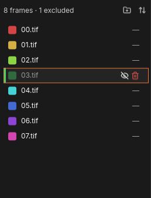
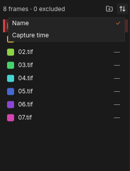
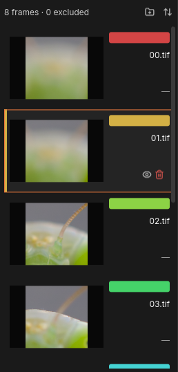
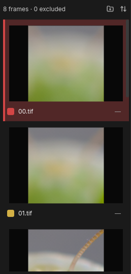
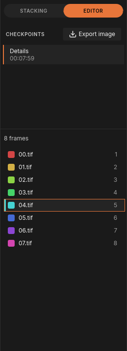
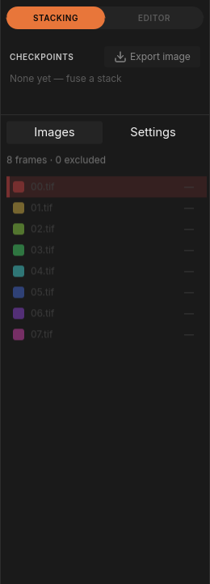

# The Images panel

The **Images** panel is the frame list in the lower half of the dock. It
shows every frame of the [stack](../glossary.md#stack) in the order FocusForge fuses them, and it is
where you decide which frames take part: look at a frame, leave it out of
the next fuse, remove it, sort or reorder the list, and add more frames.

To see it, click **STACKING** at the top of the dock (if the window is in
the editor) and then the **Images** tab. The rest of the dock is described
in [The window](gui.md#the-dock).

## The frame list

*The List presentation, with 03.tif excluded from the next fuse.*

At the top, the header counts the frames and how many of them are excluded,
for example "8 frames · 1 excluded" ("1 frame" for a single frame). At its
right end are two small icons: **Add images** (a folder with a plus) and
**Sort** (two arrows, up and down).

Each row below stands for one frame:

- **A colour.** Every frame gets its own colour, running through the
  rainbow from the first frame to the last. The same colours mark the frames
  in the [Z-Map overlay](gui.md#see-where-each-pixel-came-from) and in the
  editor, so you can tell at a glance which frame a part of the result came
  from.
- **The file name**, for example `00.tif`. A name too long for the row is cut
  short; rest the pointer on it to read the whole name.
- **The capture time** recorded by the camera, as a time of day. Frames
  without a recorded time show "—".

The list is in fuse order: the first row is the first frame FocusForge
fuses.

> **Note:** A row whose file is no longer on disk is greyed out and cannot
> be selected. In the presentations with pictures it reads "Source missing".
> See [Checkpoints and saving](history.md) for finding moved frames.

## Look at a frame

Click a row. The **Frame** pane on the left of the canvas shows that frame,
and its label changes to the file name. The selected row is tinted in its
own colour.

Other ways to move through the frames:

- With the list focused (click a row first), press **Up** or **Down**.
- Scroll the mouse wheel over a row of the list.
- Over the canvas, **Ctrl + scroll wheel** steps to the previous or next
  frame.

## Leave a frame out of the next fuse

A frame that is shaken, overexposed or simply not needed can be excluded.
It stays in the list, so you can bring it back at any time.

1. Rest the pointer on the row, or click it. In place of the capture time, two
   icons appear: an eye (**Exclude**) and a red trash can (**Remove**).
2. Click the eye. The row's name and colour are dimmed, the icon becomes a
   crossed-out eye, and the header counts one more excluded frame.
3. To bring the frame back, click the crossed-out eye (**Include**).

The next **Fuse stack** on this tab leaves excluded frames out. Excluding
never asks a question, not even when the [project](../glossary.md#project) already has checkpoints:
it changes nothing until you fuse again.

## Remove a frame

Removing takes a frame out of the project entirely. The file on disk is not
touched.

1. Rest the pointer on the row, or click it.
2. Click the red trash can (**Remove**).

Before the project's first [checkpoint](../glossary.md#checkpoint) the frame
is removed at once, without a question.

### When the project already has a checkpoint

Once you have kept a fuse, the project's checkpoints were made from the
current frames. Removing a frame then means fusing the whole stack again, so
FocusForge asks first:

*Removing a frame from a project that already holds a checkpoint.*

| Button | What happens |
|---|---|
| **Cancel** (or the **x** at the top right, or Escape) | Nothing changes. The frame stays. |
| **Exclude instead** | The frame stays in the list but is excluded from the next fuse. No new fuse starts. |
| **Remove and re-fuse** | The frame is removed and the whole stack is fused again from scratch. When the run ends you get the usual **Keep** or **Discard** question; keeping adds a new checkpoint. Your earlier checkpoints all stay. |

> **Tip:** If you only want to try the stack without a frame, **Exclude
> instead** is the quick, reversible choice.

Sorting, reordering and adding frames ask the same kind of question once a
checkpoint exists; see below.

## Sort the frames

Click **Sort** (the up and down arrows) in the header. A small menu opens:

*The sort menu after sorting by name.*

- **Name** sorts the frames by file name.
- **Capture time** sorts them by the time the camera recorded. Frames without
  a capture time go to the end, in their current order.

The line you chose last carries a check mark (✓). Click **Sort** again to
close the menu without choosing.

## Reorder by dragging

You can put the frames in any order by hand.

1. Press on a row's file name; in the presentations with pictures you can
   also press on the picture.
2. Drag the row up or down. A line between the rows shows where it will land.
   Near the top or bottom edge, the list scrolls by itself.
3. Release. The frame moves to its new place.

A manual reorder clears the check mark in the sort menu, because the list is
no longer sorted by name or time. Choose **Name** again to restore the file
name order.

> **Tip:** The colours follow the list order, from red for the first frame
> to magenta for the last. With the frames in focus order, nearest to
> farthest, the Z-Map overlay reads like a depth map of your subject. Sorting
> by **Name** or **Capture time** usually gives that order; drag only to fix
> a frame that is out of place.

## Add frames

There are two ways to add frames to the project in the active tab:

- Click **Add images** (the folder with a plus) in the header. Your system's
  file dialog opens, titled "Add frames"; choose one or more TIFF frames and
  confirm.
- Drop a folder or a set of TIFF frames onto the window while the tab is
  open. They are added to this project rather than opened as a new one.

New frames are added at the end of the list, and the sort check mark is
cleared. An empty list reads "No source images" and "Add images to begin.",
with an **Add images** button.

FocusForge compares the files' contents with the frames already in the
project. When a new file is identical to a frame that is already there, it
asks "Replace 1 existing image?" (or "Replace 3 existing images?"), names
those frames and notes "New images are added either way.":

| Button | What happens |
|---|---|
| **Cancel** | Nothing is added. |
| **Keep existing** | The new, different frames are added; the existing ones stay as they are. |
| **Replace** | The new frames are added, and each matching frame is replaced by the new file. |

If the project already holds a checkpoint, the add then asks the question in
the next section.
If the add cannot happen, a notification says why: "No TIFF images to add",
"Switch to Stacking to add images", "Adding images waits for the run to
finish" or "Still checking the last images added".

## Sorting, reordering or adding after a checkpoint

Like removing, these change the frames that the project's checkpoints were
fused from. With at least one checkpoint, each asks first:

| You did | Title | Buttons |
|---|---|---|
| Chose an entry in the sort menu | "Sort by capture time and fuse again?" | **Cancel**, **New project instead**, **Sort and re-fuse** |
| Dragged a row | "Reorder and fuse again?" | **Cancel**, **New project instead**, **Move and re-fuse** |
| Added frames | "Add frames and fuse again?" | **Cancel**, **New project instead**, **Add and re-fuse** |

The confirming button applies the change and fuses the whole stack again;
your earlier checkpoints stay. **New project instead** leaves this project
exactly as it was and opens a new tab, named after it with " copy" added,
holding the same frames and the same settings but no checkpoints. Make your
change there.

> **Note:** The sort question is titled "Sort by capture time and fuse
> again?" even when you chose **Name**. Confirming sorts by the entry you
> picked.

## Choose how the list looks

The panel has three presentations. They show the same frames and work the
same way; they differ in how much of each frame you see.

| List | Image list | Large previews |
|---|---|---|
|  |  |  |

*List, Image list and Large previews.*

- **List** shows one compact line per frame: colour, name and time. Many
  frames fit without scrolling.
- **Image list** (the default) adds a small preview of each frame on the
  left, with a colour bar above the name.
- **Large previews** shows each frame as a wide picture, with the colour,
  name and time on a line below it. Good for spotting a blurred or
  misframed shot.

While a preview is being made, its row reads "Loading…" or "Loading
preview…"; a frame that cannot be shown reads "Preview unavailable".

To switch, open the settings window with the gear at the bottom left, go to
**Appearance** and pick **List**, **Image list** or **Large previews** under
**Presentation**. The choice is remembered for the next start, and the
editor's frame list follows it too. See
[The settings window](settings-window.md#appearance).

## In the editor

*In the editor the list becomes a read-only legend.*

When you switch to **EDITOR**, the **Images** and **Settings** tabs give way
to a read-only version of the list:

- The header reads only the number of frames, for example "8 frames".
- Each row shows the frame's number in the stack (1, 2, 3 …) instead of its
  capture time. The colours match the Z-Map, so this list doubles as the
  legend for the overlay and the brush.
- Clicking a row still selects that frame: it becomes the frame the brush
  paints from. See [Retouching](retouch.md).
- There is no **Add images**, no **Sort**, no eye and no trash can, and rows
  cannot be dragged.

Click **STACKING** to edit the frame list again.

## While a stack is being fused

*During a run the panel is dimmed and its add and sort icons are gone.*

While this tab's own stack is being fused, the panel is dimmed and the
**Add images** and **Sort** icons are not shown at all. Rows show no eye or
trash can and cannot be dragged. You can still click a row to look at a
frame. Everything comes back when the run is over.
