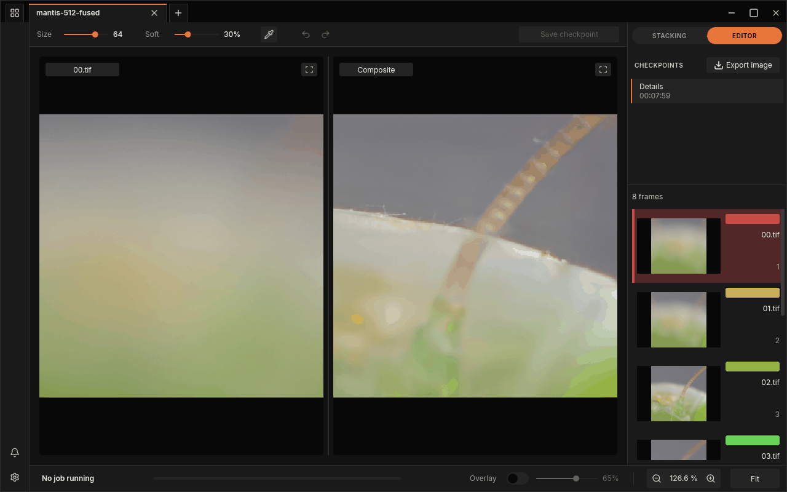
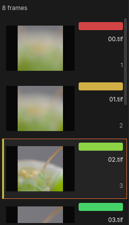
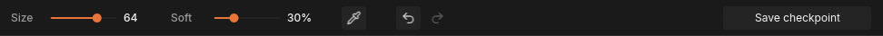
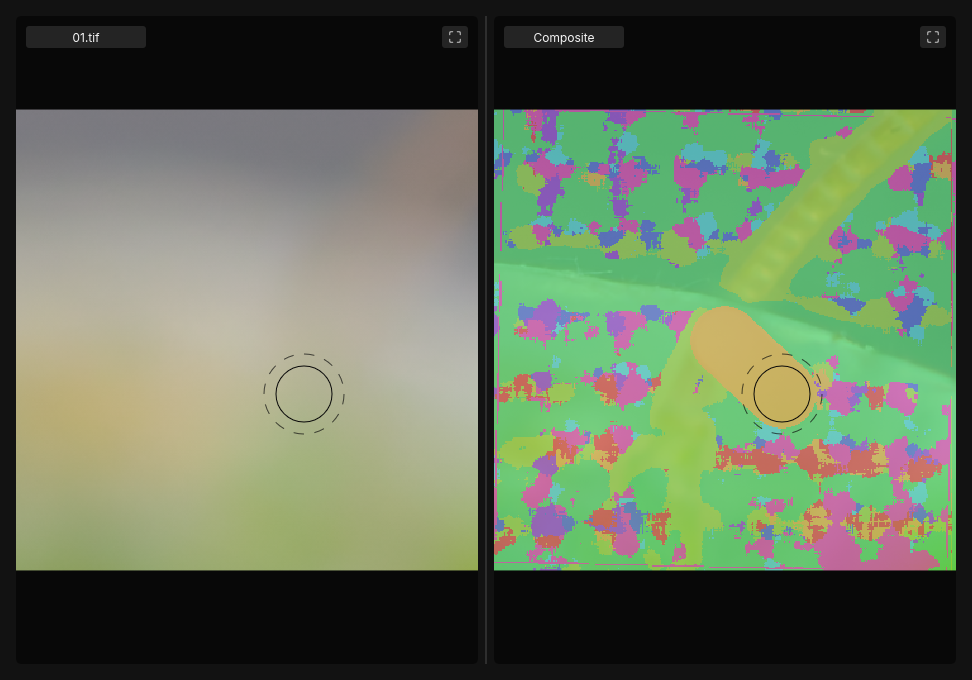

# Retouching

No [fusion method](../glossary.md#fusion-method) gets every pixel right. A [halo](../glossary.md#halo) beside an antenna, a smeared
patch where a leg moved, a spot where the wrong frame won: these are easier to
fix by hand than by fusing again. FocusForge's editor lets you do that with a
brush that paints pixels from one of your own frames into the [composite](../glossary.md#composite).

You are not painting colour. Every stroke takes the pixels of one
[source frame](../glossary.md#source-frame) (the frame you choose in the
list) and blends them over the composite where you brush. Painting from a
frame in which that area is sharp puts that sharpness back.

A retouch never destroys the fused result. Strokes are kept as a list of
edits on top of it: you can undo them one by one, keep them as a
[checkpoint](../glossary.md#checkpoint), and go back to the untouched result
at any time (see [Checkpoints and saving](history.md)).



*The window in editor mode: the brush controls in the toolbar, the source frames in the dock.*

## Switch to the editor

The switch at the top of the dock has two halves, **STACKING** and
**EDITOR**. Click **EDITOR** to retouch the result you are looking at, and
**STACKING** to go back to the frame list and the fusion settings.

When a fuse finishes and its result is kept (if FocusForge asks "Keep this
fused result?", by clicking **Keep**), the window switches to the editor by
itself, as long as you are still looking at that tab. A saved [project](../glossary.md#project) you open
starts in **STACKING**; click **EDITOR** to retouch it.

In the editor the window changes in three places:

- The toolbar shows the brush controls (**Size**, **Soft**, **Pipette**,
  **Undo**, **Redo** and **Save checkpoint**) instead of **Fuse stack**.
- The dock's list stops being the place where you arrange frames. It has no
  **Images** and **Settings** tabs; its header reads the number of frames
  (for example "8 frames"), and every row shows the frame's colour and its
  number. Rows cannot be excluded, removed or dragged here.
- The **Composite** pane becomes paintable.

**EDITOR** is greyed out, and cannot be selected, when there is nothing to
retouch:

- the tab has no fused result yet;
- a fuse is running or waiting in the queue for this tab;
- the frame list no longer matches the frames the result was fused from,
  because you added, removed, excluded or reordered a frame since. Fuse
  again (see [Fuse the stack](first-stack.md#fuse-the-stack)) and the editor is
  available for the new result.

Switching to **STACKING** and back keeps your brush settings and any strokes
you have not saved yet.

## Choose the frame to paint from

The brush always paints from the selected source frame. The **Frame** pane on
the left shows it, with its file name in the pane's label, so you can see
exactly what the brush will put down.



*The source list in the editor. The selected frame (here 02.tif, number 3) is outlined; its colour bar matches its colour in the overlay.*

There are four ways to choose it:

- **Click a row** in the dock's list.
- **Ctrl + mouse wheel** over the panes steps to the next or previous frame.
- **Pipette**: click the **Pipette** button in the toolbar, then click a
  point in either pane. The frame the composite took at that point becomes
  the source, and the pipette turns itself off. The click paints nothing.
- **Alt + click** on a point does the same as the pipette without arming it
  first. It works in **STACKING** mode too.

While the pipette is armed, or while you hold Alt, the cursor shows the
colour of the frame under the pointer, so you can see which frame a click
will pick before you click.

> **Tip:** The pipette answers "which frame did FocusForge use here?". To
> repair an area, you usually want the opposite: a frame in which it is
> sharp. Pick the frame next to the problem with the pipette, then step
> through its neighbours with Ctrl + wheel and watch the **Frame** pane.

How the rows look (a compact list, small previews or large previews) is set
by **Presentation** on the settings window's
[**Appearance**](settings-window.md#appearance) page. The editor's rows stay read-only
in every presentation.

## See which frame each area came from

The bottom bar's **Overlay** switch colours the **Composite** pane by the
frame each area came from, read from the result's
[Z-Map](../glossary.md#z-map). Each frame has its own colour, the same colour
as its bar or square in the dock's list. The slider beside the switch sets how
strongly the colours cover the image (65 % when you first turn it on).

The overlay is off when the window starts and is greyed out until the tab has
a result. It works in both modes, and it always shows the current state:
an area you painted from frame 3 turns frame 3's colour.

Use it as a map before you paint. A halo or a smeared patch often shows up as
an island of a different colour, and the colours around it tell you which
frames hold that area sharp. If a project's Z-Map cannot be read, the overlay
and the pipette are unavailable; the image itself is not affected.

## Set the brush: Size and Soft



*The editor toolbar after one stroke: Undo and Save checkpoint are now available.*

| Control | What it sets | Range | Starts at |
|---|---|---|---|
| **Size** | The brush's diameter, in pixels of the image (not of the screen). The slider is logarithmic, so small sizes are easy to set precisely. | 1 to the shorter side of the result | 64 |
| **Soft** | How much of the brush's edge fades out. | 0 % to 100 % | 30 % |

Softness decides how a stroke blends in. The inner part of the brush paints
the source frame fully; from there to the outer edge it fades out evenly to
nothing. **Soft** is the share of the radius that fades: at 0 % the brush has
a hard edge, at 30 % the outer 30 % of the radius fades, at 100 % the fade
starts at the centre.

The brush cursor draws both parts: a solid circle for the part that paints
fully, and a dashed ring for the outer edge of the fade. A hard brush
(0 %) shows only the solid circle. Because **Size** is in image pixels, the
cursor grows and shrinks with the zoom.

> **Tip:** Keep **Soft** at 30 % or more for most repairs. A soft edge hides
> the seam between the painted area and the composite around it; a hard
> brush leaves a visible outline unless both frames match exactly there.

**Shift + mouse wheel** over the image changes **Size** without reaching for
the slider. The keys and wheel gestures can be changed on the settings
window's [**Input map**](settings-window.md#input-map) page.

## Paint a stroke

1. Choose the source frame.
2. Set **Size** and **Soft**.
3. Drag across the **Composite** pane over the area to repair. A single click
   paints one round dab.



*A short stroke painted from 01.tif with the overlay on: the painted band turns that frame's yellow. The cursor shows at the same point in both panes.*

Some things to know while painting:

- You can paint in either pane. Both show the same part of the image, so a
  stroke on the **Frame** pane paints exactly where it would on the
  **Composite** pane. The cursor is echoed in the other pane at the same
  point, which makes it easy to aim at a detail you can only see in the
  source frame.
- A stroke keeps the source, size and softness it started with, even if you
  change them before releasing the button.
- Panning (middle-button drag, or Space + left drag) and zooming (mouse
  wheel) work as usual and do not paint; see [The window](gui.md).
- Dragging in **STACKING** mode paints nothing.

## Undo and redo

| Action | Toolbar | Keys |
|---|---|---|
| Undo the last stroke | **Undo** | Ctrl+Z |
| Redo the stroke you undid | **Redo** | Ctrl+Shift+Z |

Each tab keeps its own stroke history. **Undo** steps back one stroke at a
time; **Redo** puts back what you undid, in order. A new stroke after an undo
discards everything **Redo** was holding, so redo first if you want it back.

Both buttons are greyed out when there is nothing to undo or redo. The keys
work in editor mode only; you can change them on the settings window's
**Input map** page.

## Keep your strokes: Save checkpoint

**Save checkpoint**, at the right end of the toolbar, keeps every stroke you
have made as a new checkpoint at the top of the CHECKPOINTS list; the new row
flashes briefly. The button is available as soon as there is at least one
stroke that is not in a checkpoint yet.

After saving, **Undo** and **Redo** are greyed out: those strokes now belong
to the checkpoint. To take them back, click the checkpoint you started from
in the CHECKPOINTS list.

A new checkpoint is held in the tab until you save the project. Strokes you
have not saved as a checkpoint are not dropped silently: fusing again,
choosing another checkpoint, closing the tab or quitting each ask first. Both
are explained in [Checkpoints and saving](history.md).

## Example: fix a halo

A [halo](../glossary.md#halo) is a pale or smeared fringe on the background
right next to a sharp edge (see
[Halos at depth edges](../stacking/failure-images.md#halos-at-depth-edges)).
The repair is to paint the strip beside the edge from a frame in which the
background there is clean.

1. Keep the fused result. The window switches to the editor. Zoom in on the
   edge with the mouse wheel until you see the fringe clearly; judge it at
   100 %.
2. Turn **Overlay** on. The fringe usually sits in a band of one colour along
   the edge: the frame focused on the foreground, whose blur spread over the
   background.
3. Find a better frame. Click a few rows, or use Ctrl + wheel, and watch the
   **Frame** pane: you want the frame in which the background beside the edge
   is clean and free of the foreground's blur. It is usually a frame focused
   behind the subject.
4. Set **Size** a little wider than the fringe and **Soft** to 30–50 %.
5. Paint along the edge, on the background side, keeping the dashed ring off
   the sharp subject. With the overlay on, the painted band takes the new
   frame's colour, so you can see exactly what you covered.
6. Painted over the subject? Press Ctrl+Z and paint again.
7. Turn **Overlay** off and look at the result at 100 %. When it is right,
   click **Save checkpoint**, then save the project (Ctrl+S) or
   [export an image](export.md).

> **Note:** Retouching can only paint from frames you have. If no frame holds
> an area sharp, the brush cannot create that detail; see
> [Focus gaps](../stacking/failure-images.md#focus-gaps).

## From the command line

`focusforge-cli retouch` applies strokes without the window. It takes an op
list, a JSON array of brush strokes, and appends each op to the project as a
new checkpoint, each the previous one's child:

```bash
focusforge-cli retouch path/to/frames/frames.ffp --ops ops.json
```

```json
[
  {"brush-stroke": {"source_id": 3, "path": [{"x": 10, "y": 10}, {"x": 40, "y": 12}], "radius": 8.0, "softness": 0.3}}
]
```

- `source_id` is the 0-based frame index to paint from (the window's frame
  number minus one).
- `path` is a list of `{x, y}` points in image pixel coordinates.
- `radius` is half the stroke's width in pixels (the window's **Size** is the
  diameter).
- `softness` is in `[0, 1]`: the stroke is fully opaque within
  `radius * (1 - softness)` and fades linearly to nothing at `radius`.

Every op is checked before anything is written; an invalid one is refused by
its 0-based position. The ops go on the project's current head, or on another
checkpoint with `--from <id>`, which starts a [branch](../glossary.md#branch); `--name <text>` names
the last one. To see the result, export it:

```bash
focusforge-cli history list path/to/frames/frames.ffp
focusforge-cli export path/to/frames/frames.ffp --checkpoint <checkpoint-id> -o retouched.tif
```

Every flag is in the [command-line reference](../reference/cli.md#retouch).
