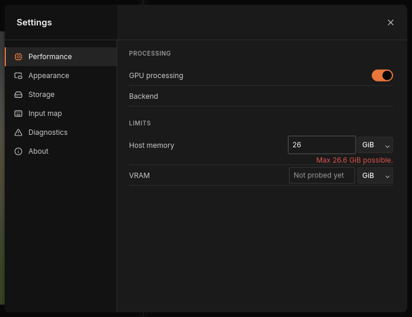
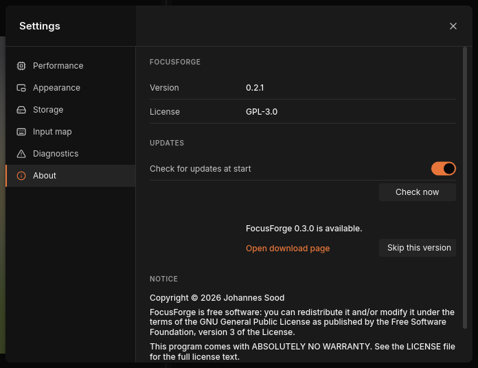

# The settings window

The settings window holds the preferences that apply to FocusForge as a
whole, not to one [stack](../glossary.md#stack): whether to use the graphics card, how much memory
FocusForge may use, whether it looks for a newer release, how the **Images** panel looks, where FocusForge keeps
its files, which mouse and key gestures do what, and the [diagnostics bundle](../glossary.md#diagnostics-bundle)
you attach to a bug report.

> **Note:** The **Settings** tab in the dock on the right is a different
> thing: it holds the fusion parameters of the open stack. It has its own
> chapter, [Stacking settings](stacking.md).

Everything you change here is saved at once in the
[settings file](#the-settings-file); there is no OK or Apply button.

## Open and close the window

1. Click **Settings**, the gear at the bottom of the narrow icon bar on the
   left edge of the window, just below the notification bell.
2. The window opens on **Performance**. Click a section in the list on its
   left to switch: **Performance**, **Appearance**, **Storage**,
   **Input map**, **Diagnostics** or **About**.
3. To close it, click **Close settings** (the × in its top-right corner) or
   press Esc, from any section, also right after typing in one of its fields.


*The settings window in front of the main window. The gear that opens it is
at the bottom-left corner.*

While the settings window is open, the main window behind it does not react:
clicks on the toolbar or the canvas do nothing, and window shortcuts such
as Ctrl+S are ignored until you close it. A fuse that is already running
keeps running.

### Open a section at start-up

`focusforge-gui --settings-section <SECTION>` opens the window on one section
as soon as FocusForge starts. `<SECTION>` is one of:

| Section | Value |
| --- | --- |
| Performance | `performance` |
| Appearance | `appearance` |
| Storage | `storage` |
| Input map | `input-map` |
| Diagnostics | `diagnostics` |
| About | `about` |

Any other value is refused and FocusForge does not start; the message names
the accepted values.

## Performance

**Performance** decides how FocusForge uses your computer while it fuses:
on the graphics card or on the processor only, and how much memory it may
take.


*Performance before the first fuse of the session. The Host memory number depends on your computer.*

| Setting | Values | Default | What it does |
| --- | --- | --- | --- |
| **GPU processing** | on / off | on | Fuses on the graphics card (GPU) when the [fusion method](../glossary.md#fusion-method) supports it. Off fuses on the processor only. |
| **Backend** | text | empty | What the last fuse actually ran on, and why. |
| **Host memory** | a number and a unit (MiB or GiB) | the amount FocusForge works out for itself | The most of the computer's own memory (RAM) a fuse may use. |
| **VRAM** | a number and a unit (MiB or GiB) | "Not probed yet" until a fuse has used the graphics card, then the amount FocusForge works out for the card | The most of the graphics card's memory a fuse may use. |

### Use the graphics card

**GPU processing** governs fusing only. How the window itself is drawn is
separate: on a machine without a GPU the window draws on a software adapter
whatever this switch says (see [Machines without a
GPU](../getting-started.md#machines-without-a-gpu)).

With **GPU processing** on, FocusForge tries the graphics card for every
fuse whose fusion method has a GPU version, and uses the processor when that
is not possible. The result is the same either way; the GPU is usually
faster. Switch it off if a graphics driver misbehaves or the card is busy
with other work. The switch applies to the next fuse you start, never to one
already running, and it is remembered after you quit.

**Backend** stays empty until a fuse has run in this session. Then it says
what that fuse used, `gpu` or `cpu` (the processor), followed by the reason.
For example:

- "cpu — GPU processing is off": you switched GPU processing off.
- "gpu — …": the fuse ran on the graphics card named there.
- "cpu — the GPU device was lost earlier in this session": the graphics card
  failed earlier, so FocusForge stays on the processor until you restart it.
- "cpu — … has no GPU implementation": the chosen fusion method only runs on
  the processor.

If a fuse finds no usable graphics card at all, the switch keeps its setting
but cannot be changed for the rest of the session, and the **VRAM** row
reads "Unavailable".

### Limit the memory a fuse may use

FocusForge decides on its own how much memory a fuse may use: from the RAM
that is free when the run starts, and from the memory of the graphics card.
Each row under **LIMITS** shows the amount in effect. You can set a lower one,
for example to keep working in another program while a large stack fuses, or
when the graphics card is shared with your display. A limit can only lower
what FocusForge would use, never raise it. A lower limit can make a fuse
slower but never changes the result.

- **Host memory** applies from the next fuse you start.
- **VRAM** shows "Not probed yet" until a fuse has used the graphics card, and
  you can enter a number before that. Once the card's memory is known, a
  changed **VRAM** limit counts from the next start of FocusForge, and the
  line "Caps only lower the probed budgets. Changes apply from the next
  start." appears under the rows.

On the command line, the same two limits are the `--max-host-memory <SIZE>`
and `--max-vram <SIZE>` options of `stack` and `align`.

### Set a limit

Click the number of a row, type a whole number and pick **MiB** or **GiB**
in the menu beside it.

- The number counts when you confirm it: press Return, click out of the
  field, click another section in the list or close the window. A unit you
  pick counts at once, with the number as shown.
- To remove a limit, empty the number and confirm. The row then shows the
  amount FocusForge works out for itself again.
- The number accepts digits only, so a unit cannot be left half-typed.



*A number above what the computer can give stores no limit and names the maximum; the figure is that of the computer the picture was taken on.*

A **Host memory** number above what the computer can give stores no limit: the
row shows FocusForge's own amount again and a red line "Max `<size>` possible."
names the largest value. The line stays until you confirm the row again, click
another section or close the window. **VRAM** accepts a number above the
graphics card's maximum the same way once that is known.

## Appearance

**Appearance** has three settings: **Presentation** under SOURCE IMAGES,
**Sharpness heatmap**, and **Reduce motion** under MOTION. The tab scrolls
when its content is taller than the window. **Presentation** chooses how the
[Images panel](images-panel.md) shows the frames of a stack:

| Choice | Shows |
| --- | --- |
| **List** | one compact row per frame, names only |
| **Image list** (default) | a small preview of each frame beside its name |
| **Large previews** | a large preview of each frame |


*The Presentation menu, with the two other settings below it. The panel changes as soon as you pick a choice.*

Click the menu and pick a choice, or use the Up and Down keys and Return;
Esc closes the menu without changing anything. The previews always show your
original frames as they are on disk, not an aligned or brightness-adjusted
version, and in the editor the frame rows can be looked at but not changed.
What each presentation looks like is shown in
[The Images panel](images-panel.md).

**Sharpness heatmap** (on by default) shows the sharpness inset in the
Composite pane while a run fuses; see [The window](gui.md). **Reduce motion**
makes every transition instant: the projects overview, the settings window
and its sections, dialogs, pop-up messages, the mode switch and the Composite pane's
crossfades.

The choices are saved in the `[appearance]` table of the settings file and
used at every start. If one cannot be saved, the section shows the reason and
"The selected view is active for this session.": the new view stays until you
quit, and the next start uses the one saved before.

## Storage

**Storage** shows where FocusForge keeps its files on this computer, and
lets you free the disk space used by earlier runs.


*Storage on a computer that has not fused yet. Your paths follow the tables
in [The settings file](#the-settings-file) and
[Diagnostics and crash reports](diagnostics.md#the-log).*

| Location | What is kept there |
| --- | --- |
| **Settings file** | `settings.toml`, everything the settings window and the main window remember (see [The settings file](#the-settings-file)) |
| **Logs** | the log of every session (see [The log](diagnostics.md#the-log)) |
| **Crash reports** | the evidence of earlier crashes (see [Crash reports](diagnostics.md#crash-reports)) |
| **Scratch** | temporary files of a fuse, including the results kept for fusing again |

Paths inside your home folder start with `~`. A long path is cut off at the
end with "…". "· not created yet" after a path means that folder does not
exist yet; FocusForge creates it the first time it needs it (the crash folder
only after a crash). "Unavailable" means FocusForge could not work out that
location on this system.

### Free disk space used by earlier runs

When FocusForge fuses, it keeps the results of its slowest steps, above all
the [alignment](../glossary.md#alignment), in the scratch folder. Fusing the
same frames again, for example with another fusion method, can then skip those
steps. This stored material is the **Stage cache** row, and it can grow over
time. **Clear cache** deletes it to free disk space. Nothing else in the
scratch folder is touched, and your [projects](../glossary.md#project),
[checkpoints](../glossary.md#checkpoint) and exported images are not affected.
The next fuse of each stack simply does those steps again.

Click **Clear cache**. The line under the row then reads, for example,
"Cleared 12 stage entries.", or "Could not clear the cache: …" with the
reason. While any fuse is running, the button is unavailable and the line
reads "A run is active.", because the running fuse uses the stored results.

The command-line equivalent is `focusforge-cli cache clear`; see
[Batch runs from the command line](../reference/batch-runs.md#the-stage-cache).

## Input map

**Input map** shows, under BINDINGS, which mouse and key gestures are in
effect and what each does in the two modes of the main window: **STACKING**
and **EDITOR**. The INPUT column names the gesture, the other two columns the
action; "—" means the gesture does nothing in that mode.


*The default bindings, as the Input map shows them.*

The line under BINDINGS says where the bindings come from: "Built-in bindings."
when FocusForge uses the shipped defaults, or "Read from `<path>`: `<n>` bindings
differ from the built-in ones." when it read your settings file. If it refused
your `[input]` table, one red line per problem appears under the line, naming
the file, the line and the problem (see
[When FocusForge refuses your bindings](#when-focusforge-refuses-your-bindings)).

The table is read-only: clicking a row changes nothing. To change a binding,
edit the settings file as described in
[Keyboard and mouse bindings](#keyboard-and-mouse-bindings), then restart
FocusForge. The table always shows the bindings that actually took effect at
start-up.

## Diagnostics

**Diagnostics** packages FocusForge's log, any crash reports and a short
description of your system into one ZIP file, the diagnostics bundle, for a
bug report. Nothing is sent anywhere; you attach the file yourself.


*Diagnostics, once its file list has been gathered.*

The section shows:

- the list of files the bundle will hold, with their sizes ("Collecting…"
  while FocusForge gathers it);
- **Include minidumps**, off by default, which adds the memory snapshots of
  crashed sessions and warns that they cannot be cleaned of personal data;
- **Save to**, the path of the ZIP file, a new dated name by default;
- **Create bundle**, which writes the file, and the line under **Save to**
  that reports the result or asks before overwriting an existing file.

Every step, what each file holds and what the bundle strips out (your home
folder path and user name, and never any image data) are in
[Diagnostics and crash reports](diagnostics.md).

## About

**About** shows which FocusForge you are running and under which terms.


*About. The version number depends on the build you installed.*

- **Version**: the version of this build. Quote it in a bug report.
- **License**: GPL-3.0, the GNU General Public License, version 3.
- UPDATES: see [Updates](#updates).
- NOTICE: "Copyright © 2026 Johannes Sood", the statement that FocusForge is
  free software you may redistribute and modify under the GNU General Public
  License version 3, and that it comes with ABSOLUTELY NO WARRANTY. The full
  licence text is in the `LICENSE` file that comes with FocusForge.
- **Source**: where the source code lives, `github.com/jjjsood/FocusForge`.

### Updates

FocusForge can tell you when a newer release exists. The check never
downloads or installs anything: it only reports the newest final release
(never a pre-release or draft) and links to its download page.

- **Check for updates at start** (on by default): once per start, FocusForge
  asks the release server in the background whether a newer release exists.
  A newer one raises a notification, "FocusForge `<version>` is available",
  with the link **Open download page**; clicking it opens the page in your
  browser. Being up to date, having no network or a failed request shows
  nothing. With the switch off, FocusForge makes no request at start.
- **Check now** asks the same question at once, whatever the switch says,
  and shows the answer beside the button: "Checking for updates…", then
  "FocusForge is up to date.", or, under the row, "FocusForge `<version>` is
  available." with **Open download page** and **Skip this version**. A failed
  check reads "Could not check for updates: " followed by the reason.
- **Skip this version** remembers that release: the check at start no longer
  announces it, and the line reads "FocusForge `<version>` is available
  (skipped)." A later release is announced again. **Check now** still shows a
  skipped version.



*The result of **Check now** for a newer release.*

The request carries only the program's name and version, no identifier,
setting or file data. It waits at most five seconds. The same check is
available on the command line as `focusforge-cli check-update`; see the
[command-line reference](../reference/cli.md#check-update). If the choice
cannot be saved, the section shows the reason and "The change is active for
this session."

## Keyboard and mouse bindings

### Default bindings

These are the gestures over the canvas that FocusForge ships with. The first
six rows are what the **Input map** section shows; the last one, painting
with the left mouse button in the editor, works the same way but is not
listed in the window.

| Input | In stacking mode | In the editor | Name in the settings file |
| --- | --- | --- | --- |
| Mouse wheel | zoom in or out at the pointer | zoom in or out at the pointer | `wheel` |
| Ctrl + wheel | step to the previous or next frame in the left pane | the same; the selected frame is also the brush source | `ctrl+wheel` |
| Shift + wheel | pan left and right | make the brush larger or smaller | `shift+wheel` |
| Middle-button drag | pan | pan | `middle-drag` |
| Space + left-button drag | pan | pan | `space+left-drag` |
| Ctrl + Z | — | undo the last stroke | `ctrl+z` |
| Ctrl + Shift + Z | — | redo | `ctrl+shift+z` |
| Alt + left-click | select the frame that supplied the sharp detail under the pointer | the same, which also makes it the brush source | `alt+left-click` |
| Left-button drag | — | paint with the brush | `left-drag` |

How these gestures are used is explained in [The window](gui.md) and
[Retouching](retouch.md).

### Fixed shortcuts

A few keys are not part of the input map and cannot be changed. They work
anywhere in the main window, but not while the settings window or another
question is open:

| Keys | Does |
| --- | --- |
| Ctrl + N | choose a folder of frames to open as a new project (see [Your first stack](first-stack.md)) |
| Ctrl + O | open a saved project file |
| Ctrl + S | save the current project (see [Checkpoints and saving](history.md)) |
| Ctrl + W | close the current project (see [Projects, notifications and quitting](batch-runs.md)) |
| Esc | close the front-most dialog or refusal, the Projects overview, the step calculator or Analytics, or the settings window |

In lists and menus, Up and Down move the selection; on a focused slider, Left
and Right move it by one step.

### Rebind a gesture

The window has no editor for bindings. You change them by editing the
`[input]` table of the [settings file](#the-settings-file) in a text editor:

1. Quit FocusForge.
2. Open `settings.toml` (the **Settings file** row in
   [Storage](#storage) shows where it is).
3. Find the `[input]` table. FocusForge writes it on its first start, with all
   nine default bindings and a comment that lists the accepted actions.
4. Change the `stacking` or `editor` action of the gesture you want. Delete
   the `stacking` or `editor` line to make the gesture do nothing in that
   mode.
5. Save the file and start FocusForge. Check the **Input map** section.

For example, to make Shift + wheel change the brush softness instead of its
size in the editor:

```toml
[[input.bindings]]
trigger = "shift+wheel"
stacking = "pan-horizontal"
editor = "brush-softness"
```

Each `[[input.bindings]]` entry names one `trigger`, one of the nine names in
the last column of the table above. Entries you leave out keep their default.
The accepted actions are:

| Action | What it does |
| --- | --- |
| `zoom-at-cursor` | zoom in or out at the pointer |
| `step-source-frame` | step to the previous or next frame |
| `pan-horizontal` | pan left and right |
| `pan` | pan in any direction |
| `brush-size` | make the brush larger or smaller |
| `brush-softness` | make the brush edge softer or harder, 5 points per wheel step |
| `undo` | undo the last stroke |
| `redo` | redo |
| `pick-source-under-pointer` | select the frame that supplied the detail under the pointer |
| `paint` | paint with the brush |

An action only works with a matching kind of gesture: the zoom, stepping,
horizontal pan and brush actions need a wheel trigger, `pan` and `paint` a
drag, and `undo`, `redo` and `pick-source-under-pointer` a key or a click.

You can only give the nine shipped gestures new actions; you cannot add a new
gesture such as `alt+wheel` or `ctrl+y`. (Alt is not a wheel modifier in
FocusForge; it only belongs to the pipette, Alt + left-click.)

### When FocusForge refuses your bindings

FocusForge checks the whole `[input]` table at start-up. If anything in it is
wrong, it refuses the table as a whole and starts with the default bindings,
so you never end up with half your changes applied. A table is refused when:

- the file is not valid TOML;
- a `trigger` is not one FocusForge knows, or is not one of the nine shipped
  gestures (`alt+wheel`, for example);
- an action is not one of the ten listed above;
- the same `trigger` appears twice.

The window does not show the problem. It is written as a warning to the log
(`focusforge.jsonl` in the **Logs** folder shown in [Storage](#storage); see
[The log](diagnostics.md#the-log)) and, if you started `focusforge-gui` from a
terminal, there too. The warning names the file, the line and the problem,
for example:

```
settings.toml:<line>: trigger "shift+wheel" duplicates the one already read at line <first line>
```

FocusForge leaves the refused table in the file as you wrote it. Fix the line
it names and restart.

## The settings file

FocusForge keeps everything it remembers between sessions in one text file,
`settings.toml`, in your user configuration folder:

| System | Settings file |
| --- | --- |
| Linux | `~/.config/focusforge/settings.toml` (or `$XDG_CONFIG_HOME/focusforge/settings.toml`) |
| macOS | `~/Library/Application Support/focusforge/settings.toml` |
| Windows | `%APPDATA%\focusforge\config\settings.toml` |

The **Settings file** row in [Storage](#storage) shows the exact path. The
file is in TOML format, one table per topic:

| Table | Holds | Changed by |
| --- | --- | --- |
| `[recent]` | the projects in the RECENT list of the Projects overview, up to five, each with its `path` | opening and saving projects |
| `[appearance]` | `presentation = "list"`, `"image-list"` or `"large"`, `sharpness_heatmap = true` or `false`, `reduce_motion = true` or `false` | [Appearance](#appearance) |
| `[input]` | the key and mouse bindings | editing by hand, see [Rebind a gesture](#rebind-a-gesture) |
| `[export]` | the export dialog's last format and its settings | [Exporting an image](export.md) |
| `[updates]` | `check_on_start = true` or `false`, and `skipped_version`, the release version you chose to skip | [Updates](#updates) |
| `[performance]` | `gpu = true` or `false`, and the optional size strings `max-host-memory` and `max-vram` | [Performance](#performance) |

For example, after switching GPU processing off and typing a host memory limit,
the file holds:

```toml
[performance]
gpu = false
max-host-memory = "8GiB"
```

The file has no version number. When FocusForge saves one table it leaves the
others, and any comments you wrote in them, exactly as they were. A file that
is not valid TOML is never overwritten: FocusForge then starts with the
defaults, cannot save changes until you fix or delete the file, and says why
in the log. A single wrong entry in `[performance]`, such as an unparsable
limit, falls back to its default alone, also with a warning in the log.

To start from scratch, quit FocusForge and delete `settings.toml`. The next
start writes a fresh one with the default bindings.

### Use another settings file

`focusforge-gui --config-dir <DIR>` makes the window read and write
`<DIR>/focusforge/settings.toml` instead (the whole file: recent projects,
appearance, input map, export choice, performance and update settings), for example to try settings
without touching your usual ones, or to keep one set per project folder. Only
the settings file moves: the log, the crash reports and the scratch folder
stay in the data folder.
