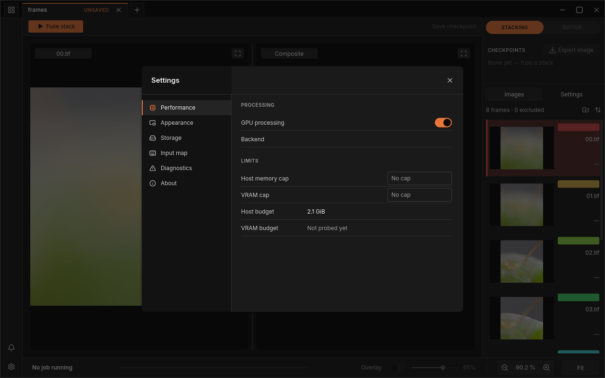
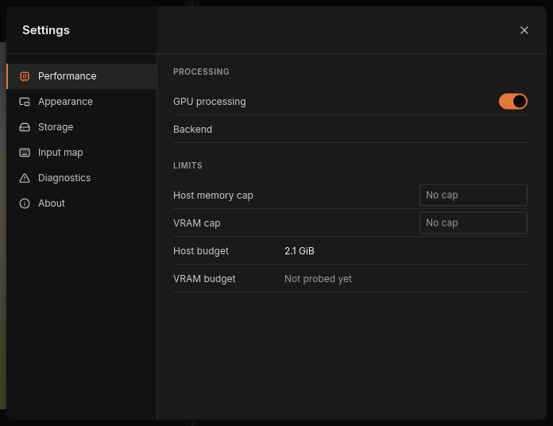
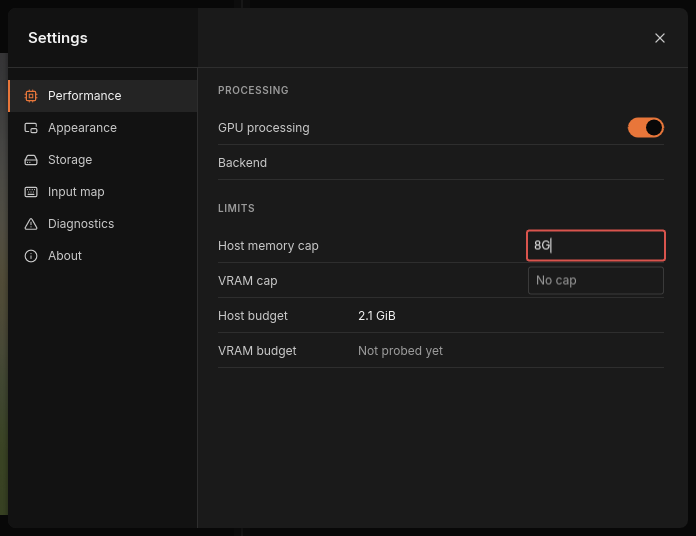
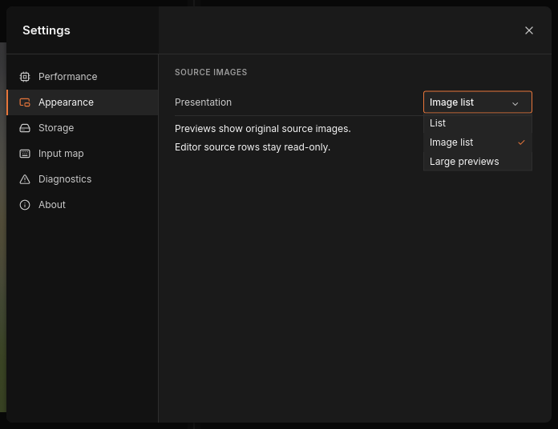
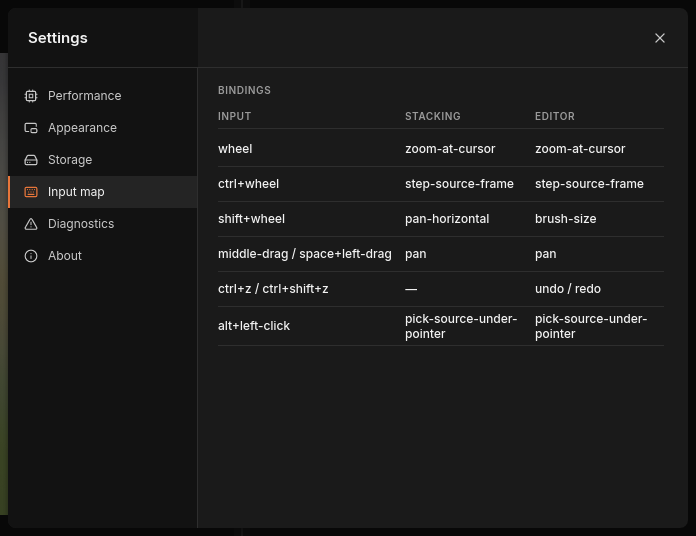
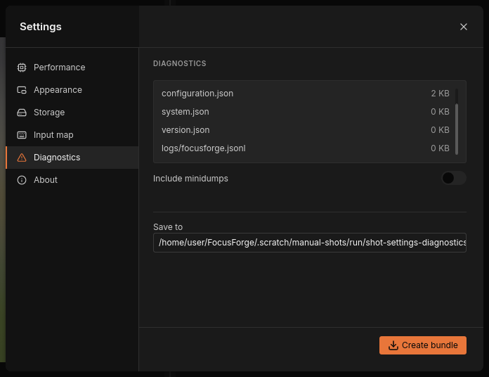
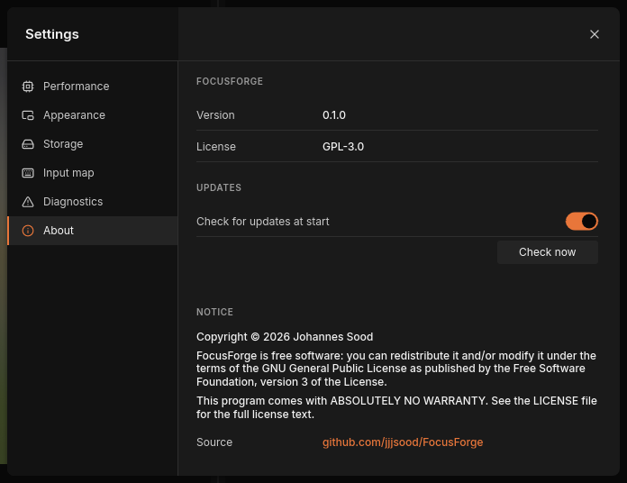

# The settings window

The settings window holds the preferences that apply to FocusForge as a
whole, not to one stack: whether to use the graphics card, how much memory
FocusForge may claim, how the **Images** panel looks, where FocusForge keeps
its files, which mouse and key gestures do what, and the diagnostics bundle
you attach to a bug report.

> **Note:** The **Settings** tab in the dock on the right is a different
> thing: it holds the fusion parameters of the open stack. It has its own
> chapter, [Stacking settings](stacking.md).

Everything you change here is saved at once in the
[settings file](#the-settings-file); there is no OK or Apply button.

## Open and close the window

1. Click **Settings**, the gear at the bottom of the narrow icon bar on the
   left edge of the window, just below the notification bell.
2. The window opens on **Performance**. Click a section in the list on its
   left to switch: **Performance**, **Appearance**, **Storage**,
   **Input map**, **Diagnostics** or **About**.
3. To close it, click **Close settings** (the × in its top-right corner) or
   press Esc, from any section, also right after typing in one of its fields.



*The settings window in front of the main window. The gear that opens it is
at the bottom-left corner.*

While the settings window is open, the main window behind it does not react:
clicks on the toolbar or the canvas do nothing, and window shortcuts such
as Ctrl+S are ignored until you close it. A fuse that is already running
keeps running.

### Open a section at start-up

`focusforge-gui --settings-section <SECTION>` opens the window on one section
as soon as FocusForge starts. `<SECTION>` is one of:

| Section | Value |
| --- | --- |
| Performance | `performance` |
| Appearance | `appearance` |
| Storage | `storage` |
| Input map | `input-map` |
| Diagnostics | `diagnostics` |
| About | `about` |

Any other value is refused and FocusForge does not start; the message names
the accepted values.

## Performance

**Performance** decides how FocusForge uses your computer while it fuses:
on the graphics card or on the processor only, and how much memory it may
take.



*Performance before the first fuse of the session. Your budget figures
depend on your computer.*

| Setting | Values | Default | What it does |
| --- | --- | --- | --- |
| **GPU processing** | on / off | on | Fuses on the graphics card (GPU) when the fusion method supports it. Off fuses on the processor only. |
| **Backend** | text | empty | What the last fuse actually ran on, and why. |
| **Host memory cap** | a size, or empty | empty ("No cap") | The most working memory a fuse may use. |
| **VRAM cap** | a size, or empty | empty ("No cap") | The most graphics-card memory a fuse may use. |
| **Host budget** | text | — | The working memory FocusForge would allow itself on this computer. |
| **VRAM budget** | text | — | The graphics-card memory the fuses of this session may use. |

### GPU processing and the Backend line

With **GPU processing** on, FocusForge tries the graphics card for every
fuse whose fusion method has a GPU version, and falls back to the processor
when that is not possible. The result is the same either way; the GPU is
usually faster. Switch it off if a graphics driver misbehaves or the card is
busy with other work. The switch applies to the next fuse you start, never to
one already running, and it is remembered after you quit.

**Backend** stays empty until a fuse has run in this session. Then it says
what that fuse used, `gpu` or `cpu`, followed by the reason. For example:

- "cpu — GPU processing is off": you switched GPU processing off.
- "gpu — …": the fuse ran on the graphics card named there.
- "cpu — the GPU device was lost earlier in this session": the graphics card
  failed earlier, so FocusForge stays on the processor until you restart it.
- "cpu — … has no GPU implementation": the chosen fusion method only runs on
  the processor.

If a fuse finds no usable graphics card at all, the switch keeps its setting
but cannot be changed for the rest of the session, and **VRAM cap** and
**VRAM budget** read "Unavailable".

### Memory caps and budgets

FocusForge works through a stack in pieces, holding only as many in memory
as its [budget](../glossary.md#budget) allows. On its own it claims a
**Host budget** of 40 % of the memory that is free when it starts a run, and
on the graphics card a **VRAM budget** it measures the first time a fuse uses
the card. Until then **VRAM budget** reads "Not probed yet".

A [cap](../glossary.md#cap) is a ceiling you set on top of that. It is
useful when you want to keep working in another program, a raw converter or
an editor, while a large stack fuses, or when the graphics card is shared
with your display. A cap can only lower a budget, never raise it: a cap above
the budget changes nothing. A lower cap makes FocusForge hold fewer pieces at
once, which can make a fuse slower but never changes the result.

- **Host memory cap** applies from the next fuse you start. The **Host
  budget** row keeps showing what FocusForge would claim on its own; a lower
  cap is what the fuse actually uses.
- **VRAM cap** applies when a fuse first uses the graphics card. Once that
  has happened in a session, a changed VRAM cap is saved but takes effect
  only at the next start, and the line "Caps only lower the probed budgets.
  Changes apply from the next start." appears under the rows.

### Type a cap

Click into a cap field and type a whole number with a unit, without spaces
or with one space:

| Unit | Means | Example |
| --- | --- | --- |
| `KiB`, `MiB`, `GiB`, `TiB` | binary units (1 GiB = 1024 MiB) | `8GiB`, `512MiB` |
| `KB`, `MB`, `GB`, `TB` | decimal units (1 GB = 1000 MB) | `8 GB`, `1000MB` |
| none, or `B` | bytes | `4096` |

Upper or lower case does not matter. To remove a cap, empty the field: it
shows "No cap" again. Every valid entry is saved as you type.



*An entry that is not a valid size gets a red outline and is not used.*

If the text is not a size FocusForge understands, the field gets a red
outline. There is no message: the field simply keeps your text while the cap
in effect stays the last valid one (or none). Typical mistakes are a unit
without its last letters (`8G`, `8Gi`), a decimal point (`1.5GiB`) and `0`.
Finish the entry, or empty the field, and the outline goes away.

> **Warning:** A number without a unit means bytes. While you type `8GiB`,
> the first keystroke already saves a cap of 8 bytes. Always finish the unit;
> if you stop after the number, every fuse runs with the smallest possible
> amount of memory and becomes very slow.

## Appearance

**Appearance** has one setting, **Presentation**, under SOURCE IMAGES. It
chooses how the [Images panel](images-panel.md) shows the frames of a stack:

| Choice | Shows |
| --- | --- |
| **List** | one compact row per frame, names only |
| **Image list** (default) | a small preview of each frame beside its name |
| **Large previews** | a large preview of each frame |



*The Presentation menu. The panel changes as soon as you pick a choice.*

Click the menu and pick a choice, or use the Up and Down keys and Return;
Esc closes the menu without changing anything. The previews always show your
original frames as they are on disk, not an aligned or brightness-adjusted
version, and in the editor the frame rows can be looked at but not changed.
What each presentation looks like is shown in
[The Images panel](images-panel.md).

The choice is saved in the `[appearance]` table of the settings file and
used at every start. If it cannot be saved, the section shows the reason and
"The selected view is active for this session.": the new view stays until you
quit, and the next start uses the one saved before.

## Storage

**Storage** shows where FocusForge keeps its files on this computer, and
lets you empty the stage cache.


*Storage on a computer that has not fused yet. Your paths follow the tables
in [The settings file](#the-settings-file) and
[Diagnostics and crash reports](diagnostics.md#the-log).*

| Location | What is kept there |
| --- | --- |
| **Settings file** | `settings.toml`, everything the settings window and the main window remember (see [The settings file](#the-settings-file)) |
| **Logs** | the log of every session (see [The log](diagnostics.md#the-log)) |
| **Crash reports** | the evidence of earlier crashes (see [Crash reports](diagnostics.md#crash-reports)) |
| **Scratch** | working files of a fuse, including the stage cache |

Paths inside your home folder start with `~`. A long path is cut off at the
end with "…". "· not created yet" after a path means that folder does not
exist yet; FocusForge creates it the first time it needs it (the crash folder
only after a crash). "Unavailable" means FocusForge could not work out that
location on this system.

### Clear the stage cache

When FocusForge fuses, it keeps the results of expensive steps, above all the
[alignment](../glossary.md#alignment), in a
[stage cache](../glossary.md#stage-cache) in the scratch folder. Fusing the
same frames again, for example with another fusion method, can then skip
those steps. The cache can grow over time; **Clear cache** deletes it to free
disk space. Nothing else in the scratch folder is touched, and your projects,
checkpoints and exported images are not affected. The next fuse of each stack
simply computes those steps again.

Click **Clear cache**. The line under the row then reads, for example,
"Cleared 12 stage entries.", or "Could not clear the cache: …" with the
reason. While any fuse is running, the button is unavailable and the line
reads "A run is active.", because the running fuse uses the cache.

The command-line equivalent is `focusforge-cli cache clear`; see
[The stage cache](../reference/batch-runs.md#the-stage-cache).

## Input map

**Input map** shows, under BINDINGS, which mouse and key gestures are in
effect and what each does in the two modes of the main window: **STACKING**
and **EDITOR**. The INPUT column names the gesture, the other two columns the
action; "—" means the gesture does nothing in that mode.



*The default bindings, as the Input map shows them.*

The table is read-only: clicking a row changes nothing. To change a binding,
edit the settings file as described in
[Keyboard and mouse bindings](#keyboard-and-mouse-bindings), then restart
FocusForge.

The table always shows the bindings that actually took effect at start-up:
the shipped defaults, or your own from the settings file. It does not say
which of the two you are looking at. If you edited the file and the table
still shows the defaults, FocusForge refused your table; the reason is
written to the log (see [Rebind a gesture](#rebind-a-gesture)).

## Diagnostics

**Diagnostics** packages FocusForge's log, any crash reports and a short
description of your system into one ZIP file, the diagnostics bundle, for a
bug report. Nothing is sent anywhere; you attach the file yourself.



*Diagnostics, once its file list has been gathered.*

The section shows:

- the list of files the bundle will hold, with their sizes ("Collecting…"
  while FocusForge gathers it);
- **Include minidumps**, off by default, which adds the memory snapshots of
  crashed sessions and warns that they cannot be cleaned of personal data;
- **Save to**, the path of the ZIP file, a new dated name by default;
- **Create bundle**, which writes the file, and the line under **Save to**
  that reports the result or asks before overwriting an existing file.

Every step, what each file holds and what the bundle strips out (your home
folder path and user name, and never any image data) are in
[Diagnostics and crash reports](diagnostics.md).

## About

**About** shows which FocusForge you are running and under which terms.



*About. The version number depends on the build you installed.*

- **Version**: the version of this build. Quote it in a bug report.
- **License**: GPL-3.0, the GNU General Public License, version 3.
- NOTICE: "Copyright © 2026 Johannes Sood", the statement that FocusForge is
  free software you may redistribute and modify under the GNU General Public
  License version 3, and that it comes with ABSOLUTELY NO WARRANTY. The full
  licence text is in the `LICENSE` file that comes with FocusForge.
- **Source**: where the source code lives, `github.com/jjjsood/FocusForge`.

## Keyboard and mouse bindings

### Default bindings

These are the gestures over the canvas that FocusForge ships with. The first
six rows are what the **Input map** section shows; the last one, painting
with the left mouse button in the editor, works the same way but is not
listed in the window.

| Input | In stacking mode | In the editor | Name in the settings file |
| --- | --- | --- | --- |
| Mouse wheel | zoom in or out at the pointer | zoom in or out at the pointer | `wheel` |
| Ctrl + wheel | step to the previous or next frame in the left pane | the same; the selected frame is also the brush source | `ctrl+wheel` |
| Shift + wheel | pan left and right | make the brush larger or smaller | `shift+wheel` |
| Middle-button drag | pan | pan | `middle-drag` |
| Space + left-button drag | pan | pan | `space+left-drag` |
| Ctrl + Z | — | undo the last stroke | `ctrl+z` |
| Ctrl + Shift + Z | — | redo | `ctrl+shift+z` |
| Alt + left-click | select the frame that supplied the sharp detail under the pointer | the same, which also makes it the brush source | `alt+left-click` |
| Left-button drag | — | paint with the brush | `left-drag` |

How these gestures are used is explained in [The window](gui.md) and
[Retouching](retouch.md).

### Fixed shortcuts

A few keys are not part of the input map and cannot be changed. They work
anywhere in the main window, but not while the settings window or another
question is open:

| Keys | Does |
| --- | --- |
| Ctrl + N | choose a folder of frames to open as a new project (see [Your first stack](first-stack.md)) |
| Ctrl + O | open a saved project file |
| Ctrl + S | save the current project (see [Checkpoints and saving](history.md)) |
| Ctrl + W | close the current project (see [Projects, notifications and quitting](batch-runs.md)) |
| Esc | close the front-most dialog or refusal, the Projects overview, or the settings window |

In lists and menus, Up and Down move the selection; on a focused slider, Left
and Right move it by one step.

### Rebind a gesture

The window has no editor for bindings. You change them by editing the
`[input]` table of the [settings file](#the-settings-file) in a text editor:

1. Quit FocusForge.
2. Open `settings.toml` (the **Settings file** row in
   [Storage](#storage) shows where it is).
3. Find the `[input]` table. FocusForge writes it on its first start, with all
   nine default bindings and a comment that lists the accepted actions.
4. Change the `stacking` or `editor` action of the gesture you want. Delete
   the `stacking` or `editor` line to make the gesture do nothing in that
   mode.
5. Save the file and start FocusForge. Check the **Input map** section.

For example, to make Shift + wheel change the brush softness instead of its
size in the editor:

```toml
[[input.bindings]]
trigger = "shift+wheel"
stacking = "pan-horizontal"
editor = "brush-softness"
```

Each `[[input.bindings]]` entry names one `trigger`, one of the nine names in
the last column of the table above. Entries you leave out keep their default.
The accepted actions are:

| Action | What it does |
| --- | --- |
| `zoom-at-cursor` | zoom in or out at the pointer |
| `step-source-frame` | step to the previous or next frame |
| `pan-horizontal` | pan left and right |
| `pan` | pan in any direction |
| `brush-size` | make the brush larger or smaller |
| `brush-softness` | make the brush edge softer or harder, 5 points per wheel step |
| `undo` | undo the last stroke |
| `redo` | redo |
| `pick-source-under-pointer` | select the frame that supplied the detail under the pointer |
| `paint` | paint with the brush |

An action only works with a matching kind of gesture: the zoom, stepping,
horizontal pan and brush actions need a wheel trigger, `pan` and `paint` a
drag, and `undo`, `redo` and `pick-source-under-pointer` a key or a click.

You can only give the nine shipped gestures new actions; you cannot add a new
gesture such as `alt+wheel` or `ctrl+y`. (Alt is not a wheel modifier in
FocusForge; it only belongs to the pipette, Alt + left-click.)

### When FocusForge refuses your bindings

FocusForge checks the whole `[input]` table at start-up. If anything in it is
wrong, it refuses the table as a whole and starts with the default bindings,
so you never end up with half your changes applied. A table is refused when:

- the file is not valid TOML;
- a `trigger` is not one FocusForge knows, or is not one of the nine shipped
  gestures (`alt+wheel`, for example);
- an action is not one of the ten listed above;
- the same `trigger` appears twice.

The window does not show the problem. It is written as a warning to the log
(`focusforge.jsonl` in the **Logs** folder shown in [Storage](#storage); see
[The log](diagnostics.md#the-log)) and, if you started `focusforge-gui` from a
terminal, there too. The warning names the file, the line and the problem,
for example:

```
settings.toml:7: trigger "shift+wheel" duplicates the one already read at line 2
```

FocusForge leaves the refused table in the file as you wrote it. Fix the line
it names and restart.

## The settings file

FocusForge keeps everything it remembers between sessions in one text file,
`settings.toml`, in your user configuration folder:

| System | Settings file |
| --- | --- |
| Linux | `~/.config/focusforge/settings.toml` (or `$XDG_CONFIG_HOME/focusforge/settings.toml`) |
| macOS | `~/Library/Application Support/focusforge/settings.toml` |
| Windows | `%APPDATA%\focusforge\config\settings.toml` |

The **Settings file** row in [Storage](#storage) shows the exact path. The
file is in TOML format, one table per topic:

| Table | Holds | Changed by |
| --- | --- | --- |
| `[recent]` | the projects in the RECENT list of the Projects overview, up to five, each with its `path` | opening and saving projects |
| `[appearance]` | `presentation = "list"`, `"image-list"` or `"large"` | [Appearance](#appearance) |
| `[input]` | the key and mouse bindings | editing by hand, see [Rebind a gesture](#rebind-a-gesture) |
| `[export]` | the export dialog's last format and its settings | [Exporting an image](export.md) |
| `[performance]` | `gpu = true` or `false`, and the optional size strings `max-host-memory` and `max-vram` | [Performance](#performance) |

For example, after switching GPU processing off and typing a host memory cap,
the file holds:

```toml
[performance]
gpu = false
max-host-memory = "8GiB"
```

The file has no version number. When FocusForge saves one table it leaves the
others, and any comments you wrote in them, exactly as they were. A file that
is not valid TOML is never overwritten: FocusForge then starts with the
defaults, cannot save changes until you fix or delete the file, and says why
in the log. A single wrong entry in `[performance]`, such as an unparsable
cap, falls back to its default alone, also with a warning in the log.

To start from scratch, quit FocusForge and delete `settings.toml`. The next
start writes a fresh one with the default bindings.

### Use another settings file

`focusforge-gui --config-dir <DIR>` makes the window read and write
`<DIR>/focusforge/settings.toml` instead, for example to try settings
without touching your usual ones, or to keep one set per project folder. Only
the settings file moves: the log, the crash reports and the scratch folder
stay in the data folder.
