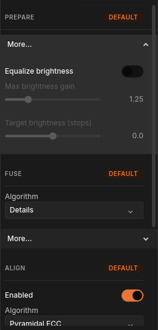
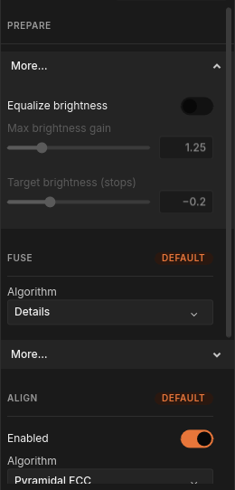
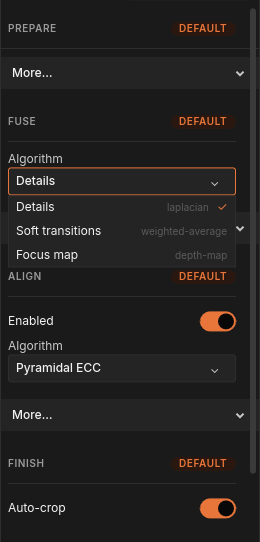
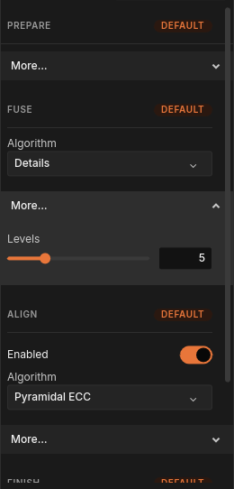
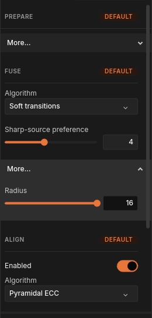
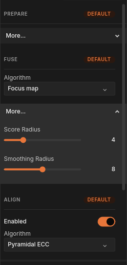
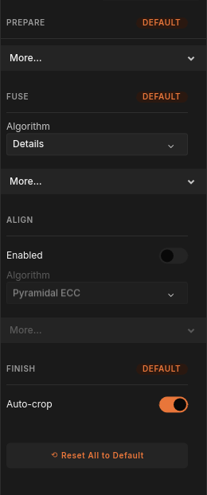
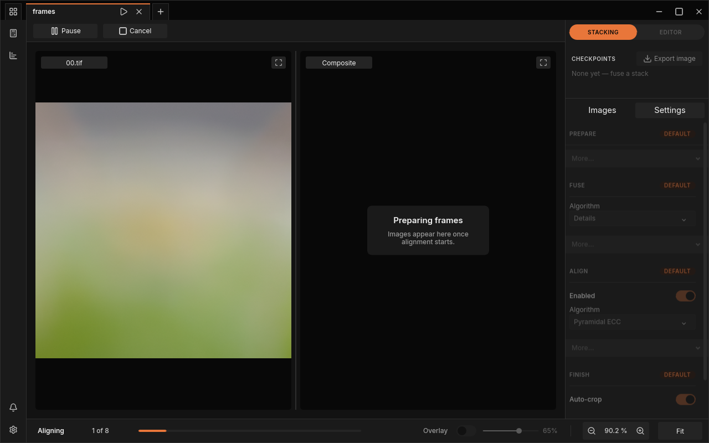

# Stacking settings

The dock's **Settings** tab holds everything the next fuse of a [project](../glossary.md#project) uses:
how the frames are evened out in brightness, which
[fusion method](../glossary.md#fusion-method) combines them, how they are
lined up, and how the result is trimmed. The defaults suit most [stacks](../glossary.md#stack), so you
can fuse without ever opening this tab. When a result disappoints, this page
tells you which setting to try and why.


*The Settings tab of a freshly opened stack: every section at its defaults.*

## Open the Settings tab

1. Open a folder of frames or a saved project (see
   [Your first stack](first-stack.md)).
2. Make sure the dock's mode switch at the top right reads **STACKING**. In
   the editor the tab is not shown.
3. Click **Settings** next to **Images** in the dock.

The tab shows the settings of the project tab you are looking at. With no
project open, the dock reads "No project open." instead.

## How the tab is laid out

The tab has four sections, in the order a fuse uses them:

| Section | What it does | What it holds |
|---|---|---|
| **PREPARE** | Evens out the brightness of the frames before anything else | [Brightness equalization](#brightness-equalization) |
| **FUSE** | Combines the frames into one sharp image | The fusion method and its settings |
| **ALIGN** | Lines the frames up so that the same detail sits at the same place in every frame | The alignment switch, method and settings |
| **FINISH** | Trims the result | **Auto-crop** |

A change applies to the **next** fuse of this project tab. Results you have
already kept stay as they were; fuse again to see the effect (see
[Checkpoints and saving](history.md) for how each result is kept).

### The DEFAULT badge

A section's heading carries an orange **DEFAULT** badge while you have not
touched any of its settings. As soon as you change a value in a section, its
badge disappears, so you can see at a glance where you have changed something.

- Setting a value back to what it was does not bring the badge back: the
  section still counts as changed. Only
  [**Reset All to Default**](#reset-all-to-default) does.
- In **ALIGN**, the **Enabled** switch counts: switching [alignment](../glossary.md#alignment) off, or off
  and on again, removes the badge.
- Choosing another fusion method changes no value, so **FUSE** keeps its badge.

### More...

Settings you rarely need sit behind a **More...** bar in each section. Click
**More...** to open it; the arrow on the right points up while it is open.
Click it again to fold it away. An open **More...** stays open when you choose
another method and when you reset.

At first, **PREPARE** shows nothing but its **More...** bar, because all
three brightness settings live there.

### Sliders, switches and menus

- **Sliders.** Click anywhere on the track to jump there, or drag the round
  handle. The box at the right shows the value; it is a readout, not a field
  you can type into. After clicking a slider, the **Left** and **Right** arrow
  keys move it one step at a time (whole numbers step by one, the brightness
  sliders by their own step). The **Epsilon (px)** slider in **ALIGN** spans
  several powers of ten and has no keyboard steps.
- **Switches.** Click to turn on (orange) or off (grey).
- **Menus.** Click the field to open the list, then click an entry. The
  current entry has a check mark; the grey text beside each entry is the name
  the command line uses for it.

The tab scrolls when it does not fit: use the mouse wheel over it or drag the
scrollbar at its right edge. The heading of the section you are in stays at
the top while you scroll.

## PREPARE: even out brightness



*PREPARE with its More... bar open, at the defaults.*

### Brightness equalization

The frames of one stack rarely have exactly the same brightness: a flash fires
a little stronger or weaker, the lens lets in slightly less light as focus
moves closer, mains light flickers. Fused as they are, such differences show
as blotches where the result switches from one frame to another.
[Brightness equalization](../glossary.md#brightness-equalization) prevents
that. Before aligning, FocusForge gives every frame one brightness factor (a
gain), the same on every colour channel, so that every frame reaches the same
average brightness.

| Setting | Range | Default | What it does |
|---|---|---|---|
| **Equalize brightness** | on / off | on | Gives each frame one gain so that all frames share one average brightness before they are aligned. |
| **Max brightness gain** | 1.01 to 2.00, in steps of 0.01 | 1.25 | Limits how much a frame may be brightened or darkened. 1.25 allows a frame to be made up to 1.25 times brighter or down to 0.8 times as bright (1 ÷ 1.25), about a third of a stop either way. |
| **Target brightness (stops)** | −0.5 to +0.5, in steps of 0.1 | 0.0 | Moves the shared brightness the frames are brought to. 0.0 keeps the frames' average brightness; each stop doubles (+1) or halves (−1) it, so the range covers half a stop up or down. |

While the gains are measured, the bottom bar reads **Preparing** with the
number of frames done and an estimated time remaining.

Things to know:

- The gain scales the pixel values as the files deliver them. It is a simple
  brightness factor, not a correction in linear light, and it does not touch
  your source files.
- With **Equalize brightness** off, the two sliders below it are greyed and
  have no effect. They keep their values, so switching equalization back on
  restores them.
- The gains a run used are stored with the project, so an exported image shows
  the equalized result.

**When to change these settings:**

- **Leave equalization on** for almost every stack. Small flash-to-flash
  variation, the slight darkening of a focus-ring stack and mild flicker are
  exactly what it is for.
- **Switch it off** when the brightness change between frames is intended, or
  when you have already matched the frames in another program and want them
  fused exactly as they are.
- **Raise Max brightness gain** when FocusForge reports that a frame was held
  at the limit (see below) and you know that frame is only somewhat darker or
  brighter. Do not use it to rescue a frame that is far off, such as one whose
  flash did not fire: leave that frame out with **Exclude** in
  [the Images panel](images-panel.md) instead.



*Equalization switched off: the sliders grey out but keep their values.*

### Set a brightness target

**Target brightness (stops)** lets you make the whole stack a little brighter
or darker as part of the fuse, for example when every frame came out slightly
underexposed. The slider reads with a sign: `−0.2`, `0.0`, `+0.3`. It snaps to
tenths of a stop, and the arrow keys move it by 0.1 up to the ends at `−0.5`
and `+0.5`.

> **Tip:** The target and the gain limit work together. With the default
> **Max brightness gain** of 1.25, no frame can move by more than about a
> third of a stop, so a target of `+0.5` cannot be reached and every frame is
> held at the limit. To move the stack by half a stop, raise **Max brightness
> gain** to about 1.45 or more.

A brightness change made here is modest by design. For larger corrections,
adjust the exported image in your photo editor.

### When a frame needs more than the limit

A frame that would need a larger gain than **Max brightness gain** allows is
brightened or darkened only up to the limit. After the run, FocusForge reports
it in a notification titled "Brightness target limited", naming the frame,
the gain it needed, the gain it got, the smallest limit that would have
covered it and the brightness it reached. Similar notices report a completely
black frame (it keeps its brightness, because a gain cannot brighten black)
and a frame whose gain pushes highlights to pure white. See
[Projects, notifications and quitting](batch-runs.md) for where notifications
appear.

The result is still usable: only that frame stays a little brighter or darker
than the rest. If you see blotches where it contributed, raise the limit to
the value the notice suggests and fuse again, or exclude the frame.

## FUSE: choose how the frames are combined



*The FUSE method menu: three fusion methods.*

**FUSE** decides, for every pixel, which frames the result takes it from. Its
**Algorithm** menu offers three methods; each one brings its own settings,
which appear below the menu when you choose it. Every method remembers its own
settings while the project tab is open: try **Soft transitions** with a higher
preference, switch to **Details** and back, and your **Soft transitions**
values are still there.

### Details

The default. Details splits every frame into layers from coarse to fine (an
image [pyramid](../glossary.md#pyramid)), takes the sharpest frame's
contribution in every layer separately and puts the layers back together.

| Setting | Range | Default | What it does |
|---|---|---|---|
| **Levels** (under **More...**) | 1 to 16 | worked out from the image size | How many layers of detail are compared and blended. |

The default of **Levels** is not a fixed number: FocusForge works it out from
the frame size each time (it reads 5 for 512-pixel frames). Leave it there.
More layers make every piece of work far larger and slower, and a value much
higher than the automatic one can stop the run with an error.



*Details has one setting, Levels, worked out from the frame size.*

### Soft transitions

Instead of choosing a winner, Soft transitions blends every frame at each
pixel, giving sharper frames more weight.

| Setting | Range | Default | What it does |
|---|---|---|---|
| **Sharp-source preference** | 1.0 to 8.0, in steps of 0.1 | 4 | How strongly the sharpest frame is preferred where frames overlap. Low values blend smoothly; high values lean towards picking the sharpest frame. |
| **Radius** (under **More...**) | 0 to 16 pixels | 16 | How far around itself each pixel looks to judge how sharp it is. |

Raise **Sharp-source preference** for crisper detail (the result moves
towards what Details gives); lower it for gentler transitions. A smaller
**Radius** judges sharpness from a tighter neighbourhood around each pixel.



*Soft transitions: Sharp-source preference, and Radius under More...*

### Focus map

Focus map first builds a map of which frame is sharpest where, smooths that
map so that neighbouring pixels agree, and then takes each pixel from the one
frame the map names. It produces the most orderly
[Z-Map](../glossary.md#z-map) (the record of which frame each pixel came
from) of the three methods.

| Setting | Range | Default | What it does |
|---|---|---|---|
| **Score Radius** (under **More...**) | 0 to 16 pixels | 4 | How far around itself each pixel looks to judge how sharp it is. |
| **Smoothing Radius** (under **More...**) | 0 to 16 pixels | 8 | How far the sharpness map is smoothed, so that neighbouring pixels agree on which frame is in focus. |

A larger **Smoothing Radius** gives larger, calmer areas from one frame; a
smaller one follows detail more closely but can switch frames more often.



*Focus map: both of its settings sit under More...*

## Choose a fusion method

The same eight frames of a mantis, fused with each method at its defaults:


*The three fusion methods on the sample stack; the lower row enlarges the framed area.*

| Method | Wins when | Trade-off |
|---|---|---|
| **Details** | You want the most fine detail: insects, textures, hair, most subjects. Start here. | At strong depth edges (a near outline against a far background) it can leave a [halo](../glossary.md#halo). It is also the fastest on a computer with a usable graphics card; the other two always run on the processor. |
| **Soft transitions** | Details shows seams, halos or harsh edges between frames; smooth subjects such as petals or glossy surfaces, where gentle transitions matter more than the last bit of texture. | Fine detail is softer, because neighbouring frames are mixed in. |
| **Focus map** | You plan to retouch: each area comes cleanly from one frame, which makes the Z-Map easy to read and paint from. Simple, solid subjects with clear depth. | In smooth areas with no detail in any frame, such as a blurred background, the map has little to go on and the result can show patches, as in the example above. |

A practical approach:

1. Fuse with **Details**.
2. If you see halos, seams or blotches, change the method under **FUSE** to
   **Soft transitions** and fuse again. FocusForge reuses the alignment from
   the first run, so the second fuse is much quicker.
3. Compare the two results in the **CHECKPOINTS** list (see
   [Checkpoints and saving](history.md)) and keep the better one. Repair what
   remains by [retouching](retouch.md).

[Common failure images](../stacking/failure-images.md) shows what halos,
motion and [focus gaps](../glossary.md#focus-gap) look like and which settings help.

## ALIGN: line the frames up

**ALIGN** moves every frame so that it lines up with one [reference frame](../glossary.md#reference-frame)
before fusing, correcting drift and the change in image size as focus moves.
It is on by default.

| Setting | Range | Default |
|---|---|---|
| **Enabled** | on / off | on |
| **Algorithm** | **Pyramidal ECC** | **Pyramidal ECC** |
| **Mode** (under **More...**) | **Translation only**, **Rotation + Scale** | **Rotation + Scale** |
| **Max Iterations** (under **More...**) | 1 to 1000 | 400 |
| **Epsilon (px)** (under **More...**) | 0.000000001 to 1 | 0.0001 |
| **Pyramid Depth** (under **More...**) | 0 to 16 | worked out from the frame size |
| **Reference Policy** (under **More...**) | **Anchor**, **Chain** | **Chain** |
| **Reference Frame** (under **More...**) | **First**, **Middle**, **Last** | **Middle** |

Switching **Enabled** off greys out the rest of the section. What each
setting does, and when to change it, is explained in
[Alignment](alignment.md).

## FINISH: trim the edges

| Setting | Range | Default | What it does |
|---|---|---|---|
| **Auto-crop** | on / off | on | Trims the result to the area that every aligned frame covers. Turn it off to keep the full frame. |

Aligning moves frames by a few pixels, so along the edges some frames leave a
strip with no picture. **Auto-crop** cuts those strips off, so the result has
clean edges. Turn it off when you would rather keep every pixel and crop by
hand later. The outer strip then includes areas that not every frame
covers.

## Reset All to Default

**Reset All to Default** sits at the bottom of the tab, below **FINISH**
(scroll down to reach it). It is greyed until you have changed something.

Clicking it:

- returns every setting of every section on this project tab to its default,
  and every section's **DEFAULT** badge comes back;
- also forgets the values each fusion method remembered for this tab;
- keeps the fusion method you chose: if **FUSE** reads **Focus map**, it
  still does, now with the Focus map defaults;
- leaves open **More...** bars open.

It does not ask first, and it affects only the project tab you are looking at.
It does not change any result you have already kept.



*After one change (here: alignment switched off) Reset All to Default becomes available.*

## Each project tab has its own settings

Settings belong to the project tab, not to the window. When you have two
projects open, each keeps its own method and values; click the other tab and
the Settings tab shows that project's settings.

- A project you reopen from its `.ffp` file starts with the settings recorded
  in it, so the sections show the values that project was fused with rather
  than DEFAULT badges.
- **New project instead**, offered when you change the frames of a project
  that already has a result (see
  [the Images panel](images-panel.md#sorting-reordering-or-adding-after-a-checkpoint)),
  opens the new tab with this tab's settings.
- The values each method remembers while you switch between methods are kept
  only while the tab is open; the project file records the settings of the
  runs you keep.

## While a fuse is running



*During a run the Settings tab is faded and locked.*

From the moment you click **Fuse stack** until the run is over, the Settings
tab of that project is drawn faded and does not react to clicks. That holds
while the run is paused and while it is being cancelled, too: a run keeps the
settings it started with. When the run ends (kept, discarded, cancelled or
failed), the tab works again.

The lock applies only to the project that is fusing. Click another project
tab and you can change its settings while the first one runs.

> **Tip:** To try a different setting, let the run finish (or **Cancel** it),
> change the setting, and click **Fuse stack** again. See
> [Your first stack](first-stack.md) for **Pause**, **Cancel** and the
> **Keep** or **Discard** question.

## From the command line

Everything on this tab is also available to `focusforge-cli`. The window
shows each method's display name; the command line takes its id:

| In the window | On the command line |
|---|---|
| **Details** | `laplacian` |
| **Soft transitions** | `weighted-average` |
| **Focus map** | `depth-map` |
| **Pyramidal ECC** | `pyramidal-ecc` |

`focusforge-cli algorithms` lists them, and `focusforge-cli algorithms <id>`
prints every setting a method has, with its id, range, default and a short
description. [The command-line reference](../reference/cli.md#algorithms)
has the full listing.

### Stack a folder

```bash
focusforge-cli stack path/to/frames/ --algorithm laplacian
```

`stack` fuses a directory of TIFF or supported RAW frames into a
**project**; it does not write an image file (`export` does that, below).
`path/to/frames/` is read non-recursively, or from a `frames/` subdirectory
when one exists. The project is written beside the frames as
`<dir>/<dir-name>.ffp`, or into the directory given with `-o`/`--output`.
For a folder holding more than one stack, see
[Batch runs from the command line](../reference/batch-runs.md). Alignment and
the auto-crop are on by default, as in the window; see
[Alignment](alignment.md#from-the-command-line) for their flags.
[`reference/cli.md`](../reference/cli.md#stack) lists every flag.

Set any declared setting with `--set key=value` (repeatable), using the ids
`focusforge-cli algorithms <id>` prints:

```bash
focusforge-cli stack path/to/frames/ --algorithm weighted-average --set weight-exponent=6 --set radius=8
focusforge-cli stack path/to/frames/ --algorithm depth-map --set smoothing-radius=12
focusforge-cli stack path/to/frames/ --algorithm laplacian --set levels=4
```

Leave `levels` unset and it is derived from the stack's resolution, as in
the window.

### RAW frames

RAW input uses `rawler`. Put one compatible RAW format in a directory and run
the same command as for TIFF; `focusforge-cli info` reports camera metadata
before a stack run. TIFF and RAW frames form separate stacks, and a group that
mixes them is refused before pixels are developed. A file the decoder cannot
read reports an error; FocusForge has no alternate RAW decoder.

### Brightness equalization flags

The **PREPARE** settings are the project settings `equalize`,
`equalize-max-gain` and `equalize-target`:

```bash
focusforge-cli stack path/to/frames/ --algorithm laplacian --set equalize=false
focusforge-cli stack path/to/frames/ --algorithm laplacian --set equalize-max-gain=1.5
focusforge-cli stack path/to/frames/ --algorithm laplacian --set equalize-target=0.2
```

A frame held at the bound makes the run print a notice naming the frame, the
gain it needed, the smallest bound that would cover it and the mean it
reached; a black frame keeps gain 1, and a frame whose gain clips samples at
white and misses the target is reported as well. The gains are recorded in
the project, so `export` writes the equalized result.

### Getting an image back

```bash
focusforge-cli export path/to/frames/frames.ffp -o out.tif --zmap zmap.tif
```

`export` reads a project and writes the image (`-o`), the Z-Map (`--zmap`),
or both; at least one of the two is required. The image is rendered from the
project's stored [composite](../glossary.md#composite), so it reflects the checkpoint you ask for (the
newest by default; `--checkpoint <id>` picks another). An unretouched
checkpoint needs no [source frames](../glossary.md#source-frame); a retouched one reads them again and checks
them against the hashes recorded when the project was written, and a missing
or changed frame is named with nothing written. `export` refuses an output
path that names the project itself.

The format follows `-o`'s extension: `.tif`, `.png` or `.jpg`, each with its
own options:

```bash
focusforge-cli export frames.ffp -o out.png --png-bits 8 --png-compression best
focusforge-cli export frames.ffp -o out.jpg --jpeg-quality 90 --jpeg-subsampling 444
focusforge-cli export frames.ffp -o out.tif --tiff-bits 16 --tiff-compression lzw
```

TIFF and PNG default to 16 bits and JPEG to quality 95 with 4:2:0 chroma
subsampling. EXIF from the alignment reference frame and an ICC profile are
carried into the image by default; `--xmp on` and `--iptc on` carry those too
(IPTC is never written to PNG), and `--exif off` / `--icc off` leave them out.
In the window, the same choices are in the export dialog: see
[Exporting an image](export.md). [`reference/cli.md`](../reference/cli.md#export)
lists every flag.

### Getting the Z-Map

Every project already carries its Z-Map, a single-channel 16-bit TIFF naming,
per pixel, which source frame contributed. Pass `--zmap` to `export` to write
it out:

```bash
focusforge-cli stack path/to/frames/ --algorithm depth-map
focusforge-cli export path/to/frames/frames.ffp --zmap zmap.tif
```

### Using the GPU

The GPU path for `laplacian` is compiled in by default
(`cargo build --release`); `weighted-average` and `depth-map` always run on
the CPU. When the path is compiled in and a usable adapter is present, `stack`
uses it automatically; `--cpu` forces the CPU path, and
`cargo build --release --no-default-features` leaves the GPU path out of the
binary. A missing or unusable adapter falls back to the CPU on its own,
printing why on stderr, never silently and never as a hard failure. If the
graphics device is lost partway through a run, the remaining tiles run on the
host instead; see [Diagnostics and crash reports](diagnostics.md) for where
that and other GPU errors are logged. Every GPU kernel matches its CPU
counterpart to within 1 LSB at 16-bit, so the backend changes speed, not the
result; `--json`'s `backend` field says which one ran. In the window, GPU use
is set under **GPU processing** in [the settings window](settings-window.md).

### Reading the result

```bash
focusforge-cli stack path/to/frames/ --algorithm laplacian --json
```

`--json` reports the frames that were read, the resolved algorithm and
settings (with where each value came from), the tile geometry the run
planned, and the project path written; see
[`reference/cli.md`](../reference/cli.md#stack) for the full schema.
