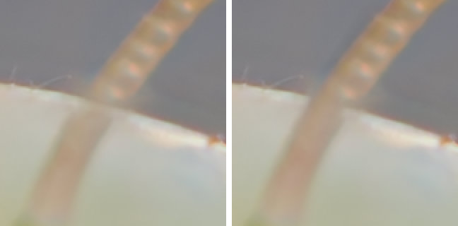

# Common failure images

Most stacks that go wrong go wrong in one of three ways: a glow along the
edges of the subject, doubled or broken outlines, or soft bands between sharp
ones. Each has a cause you can name, a way to avoid it next time you shoot,
and often a way to repair it in FocusForge.

For each failure this chapter shows an example, then answers four questions:
what you see, why it happens, how to avoid it when shooting, and how to
repair it.

The examples are crops fused by FocusForge from the eight frames of a
praying mantis's head, numbered 00 to 07 in focus order, that the chapter
[Depth of field and why stack](depth-of-field.md#an-example) introduces. They are shown at 1:1 (one image pixel per screen pixel) unless a
caption says otherwise. The motion example is simulated by moving frames in
software, and its caption says so.

> **Tip:** Judge a composite at 100 %. All three failures are easy to miss
> in a small preview. In the window, the bottom bar's **Overlay** colours the
> **Composite** pane by the frame each area came from; it is the quickest way
> to see where a soft band or a halo was taken from (see
> [Retouching](../guide/retouch.md)).

## Halos at depth edges

*The same eight frames fused with default settings by each method. Left: Details. Middle: Soft transitions, with a dark band along the rim. Right: Focus map, with dark blotches beside the antenna and the rim.*

A second, quieter form of the same problem sits where the antenna, close to
the camera, crosses the rim of the head, further back:

*Enlarged 2×. Left: the Details composite, where the sharp rim from frame 03 wins over the antenna in front of it. Right: the same composite after one brush stroke from frame 02 along the antenna.*

### What you see

A pale or dark fringe, or a soft ghost outline, running alongside an edge
where a sharp foreground object stands in front of a more distant background:
around antennae, hairs, the edges of legs or petals. The object itself is
sharp; the strip of background next to it looks smeared or glowing.

### Why it happens

A **[halo](../glossary.md#halo)** comes from the optics, not from a bug. In
the frames focused on the foreground object, the background behind it is
blurred. In the frames focused further back, the foreground object is out of
focus and its blur spreads out over the background beside it. Next to the
edge there is therefore no frame in which the background is both sharp and
free of the foreground's blur. The fusion method has to choose between
blurred versions, and a broad, soft edge can score as "detail" too.

The fusion methods handle this differently, as the first example shows.
**Details** works scale by scale and kept the cleanest edges here.
**Soft transitions** blends every frame at every pixel, so the soft spread
of the out-of-focus frames is mixed into the strip beside the edge: here a
dark band along the rim. **Focus map** picks one frame per area from a
smoothed sharpness map; next to the edges, and in smooth areas where no frame
has real detail, it switched between frames whose blur differs in brightness,
which leaves dark blotches and patches.

The second example is the same conflict the other way round. Where the
antenna, close to the camera, crosses the rim of the head, the rim is the
crisper of the two, and its sharp line wins even where the antenna should
cover it. The near object then looks transparent, with the far edge drawn
across it.

### How to avoid it when shooting

- Give the subject distance from the background. The further away the
  background, the smoother and more even its blur, and the less there is to
  confuse.
- Prefer a plain, evenly lit background to a busy one.
- Keep the steps between frames small enough to overlap (see
  [Shooting a stack](shooting-practice.md)). This does not remove halos, but
  it keeps the edge itself clean.

### How to repair it

1. Fuse again with another fusion method and compare at 100 %. The
   **Algorithm** picker in the dock's **FUSE** settings offers **Details**,
   **Soft transitions** and **Focus map**; see
   [Stacking settings](../guide/stacking.md). Which one is best depends on
   the scene, so try more than one on a stack that shows halos.
2. Retouch what remains: in the editor, choose the frame that shows the area
   the way it should look and paint it in with the brush. For a halo that is
   a frame in which the background beside the edge looks clean; for a near
   object with a far edge drawn across it, the frame in which the near object
   is sharp. The second example above needed a single stroke from frame 02.
   See [Retouching](../guide/retouch.md).

## Motion between frames

*Simulated camera movement: frames 03 to 07 moved 20 pixels sideways and 12 vertically against frames 00 to 02. Left: fused with alignment off. Right: fused with alignment on (**Mode** set to **Translation only**), which puts the frames back in register.*

### What you see

Outlines that appear twice, a sharp edge with a soft copy just beside it, or
a structure that does not line up with itself: an antenna with a kink or a
step where one frame takes over from the next. When the whole picture shows
it, the camera moved. When only one part does, the subject moved.

### Why it happens

Focus stacking assumes that only the focus changes between frames. If the
camera moves, every frame after the movement shows the scene in a slightly
different place. If the subject moves, a leg, an antenna or a leaf is in a
different place in some frames while everything else stays put. Either way,
the composite takes each area from its sharpest frame, and areas taken from
frames on either side of the movement no longer fit together.

**Camera movement** comes from knocking the tripod, the shutter, a loose
focusing rail, or a support that settles. **Subject movement** comes from
wind, a living subject, or a subject settling on its perch.

### How to avoid it when shooting

A steady support, a remote release or self-timer, a pause after every step
for vibration to die down, and shelter from wind. Living subjects need short
series or calm moments. All of this is covered in
[Shooting a stack](shooting-practice.md).

### How to repair it

- **Camera movement:** alignment repairs it. It is on by default: FocusForge
  registers every frame onto a reference frame, shifting, rotating and
  scaling it as needed, and crops the result to the area every frame covers.
  When it cannot register a frame, it fuses that frame as it is, and the
  window asks **Keep this fused result?**, naming the frames that "could not
  be aligned". Look at the result before you choose **Keep** or **Discard**.
  See [Alignment](../guide/alignment.md).
- If a frame does not register, open **More...** in the **ALIGN** settings
  and set **Mode** to **Translation only**, which corrects shifts but not rotation or scale and
  copes better with frames that hold little detail. In the example above, the
  default **Rotation + Scale** could not register frame 02 onto frame 03,
  because most of that small window is plain blur; **Translation only** could.
- **Subject movement:** alignment cannot help, because it moves whole frames
  and the rest of the scene did not move. Instead:
  1. Find the frames in which the subject moved: select them one after the
     other in the [Images panel](../guide/images-panel.md) and compare them
     in the frame pane beside the **Composite** pane.
  2. **Exclude** them in the [Images panel](../guide/images-panel.md) and fuse
     again. An excluded frame stays in the list and can be included again.
  3. Repair what is left with the brush, painting the area from one frame in
     which it is sharp. See [Retouching](../guide/retouch.md).
- If the movement spans the frames that hold a part of the subject sharp,
  there is nothing to repair from: shoot that part again.

## Focus gaps

*Left: all eight frames. Right: the same stack without frame 02, the only frame with the antenna in focus, so the step from frame 01 to frame 03 is twice as large. Alignment is off for both, so the two crops match pixel for pixel.*

> **Note:** The eight frames are themselves a thinned series: every eighth
> or ninth of the 61 frames the photographer took. That is the most likely
> reason why, in every example on these pages, the face of the mantis below
> the rim stays soft: none of the eight has it in focus.

### What you see

Soft bands or patches between areas that are sharp. On a surface that runs
away from the camera, such as a leaf, a wing or the side of a head, they
show up as stripes: sharp, soft, sharp, soft.

### Why it happens

A **[focus gap](../glossary.md#focus-gap)** is a slice of the subject that is
not sharp in any frame. Either the step between two frames was larger than
the depth of field, so their sharp slices did not overlap, or frames are
missing from the series: deleted, skipped, or excluded before fusing. Focus
stacking can only pick from what the frames contain, so a slice that no frame
holds sharp stays soft.

### How to avoid it when shooting

Choose a step size smaller than the depth of field, so neighbouring frames
overlap, and check the series for missed frames before you pack up. See
[Shooting a stack](shooting-practice.md).

### How to repair it

- If the frames exist but were left out, put them back: **Include** an
  excluded frame in the [Images panel](../guide/images-panel.md) (or add the
  missing files) and fuse again.
- If the frames were never taken, no setting or retouch can recover the
  detail; retouching can only paint from frames you have. Shoot the missing
  range again, ideally the whole series.

## Where to go next

- [Shooting a stack](shooting-practice.md): how to avoid all three before
  they happen.
- [Stacking settings](../guide/stacking.md): the fusion methods and their
  settings.
- [Retouching](../guide/retouch.md): painting areas of the composite from a
  chosen frame.
