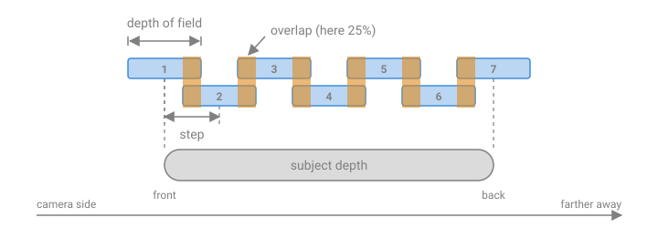

# Shooting a stack

A good [stack](../glossary.md#stack) is decided at the camera. FocusForge lines frames up, evens out
small brightness differences and picks the sharpest detail from each frame,
but it can only work with what you shot: a slice of the subject that no frame
has in focus stays soft, and a leg that moved between frames stays doubled.

This chapter is the practical half of
[Depth of field and why stack](depth-of-field.md). It answers the questions
you face with the camera in your hands:

- how far to move focus between frames, and how many frames to take;
- which aperture to use, and why stopping down further is not the answer;
- how to light the subject so every frame looks the same;
- what to put the camera on, and how to move focus;
- how to keep the subject still;
- which file format to record.

It ends with a checklist to run through before the first frame. FocusForge
starts once the frames are on your disk; [Your first stack](../guide/first-stack.md)
takes over from there.

## Know your magnification

Every number in this chapter depends on
**[magnification](../glossary.md#magnification)**: how large the
subject is on the sensor compared with its real size. At 1:1 (written 1×) a
10 mm beetle covers 10 mm of the sensor. At 1:2 (0.5×) it covers 5 mm, at
2:1 (2×) it covers 20 mm.

Macro lenses usually print the magnification on the focus scale. If yours
does not, measure it:

1. Lay a ruler flat in front of the lens.
2. Focus on it at the distance you will shoot from.
3. Read how many millimetres of ruler fill the width of the frame.
4. Divide your sensor's width by that number. A full-frame sensor is 36 mm
   wide, so 36 mm of ruler across the frame means 1×, and 72 mm means 0.5×.

| Magnification | Width of scene on a full-frame sensor (36 mm) |
|---|---:|
| 0.25× (1:4) | 144 mm |
| 0.5× (1:2) | 72 mm |
| 1× (1:1) | 36 mm |
| 2× (2:1) | 18 mm |
| 3× (3:1) | 12 mm |
| 5× (5:1) | 7.2 mm |

> **Note:** The magnification that matters is the one you shoot at, not the
> lens's maximum. A "1:1 macro lens" focused a little farther away may be
> working at 0.6×.

## Choose the step and the number of frames

The **[step](../glossary.md#step)** is how far the plane of focus moves from one frame to the next.
Too large a step leaves bands that no frame has sharp, a
[focus gap](../glossary.md#focus-gap) (see
[Common failure images](failure-images.md)). Too small a step only costs
time and disk space, so when in doubt, step smaller.

### The model behind the numbers

All the tables below come from one formula, the standard close-up
depth-of-field approximation that the
[depth of field chapter](depth-of-field.md) explains:

> depth of field ≈ 2 · N · c · (m + 1) / m²

- **N** is the f-number set on the lens (the marked aperture, such as f/8).
- **m** is the magnification (1 for 1:1).
- **c** is the [circle of confusion](../glossary.md#circle-of-confusion):
  the largest blur spot that still counts as sharp. This chapter uses
  **c = 0.015 mm**, for a full-frame sensor.

Why 0.015 mm? The classic full-frame value, 0.03 mm, used in the
[depth of field chapter](depth-of-field.md), describes what looks sharp when
the whole picture is viewed at a normal size. A stack is usually judged at
100% on screen, where that blur is plainly visible, so this chapter uses half
the classic value. Every [depth of field](../glossary.md#depth-of-field) here is therefore half the one you get
with 0.03 mm: at 1:1 and f/8 the previous chapter's 0.96 mm becomes 0.48 mm.
The larger figure is fine for small prints, too generous for a stack you want
sharp at full size.

The formula also assumes a lens whose entrance and exit pupils are the same
size (a pupil magnification of 1). Real macro lenses differ a little in either
direction, which is one more reason to keep the [overlap](../glossary.md#overlap) described next.

> **Note:** For a smaller sensor, divide c by the crop factor: about
> 0.010 mm for APS-C (×1.5) and 0.0075 mm for Micro Four Thirds (×2), again
> half the values for normal viewing. The
> depth of field, and so the step, shrinks in proportion: on APS-C, use
> two thirds of the step in the tables below.

### Step and overlap

Do not step by the full depth of field. Let the sharp zones of neighbouring
frames overlap, so that small errors in the step, in the model or in your
focusing do not open a gap:

> step = depth of field × (1 − overlap)

An overlap of **25%** is a good default: the step is three quarters of the
depth of field. Raise it to 30–50% when your steps are uneven (focus ring,
handheld) or when you see gaps in a result.

*Each frame's sharp zone overlaps its neighbours; the first and last frames sit on the front and back of the subject.*

### Depth of field per frame

Depth of field of one frame, in millimetres, for a full-frame camera
(c = 0.015 mm):

| Magnification | f/2.8 | f/4 | f/5.6 | f/8 | f/11 | f/16 |
|---|---:|---:|---:|---:|---:|---:|
| 0.25× (1:4) | 1.7 | 2.4 | 3.4 | 4.8 | 6.6 | 9.6 |
| 0.5× (1:2) | 0.50 | 0.72 | 1.0 | 1.4 | 2.0 | 2.9 |
| 1× (1:1) | 0.17 | 0.24 | 0.34 | 0.48 | 0.66 | 0.96 |
| 2× (2:1) | 0.063 | 0.090 | 0.13 | 0.18 | 0.25 | 0.36 |
| 3× (3:1) | 0.037 | 0.053 | 0.075 | 0.11 | 0.15 | 0.21 |
| 5× (5:1) | 0.020 | 0.029 | 0.040 | 0.058 | 0.079 | 0.12 |

At 1:1 and f/8, one frame is sharp over less than half a millimetre. That is
why a whole insect needs a stack.

### Step size

Recommended step, in millimetres, with 25% overlap (three quarters of the
table above):

| Magnification | f/2.8 | f/4 | f/5.6 | f/8 | f/11 | f/16 |
|---|---:|---:|---:|---:|---:|---:|
| 0.25× (1:4) | 1.3 | 1.8 | 2.5 | 3.6 | 5.0 | 7.2 |
| 0.5× (1:2) | 0.38 | 0.54 | 0.76 | 1.1 | 1.5 | 2.2 |
| 1× (1:1) | 0.13 | 0.18 | 0.25 | 0.36 | 0.50 | 0.72 |
| 2× (2:1) | 0.047 | 0.068 | 0.095 | 0.14 | 0.19 | 0.27 |
| 3× (3:1) | 0.028 | 0.040 | 0.056 | 0.080 | 0.11 | 0.16 |
| 5× (5:1) | 0.015 | 0.022 | 0.030 | 0.043 | 0.059 | 0.086 |

Values are rounded to two significant figures. A step of 0.043 mm is
43 µm: small enough that only a focus rail can make it reliably (see
[Support the camera and move the focus](#support-the-camera-and-move-the-focus)).

### Count the frames

Once you know the step, the number of frames follows from how deep the part of
the subject you want sharp is, front to back:

> frames = (subject depth ÷ step), rounded up, + 1

The "+ 1" is there because the first frame sits on the front of the subject
and the last on the back: seven frames cover six steps, as in the diagram.

**Worked example.** A fly's head and eyes, about 5 mm deep, at 1:1 and f/8 on
a full-frame camera:

1. Depth of field from the first table: 0.48 mm.
2. Step with 25% overlap: 0.48 × 0.75 = 0.36 mm.
3. Frames: 5 ÷ 0.36 = 13.9, rounded up to 14, plus 1 = **15 frames**.

More examples from the same tables:

| Subject | Magnification | Aperture | Depth | Step | Frames |
|---|---|---|---:|---:|---:|
| Flower head | 0.25× | f/8 | 30 mm | 3.6 mm | 10 |
| Fly's head | 1× | f/8 | 5 mm | 0.36 mm | 15 |
| Jumping spider's face | 2× | f/5.6 | 3 mm | 0.095 mm | 33 |
| Butterfly wing scales | 5× | f/2.8 | 1 mm | 0.015 mm | 68 |

> **Tip:** Start a frame or two in front of the subject and finish a frame or
> two behind it. Extra frames at the ends cost a few seconds; a nose or an
> antenna tip that falls outside the stack cannot be fixed later.

### Common step mistakes

- **Stepping by the full depth of field.** Without overlap, every small
  unevenness opens a gap. Keep 25% at least.
- **Using a table for the wrong magnification.** Depth of field falls with the
  square of magnification: going from 1× to 2× cuts it to about a third, not
  a half. Measure the magnification you actually shoot at.
- **Using print-size depth of field.** Figures computed with c = 0.03 mm, as
  many online calculators do, give steps twice as large as these.
- **Changing the aperture without changing the step.** Opening from f/8 to
  f/5.6 shortens the depth of field by almost a third; shorten the step with it.

## Choose the aperture

The aperture sets how deep each frame is, and so how many frames you need.
Stopping down gives more depth per frame, but it also softens fine detail
through [diffraction](../glossary.md#diffraction). At macro magnifications diffraction arrives sooner than
the lens markings suggest.

### Effective aperture

When a lens focuses close, the image it projects is spread over a larger area,
so less light reaches each part of the sensor and the lens behaves as if it
were stopped down further. This **[effective aperture](../glossary.md#effective-aperture)** is approximately:

> effective aperture = N × (1 + m)

At 1:1, f/8 on the lens works like f/16: two stops less light, and the
diffraction of f/16.

| Magnification | f/2.8 | f/4 | f/5.6 | f/8 | f/11 | f/16 |
|---|---:|---:|---:|---:|---:|---:|
| 0.25× | f/3.5 | f/5 | f/7 | f/10 | f/14 | f/20 |
| 0.5× | f/4.2 | f/6 | f/8.4 | f/12 | f/17 | f/24 |
| 1× | f/5.6 | f/8 | f/11 | f/16 | f/22 | f/32 |
| 2× | f/8.4 | f/12 | f/17 | f/24 | f/33 | f/48 |
| 3× | f/11 | f/16 | f/22 | f/32 | f/44 | f/64 |
| 5× | f/17 | f/24 | f/34 | f/48 | f/66 | f/96 |

The depth-of-field formula above already accounts for this, because
2 · N · (m + 1) is twice the effective aperture. Your light meter accounts for
it too when it meters through the lens.

> **Note:** Some camera and lens combinations display the effective aperture
> when focused close, others show the marked one. If the displayed f-number
> changes as you focus closer without touching the aperture, your camera shows
> the effective value: convert back before using the tables, which take the
> marked f-number.

### Diffraction

Light passing through a small opening spreads into a blur spot (the Airy
disc). Its diameter is about 1.34 µm times the effective aperture for green
light:

| Effective aperture | f/8 | f/11 | f/16 | f/22 | f/32 | f/45 |
|---|---:|---:|---:|---:|---:|---:|
| Blur spot from diffraction | 11 µm | 15 µm | 21 µm | 30 µm | 43 µm | 60 µm |

For comparison, a 45-megapixel full-frame sensor has pixels about 4.4 µm
across, a 24-megapixel one about 6 µm. Once the blur spot covers several
pixels, the finest detail is gone, and no stacking software can bring back
detail that no frame recorded.

### Recommended working apertures

Aim for an **effective aperture of about f/11 to f/16**. Detail is slightly
softened at 100% on high-resolution sensors but sharpens back well, and the
number of frames stays reasonable. Beyond about f/22 effective, the loss is
visible at any viewing size.

| Magnification | Set on the lens | Effective aperture |
|---|---|---|
| 0.25× | f/8 to f/11 | about f/10 to f/14 |
| 0.5× | f/8 to f/11 | about f/12 to f/17 |
| 1× | f/5.6 to f/8 | about f/11 to f/16 |
| 2× | f/4 to f/5.6 | about f/12 to f/17 |
| 3× | f/2.8 to f/4 | about f/11 to f/16 |
| 5× | f/2 to f/2.8 | about f/12 to f/17 |

Very wide apertures are not better either. Below these ranges you need many
more frames, each frame's out-of-focus areas are more blurred, and the blurred
edges around foreground parts grow into wider
[halos](../glossary.md#halo) in the result (see
[Common failure images](failure-images.md)).

### Why stopping down does not replace stacking

Take the fly's head again, 5 mm deep at 1:1. At f/22 on the lens (effective
f/44) a single frame is sharp over only 1.3 mm, and diffraction blurs every
point into a spot about 60 µm wide, some thirteen pixels on a 45-megapixel
sensor. You would get a soft picture that is still not sharp front to back. At
f/8 and 15 frames, every part of the head is in a frame shot at an aperture
that keeps the detail.

## Light the subject steadily

Every frame of a stack must look the same apart from where it is sharp. If the
brightness, colour or direction of the light changes between frames, the
result shows it as blotches, bands or seams where FocusForge switched from one
frame to another.

### Continuous light or flash

| | Continuous light (LED panel, lamp, daylight) | Flash |
|---|---|---|
| Best for | Still subjects indoors: specimens, flowers, products | Live subjects, wind, handheld, high magnification |
| Strengths | What you see is what you get; easy to place; no recycle wait | Very short flash duration freezes movement and vibration; plenty of light at small apertures |
| Risks | Long shutter times show vibration and subject movement; some lights flicker | Output varies a little from flash to flash; a missed or half-charged flash gives a dark frame |
| Tips | Use a steady, flicker-free light; keep the shutter time a whole multiple of the flicker period | Use low power for fast, consistent recycling; diffuse it; let the flash dominate the ambient light |

For flash, set the shutter time so that ambient light contributes almost
nothing (for example 1/200 s at ISO 100 indoors). Then each frame's exposure
is the flash alone, and vibration during the exposure no longer matters. Wait
for the flash to recycle fully before every frame.

### Avoid flicker

Many lights are not steady even when they look it:

- **Mains-powered lights** brighten and dim twice per mains cycle: 100 times a
  second where the mains is 50 Hz, 120 times where it is 60 Hz. At shutter
  times shorter than one flicker period, each frame catches a different part
  of the cycle and comes out brighter or darker.
- **Dimmed LEDs** often dim by switching on and off very fast (pulse-width
  modulation, PWM). At short shutter times the same thing happens, sometimes
  at much higher frequencies.

How to avoid it:

1. Use a light sold as flicker-free, or run a dimmable LED at full power and
   control brightness by distance or diffusion instead.
2. With mains-powered light, use a shutter time that is a whole multiple of
   the flicker period: 1/100, 1/50 or 1/25 s at 50 Hz; 1/120, 1/60 or 1/30 s
   at 60 Hz.
3. Some cameras have a flicker-reduction setting that times each exposure to
   the flicker; it helps with mains flicker.
4. Test: shoot ten frames without moving focus and compare their brightness.
   If they differ, so will your stack.

> **Warning:** With an electronic shutter, flicker shows as dark and light
> bands across a single frame rather than as a brighter or darker frame.
> FocusForge cannot remove those bands. Use the mechanical shutter (or
> electronic first curtain) under artificial light, or use flash.

### Keep exposure and white balance fixed

Set everything by hand before the first frame and do not touch it during the
stack:

- **Exposure mode:** manual (M). In aperture priority the camera may change the
  shutter time from frame to frame as the image changes.
- **ISO:** a fixed value, not Auto ISO.
- **Aperture:** fixed, at the value you chose above.
- **White balance:** a fixed preset (Daylight, Flash) or a measured custom
  value, never Auto. When FocusForge opens RAW files it develops each one with
  the white balance recorded in that file, so Auto white balance can give each
  frame a slightly different colour.
- **Picture style, noise reduction, lens corrections in the camera:** leave
  them as they are for the whole stack.

Expose so that the brightest important parts of the subject are not clipped.
Detail that is pure white in a frame is lost in that frame.

> **Note:** If you move focus with the focus ring, magnification grows as you
> focus closer, and with it the effective aperture. With a fixed manual
> exposure, frames at the near end of the stack come out slightly darker:
> going from 0.8× to 1× costs about 0.3 stops. [Brightness equalization](../glossary.md#brightness-equalization) (next
> section) evens out a change of this size.

### What FocusForge evens out, and what it does not

FocusForge's **Equalize brightness** setting is on by default. Before
aligning, it gives every frame one gain, the same on every colour channel, so
that all frames share the same average brightness. **Max brightness gain**,
1.25 by default, limits that gain in both directions: a frame can be made up
to 1.25 times brighter or down to 0.8 times as bright, about a third of a stop
either way. A frame that needs more is held at the limit, and FocusForge
reports it with a notice after the run. The settings are described in
[Stacking settings](../guide/stacking.md).

That covers small flash-to-flash variation, the slight darkening of focus-ring
stacks and mild flicker. It does not cover:

- a frame much darker or brighter than the others, such as a missed flash;
- colour that changes between frames (white balance, mixed light);
- bands or gradients inside one frame;
- light that changes direction, such as a sun moving behind a cloud, or
  shadows that move;
- highlights that are clipped to white.

Fix those at the camera. A single bad frame can be left out later with
**Exclude** in [the Images panel](../guide/images-panel.md), but a gap in
focus where that frame was may remain.

## Support the camera and move the focus

There are four common ways to move focus through a subject. Pick by
magnification and by how still the subject is.

| Method | Use it for | What it risks |
|---|---|---|
| Tripod, turning the focus ring | Up to about 1×; still subjects; no extra gear | Uneven steps; magnification changes across the stack; touching the camera shakes it |
| Tripod and focus rail | 1× and above; long or precise stacks; lenses with no focus ring | Cost and setup time; rail play; vibration after each move |
| Camera's own focus bracketing | Up to about 1× with a lens the camera can focus; outdoors; quick stacks | Step set in camera units, not millimetres; magnification changes like the focus ring |
| Handheld | Low magnification, live subjects, flash | Uneven steps and gaps; tilt between frames; motion blur without flash |

### What alignment absorbs

FocusForge [aligns](../glossary.md#alignment) the frames before it fuses
them. With the default **Rotation + Scale** mode it removes, for each frame:

- **shift**: the camera drifting slightly on the tripod or rail, or moving
  between handheld frames;
- **scale**: the change in image size as focus moves, called
  [focus breathing](../glossary.md#focus-breathing), which is what focus-ring
  stepping and in-camera bracketing produce;
- **rotation**: a small twist of the camera between frames.

It moves each frame as a whole. It cannot fix part of the subject moving
relative to the rest (an antenna, a leaf), or the change in perspective when
the camera tilts or swings between frames. See
[Alignment](../guide/alignment.md) for the settings.

### Tripod and focus ring

The simplest method: lock the camera on a tripod, focus on the nearest part of
the subject, then turn the focus ring a little between frames until you are
past the farthest part.

- **Do:** use a remote release or the self-timer, magnified live view to
  check each step, and small, even movements. With the camera on a tripod,
  an overlap of 30–50% is safer than 25%.
- **Watch for:** turning the ring moves the camera. Wait a second after
  touching it. On lenses with electronic manual focus, how far focus moves per
  turn can depend on how fast you turn, so turn slowly and evenly.
- **Expect:** magnification changes from the first frame to the last.
  FocusForge's alignment absorbs it, but the edges of the frame differ, and
  the result is cropped to the area every frame covers (**[Auto-crop](../glossary.md#auto-crop)**).

> **Tip:** To judge the step by eye, magnify live view on a detail at the
> back edge of the sharp zone. After you turn the ring, that detail should
> still be sharp, now near the front edge of the new sharp zone.

### Tripod and focus rail

A focus rail moves the whole camera forward or backward while the lens focus
stays fixed. Magnification stays the same across the stack, and the step is a
known distance. Above 1× it is the reliable way to make steps of a few tens of
micrometres, and with lenses or objectives that have no focus ring it is the
only way.

- **Manual rails** have a knob and a scale; read your rail's markings to set
  steps from the table.
- **Motorized rails** step and fire the camera on their own, with a pause
  after each move for vibrations to settle. Set that pause to at least a
  second at high magnification, more on a light tripod.
- **Watch for:** play in the mechanism. Before the first frame, turn the rail
  a little in the direction you will shoot, so the slack is taken up, and
  never reverse in the middle of a stack.

Because magnification stays constant, a rail stack only needs alignment to
remove drift. The faster **Translation only** mode is often enough.

### Camera focus bracketing

Many recent cameras can shoot a stack on their own: you set a number of shots
and a step width, and the camera moves the lens focus between frames. The
menu item is called focus bracketing, focus shift shooting or similar,
depending on the maker.

- **Good for:** quick stacks outdoors, with nobody touching the camera.
- **Limits:** it needs a lens the camera can focus electronically. The step
  width is in the camera's own units, and on many bodies it also depends on
  the aperture, so it does not map to the millimetres in the tables. Shoot a
  test stack and look for gaps before relying on a setting. Magnification
  changes as with the focus ring.
- **Watch for:** some cameras use the electronic shutter for bracketing,
  which brings back the banding described under
  [Avoid flicker](#avoid-flicker).

### Handheld

At low magnification you can stack handheld: with flash, shoot a burst while
rocking slowly toward the subject, or use the camera's focus bracketing with a
short shutter time.

- **Good for:** live insects in the field, where setting up a tripod would
  scare them off.
- **Limits:** steps are uneven, so take more frames than the table suggests
  and expect some gaps. Tilting the camera between frames changes the
  perspective, which alignment cannot remove; it shows as ghosting at edges.
  Stay at or below about 1×, and keep stacks short.

### Stop vibration

At 1× and above, even small vibrations blur a frame:

- Use a remote release, the self-timer or the camera's interval timer, never
  the shutter button.
- Use electronic first curtain shutter, or mirror lock-up on a DSLR.
- Put the tripod on a solid floor; on a wooden floor, keep still while
  shooting.
- After every touch, focus change or rail move, wait for the setup to settle.
- Or use flash as the main light: its short duration freezes what remains.

## Keep the subject still

FocusForge aligns whole frames; it cannot put a moving part of the subject
back in place. If something moves between frames, the result shows it doubled,
smeared or cut off: see the motion example in
[Common failure images](failure-images.md).

A stack takes time. Sixty frames at one every two seconds is two minutes, and
a lot can move in two minutes.

- **Wind.** Shoot early in the morning or late in the evening, when air is
  calmest. Shield the subject with your body, a reflector or a small tent.
  Clamp a plant stem out of frame to steady it. Wait for a lull and shoot the
  whole stack in it.
- **Living insects.** They are stillest when cool, in the early morning, and
  when resting or feeding. Keep stacks short, shoot fast with flash, and accept
  fewer frames at a slightly smaller aperture rather than a long stack the
  insect walks out of. Stop if the subject starts to move, and start over.
- **Plants and cut flowers.** They droop as they lose water and turn toward
  a light over minutes. Shoot fresh, and do not leave them under a warm lamp.
- **Specimens.** Mount them firmly on a pin or a small blob of adhesive putty.
  Glued or pinned specimens can still settle; give them a few minutes before
  the first frame.
- **Temperature.** A setup carried from a warm room into the cold, or warmed
  by its own lights, expands and shrinks as it settles, which makes the focus
  creep. Let the camera, lens and rail reach the room's temperature first,
  about a quarter of an hour, and avoid lights that run hot.

> **Tip:** If you need to stop and wait during a stack, for a gust or for an
> insect, remember that FocusForge tells stacks apart by capture time. Frames
> taken more than a minute apart are treated as separate stacks when you open
> the folder: FocusForge says the folder reads as two stacks, and
> **Open as one project** puts them back together. A long pause is still
> worth avoiding, because the subject and the light rarely wait with you.

## Choose a file format

FocusForge stacks two kinds of file. JPEG and PNG are export formats only:
FocusForge does not stack them.

| | RAW files | TIFF files |
|---|---|---|
| What FocusForge reads | Camera RAW files its built-in decoder supports, including DNG and the usual extensions (`.cr2`, `.cr3`, `.nef`, `.arw`, `.raf`, `.orf`, `.rw2`, `.pef` and others) | 16-bit TIFF with interleaved colour samples: uncompressed, LZW or Deflate (ZIP) compressed, in strips or tiles |
| Not read | Files the decoder does not support (FocusForge reports them by name) | 8-bit TIFF, 32-bit floating-point TIFF, BigTIFF |
| Workflow | Copy the RAW files into a folder and open it | Develop the RAW files in your converter first, then export 16-bit TIFFs |
| Development | Done by FocusForge with its decoder's standard rendering, using each file's recorded white balance | Done by you, with full control: lens profiles, noise reduction, colour |
| Disk space | Smaller files | Large: about 270 MB per 16-bit frame from a 45-megapixel camera |

Recommendations:

- **To start, shoot RAW** and open the RAW files directly. It is the shortest
  path, and the files stay small.
- **Export TIFFs when you want control** over the development, for example to
  correct chromatic aberration with a lens profile before stacking. Apply
  exactly the same settings to every frame (synchronise them in your
  converter), with no per-frame automatic adjustments and no cropping.
  Export at 16 bits per channel; uncompressed TIFFs open fastest (see the
  [TIFF fast path](../reference/tiff-fast-path.md)).
- **Do not mix** RAW and TIFF frames in one stack. FocusForge refuses a stack
  that mixes them.
- **Keep the frames in focus order by file name.** FocusForge reads a stack in
  file-name order and by default aligns each frame to its neighbour, so the
  names must follow the focus sequence. Camera numbering does this, unless the
  counter rolls over in the middle of a stack (IMG_9999 followed by
  IMG_0001); rename the frames if it does. Do not shoot a missed frame again
  at the end.
- **Keep the capture time.** FocusForge uses each frame's recorded capture time
  to tell stacks apart in one folder. Leave the metadata in when you export
  TIFFs.
- **One stack, one folder** is the tidiest layout. When several stacks share a
  folder, leave more than a minute between them so they are proposed as
  separate stacks.

## Before the first frame: checklist

Run through this list before you press the shutter.

1. **Support locked.** Tripod legs and head tight, rail clamped, nothing
   resting against the setup.
2. **Magnification known.** Read from the lens scale or measured with a ruler.
3. **Aperture chosen.** From the recommended range for your magnification.
4. **Step and frame count chosen.** From the step table and your subject's
   depth, with at least 25% overlap and a frame or two to spare at each end.
5. **Exposure manual.** Mode M, fixed ISO, fixed shutter time; highlights not
   clipped.
6. **White balance fixed.** A preset or a custom value, not Auto.
7. **Light steady.** Flicker-free light or a flicker-safe shutter time, or
   flash at a power it recycles from quickly.
8. **Vibration handled.** Remote release or timer, electronic first curtain
   or mirror lock-up, settling time after each move.
9. **Subject still.** Wind blocked or a lull waited for; specimen mounted and
   settled; gear at room temperature.
10. **Start and end set.** The first frame in front of the nearest part you
    want sharp, the last behind the farthest.
11. **File format chosen.** RAW, or a plan to export 16-bit TIFFs with
    identical settings.
12. **Test shot reviewed.** For a new setup, shoot a short test stack and
    check it for gaps and flicker before the real one.

When the frames are on your disk, copy them into a folder of their own and
continue with [Your first stack](../guide/first-stack.md), which opens them
in FocusForge.
