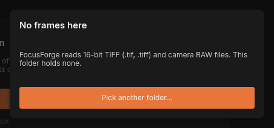
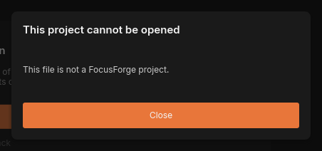
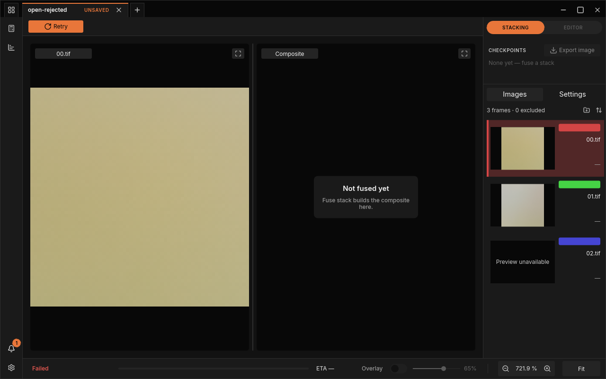
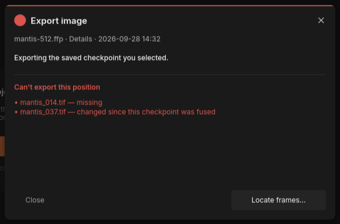
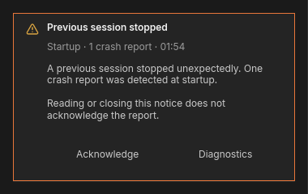

# Troubleshooting and FAQ

This chapter starts from what you see: a dialog, a notification, a red
"Failed", a line on the terminal. Find the message (your browser's search
works well here), read what it means, and follow the fix. Each entry links to
the section of the manual that explains the function behind it.

Messages are quoted exactly as FocusForge shows them. Where a message names a
file or a number, this page writes it as `<path>`, `N` or "…".

## Opening a folder or project

### "No frames here"



*The refusal for a folder that holds nothing FocusForge can stack.*

> FocusForge reads 16-bit TIFF (.tif, .tiff) and camera RAW files. This folder holds none.

**Cause:** the folder you opened holds no frames FocusForge can read. JPEG and
PNG files are not stacked; neither are documents or sidecar files.

**Fix:** click **Pick another folder…** and choose the folder that holds the
frames, or press `Escape`. If your frames are JPEGs, export 16-bit TIFFs from
your raw converter instead, or open the [camera RAW](glossary.md#camera-raw) files directly.

The same dialog title appears with other messages:

| Message | Cause and fix |
|---|---|
| "These files mix camera RAW and TIFF. A stack is one kind of file." | Pick only the RAW files or only the TIFF files. |
| "These files are in different folders. A stack's frames share one folder." | Move the frames into one folder, or open the folder with **New project**. |
| "`<path>`: not a folder of frames or a FocusForge project" | You opened a single file that is neither a frame nor a project file. Open the folder of frames or the `.ffp` file instead. |
| "`<path>` is no longer on disk. This project cannot be fused again until it is back." | You pressed **Fuse stack** on a project whose frames were moved or deleted. See [The frames are no longer there](#the-frames-are-no-longer-there). |

See: ["No frames here"](guide/first-stack.md#no-frames-here) in *Your first stack*.

### "This project cannot be opened"



*A file named `.ffp` that is not a FocusForge project.*

| Message | Cause |
|---|---|
| "This file is not a FocusForge project." | The file was given the `.ffp` name but is something else. |
| "The file was cut short — it ends before the project does." | The file is incomplete: an interrupted copy or download, or a full disk while saving. |
| "The project file is damaged: part of its saved history no longer reads back as it was written." | The file was changed or corrupted after FocusForge wrote it, or it was written by an older version that lacks records the current one needs. |
| "The file could not be read: …" | The system refused to read the file; the rest of the message says why, for example a missing permission. |

**Fix:** click **Close**. Try a backup copy of the project if you have one.
Otherwise open the folder of frames and fuse again: that makes a new project
(retouching you did in the damaged one is lost).

See: ["This project cannot be opened"](guide/first-stack.md#this-project-cannot-be-opened).

### "The frames are no longer there"

> A project remembers its frames by path. N of N cannot be found in this location.

**Cause:** the project opened, but its [source frames](glossary.md#source-frame)
are not where it recorded them: the folder was moved, renamed or deleted, or
the project file was copied to another computer without its frames. History
and [Z-Map](glossary.md#z-map) are intact, and fused results still show.

**Fix:** click **Locate frames…** and choose the folder the frames are in now.
If you click **Close**, you can still look at and export fused results, but
not retouched [checkpoints](glossary.md#checkpoint), and you cannot fuse again until the frames are
back. The project's card in the projects overview reads "Sources missing" and
offers **Locate frames…** later.

See: ["The frames are no longer there"](guide/first-stack.md#the-frames-are-no-longer-there).

### "The source frames are not the same"

> The project was made over N frames. The frames in this location give a different fingerprint.

**Cause:** files with the right names are where the project expects them, but
their content changed: they were edited, re-exported from the raw converter,
or replaced by other frames with the same names. Retouching paints from
frames by their place in the row, so wrong frames would put wrong pixels into
the result.

**Fix:** click **Locate frames…** and choose the folder with the original
frames. Use **Open anyway** only when you know the pictures themselves did not
change (for example, you only edited their metadata). **Cancel** opens
nothing.

See: ["The source frames are not the same"](guide/first-stack.md#the-source-frames-are-not-the-same).
On the command line, see
[`source frame(s) changed since this project was written`](#source-frames-changed-since-this-project-was-written).

### "These are not the project's frames"

**Cause:** the folder you chose with **Locate frames…** does not hold the
project's frames. The message says why, for example "3 of 3 cannot be found in
this folder" or "2 of 3 frames in this folder differ from the ones this
project was made over".

**Fix:** click **Close** and use **Locate frames…** again with another
folder. FocusForge accepts a folder only when both the names and the content
of the files match, so renaming other frames does not help.

See: [Locate frames…](guide/first-stack.md#locate-frames).

### "This folder reads as N stacks of M frames."

This is a question, not an error. The folder holds frames from several
sessions, in subfolders or shot more than a minute apart.

**Fix:** choose **Open as N projects** to get one project per stack, or
**Open as one project** if it really is one stack (for example, you paused
during a long stack). See
[A folder with several stacks](guide/first-stack.md#a-folder-with-several-stacks).

### "Some images were skipped"

> N subfolder(s) skipped:

**Cause:** the folder you opened has subfolders without frames, such as notes
or sidecar files. They were left alone; the frames opened normally. Each one
also shows as a "Not a project" card in the projects overview.

**Fix:** nothing to do. If a skipped subfolder does hold a stack, open it on
its own. See
[How FocusForge reads a folder](guide/first-stack.md#how-focusforge-reads-a-folder).

### A frame reads "Preview unavailable"

In the **Images** list a row reads "Preview unavailable", and the **Frame**
pane reads "Cannot show this frame:" with the file name.

**Cause:** FocusForge cannot decode that file: it is damaged or cut short, or
it is a TIFF layout FocusForge does not read (8-bit, 32-bit floating point,
BigTIFF). A fuse of the stack will fail; see the next section.

**Fix:** exclude or remove the frame in the **Images** panel, or re-export it
as a 16-bit TIFF. See [Which files can FocusForge read?](#which-files-can-focusforge-read)
and [The Images panel](guide/images-panel.md#leave-a-frame-out-of-the-next-fuse).

## Fusing

### "Failed": "Setup failed", "Alignment failed" or "Fusion failed"



*A failed fuse: **Retry** in the toolbar, "Failed" in the bottom bar, one notification on the bell.*

The bottom bar reads "Failed" in red, **Retry** replaces **Fuse stack**, the
bell shows a new notification, and the project's card in the projects
overview reads "Did not stack". The notification's title names the step that
failed; its full message (click the bell, then the row) names the file and the
reason, for example:

| Full message | Cause |
|---|---|
| "`<path>`: IFD value for tag 273 runs past end of file" | The frame's file is cut short, for example by an interrupted copy. |
| "`<path>`: BigTIFF (magic 43) is not supported, only classic TIFF (magic 42)" | The frame is a BigTIFF file. |
| "`<path>`: BitsPerSample=[8, 8, 8] is not supported by the decoded TIFF reader" | The frame is an 8-bit TIFF (a 32-bit floating-point TIFF reads `[32, 32, 32]`). |

**Fix:** **Retry** runs the same fuse again, which only helps when the cause
was passing (a network drive that was briefly away). For a damaged or
unsupported frame, exclude or remove it, or replace it with a 16-bit TIFF
export, and fuse again.

See: [When a fuse fails](guide/first-stack.md#when-a-fuse-fails) and
[Cards that need attention](guide/batch-runs.md#cards-that-need-attention).

### "Keep this fused result?"

> 00.tif and 02.tif could not be aligned and were fused as they are.

**Cause:** the fuse finished, but some frames could not be
[aligned](glossary.md#alignment) and were used unmoved (an
[identity fallback](glossary.md#identity-fallback)). Very blurred frames at
the ends of a stack often cannot be aligned and contribute little anyway.

**Fix:** look at the result. If it shows no doubled edges or smeared
detail, click **Keep**. Otherwise click **Discard** and try one change at a
time: exclude the named frames, switch **Mode** to **Translation only**, or
switch **Reference Policy**. The question needs an answer; `Escape` does not
close it.

See: [When a frame cannot be aligned](guide/alignment.md#when-a-frame-cannot-be-aligned).

### "N frames unaligned"

> Kept the fused result with N frames unaligned.

A record, not an error: you kept a result with frames that could not be
aligned. Nothing to do. See
[Keep or discard the result](guide/first-stack.md#keep-or-discard-the-result).

### "Brightness target limited"

**Cause:** [brightness equalization](glossary.md#brightness-equalization)
needed a larger change for the named frame than **Max brightness gain**
allows, so the frame stays a little brighter or darker than the rest. A
**Target brightness (stops)** beyond about a third of a stop causes one such
notice per frame at the default limit.

**Fix:** if you see blotches where that frame contributed, raise **Max
brightness gain** to the value the notice suggests and fuse again, or exclude
the frame.

See: [When a frame needs more than the limit](guide/stacking.md#when-a-frame-needs-more-than-the-limit).

### "Processing notice"

A record, not an error: the fuse had to take another route and still
finished normally. The message says which, for example that alignment or
fusing moved from the graphics card to the processor (a card with too little
memory, or one that failed during the run), or that the
[stage cache](glossary.md#stage-cache) could not be written, so the next fuse
of these frames aligns them afresh. The result is the same; only the time it
took changes. If such notices keep coming, see
[The Backend line reads "cpu — …"](#the-backend-line-reads-cpu--) below.

### The fuse fails after raising Levels

A **Levels** value far above the automatic one makes the run stop with a
message such as "tile_size 1182 leaves no interior at margin 327680 for
levels=16; use tile_size >= 1048640, or request fewer levels".

**Fix:** set **Levels** back to its default (the **DEFAULT** badge, or
**Reset All to Default**) and fuse again. See [Details](guide/stacking.md#details).

### **Run again** does nothing

**Run again** on a "Did not stack" or "Cancelled" card does nothing while
any fuse is running, in this project or another. Wait for that run to end, or cancel
it, then click again. See [Run a stack again](guide/batch-runs.md#run-a-stack-again).

### The window closed by itself during a fuse

**Cause:** the graphics device the window draws with disappeared (a driver
reset, an external graphics card unplugged). Rather than hang, the window
closes itself a moment later.

**Fix:** start FocusForge again; if it left a crash report, the next start
says so (see ["Previous session stopped"](#previous-session-stopped)). If it
happens again, update the graphics driver and make a
[diagnostics bundle](glossary.md#diagnostics-bundle) for a bug report.

See: [When a fuse fails](guide/first-stack.md#when-a-fuse-fails) and
[Diagnostics and crash reports](guide/diagnostics.md).

### The Backend line reads "cpu — …"

The **Backend** line in the settings window's **Performance** section says
what the last fuse ran on. A fuse on the processor gives the same result as
one on the graphics card, only more slowly.

| Backend line | Cause and fix |
|---|---|
| "cpu — GPU processing is off" | You switched **GPU processing** off. Switch it on for the next fuse. |
| "cpu — the GPU device was lost earlier in this session" | The graphics card failed during an earlier fuse; that fuse finished on the processor. Restart FocusForge to use the card again. |
| "cpu — … has no GPU implementation" | The chosen [fusion method](glossary.md#fusion-method) only runs on the processor. Use **Details** for GPU speed. |

When no usable graphics card is found at all, **VRAM cap** and **VRAM
budget** read "Unavailable" and the switch cannot be changed for the session.

See: [GPU processing and the Backend line](guide/settings-window.md#gpu-processing-and-the-backend-line).

## Adding frames

### "No TIFF images to add" and similar

| Notification | Cause and fix |
|---|---|
| "No TIFF images to add" | What you dropped or picked holds no TIFF frames. **Add images** takes TIFF frames only. |
| "Switch to Stacking to add images" | The tab is in the editor. Click **STACKING** first. |
| "Adding images waits for the run to finish" | This project is being fused. Wait, or cancel the fuse. |
| "Still checking the last images added" | The previous add is still being compared with the frames already there. Wait a moment. |

See: [Add frames](guide/images-panel.md#add-frames).

## Saving and exporting

### "Save failed"

> Could not save `<path>`: …

**Cause:** the project file could not be written: a full disk, a folder you
may not write to, a drive that went away. Everything stays held in the tab;
nothing is lost.

**Fix:** fix the cause the message names (free some space, choose another
folder), then save again with `Ctrl+S`.

See: [Saving a project](guide/history.md#saving-a-project).

### "Can't export this position"



*An export refused because two source frames are gone or changed.*

**Cause:** a retouched checkpoint is rebuilt from your source frames, and one
of them is "— missing" or "— changed since this checkpoint was fused". Other
lines name other causes:

| The dialog says | Fix |
|---|---|
| "JPEG can't be bigger than 65,535 pixels on a side. This image is …" | Export as TIFF or PNG. |
| "PNG and JPEG can only save grey or colour (RGB) images; this one has extra channels." | Export as TIFF. |
| "Can't write …" | Choose another folder or free some disk space. |
| "Some export settings aren't valid: …" | Close the dialog, open it again and choose the settings again. |

**Fix for missing or changed frames:** click **Locate frames…** and choose
the folder with the original frames; the export then runs. A plain fused
checkpoint always exports, because it is stored in the project.

See: [When an export is refused](guide/export.md#when-an-export-is-refused).

## Settings and diagnostics

### A cap field has a red outline

The text in **Host memory cap** or **VRAM cap** is not a size FocusForge
understands, so the last valid cap stays in effect. Typical mistakes: `8G`
instead of `8GiB`, a decimal point (`1.5GiB`), or `0`. Finish the unit or
empty the field.

> **Warning:** a number without a unit means bytes. If fuses became very
> slow after you typed a cap, check that the field does not hold a bare
> number.

See: [Type a cap](guide/settings-window.md#type-a-cap).

### My key bindings are ignored

**Cause:** something in the `[input]` table of `settings.toml` is wrong, so
FocusForge refused the whole table and started with the default bindings.
The window does not show the problem; the log names the file, the line and
the reason.

**Fix:** search the log for `WARN`, correct the line it names, and restart.

See: [When FocusForge refuses your bindings](guide/settings-window.md#when-focusforge-refuses-your-bindings).

### "Could not clear the cache: …" or "A run is active."

**Clear cache** cannot run while a fuse uses the
[stage cache](glossary.md#stage-cache) ("A run is active."); wait for the
fuse to finish. "Could not clear the cache: …" gives the system's reason.
See: [Clear the stage cache](guide/settings-window.md#clear-the-stage-cache).

### "Could not write the bundle. Nothing was written."

The **Save to** path of a diagnostics bundle could not be written: a folder
you may not write to, a full disk, or a path without a file name. Choose
another path and click **Create bundle** again.
See: [Create the bundle](guide/diagnostics.md#create-the-bundle).

### "Previous session stopped"



*The crash notice in the notification center.*

> A previous session stopped unexpectedly. One crash report was detected at startup.

**Cause:** FocusForge stopped unexpectedly last time and left a
[crash report](glossary.md#crash-report). The notice comes back at every
start until you deal with it; reading it is not enough.

**Fix:** click **Diagnostics** to open the settings window ready to package a
bundle for a bug report, or **Acknowledge** if you do not want to report it.

See: [After a crash](guide/diagnostics.md#after-a-crash) and
[The crash notice](guide/batch-runs.md#the-crash-notice).

### "Crash reports unavailable" or "Could not acknowledge report."

"Crash reports unavailable" means the folder holding the crash reports could
not be read. "Could not acknowledge report. Evidence remains unreported. Try
the explicit action again." means marking it failed. In both cases
**Diagnostics** still makes a bundle; check that the data folder shown under
**Storage** in the settings window is readable and writable.
See: [The crash notice](guide/batch-runs.md#the-crash-notice).

## Command line

`focusforge-cli` prints its errors on stderr, starting with `error:`, and
exits with a non-zero status; warnings start with `warning:` and do not stop
the run. Paths in the messages are the ones you typed.

### `no TIFF frames found`

```
error: <path>: no TIFF frames found
```

**Cause:** the folder you passed to `stack` or `info` holds no frames
FocusForge can read. The message says "TIFF" but a folder of camera RAW
files is read too. Exit status 1; nothing is written.

**Fix:** pass the folder that holds the frames (for a folder with a `frames`
subfolder, the parent works too).
See: [`stack`](reference/cli.md#stack).

### `is not a FocusForge project`

```
error: <path>: is not a FocusForge project
```

**Cause:** the file you passed is not a project file. `history` exits with
status 3 and refuses other damaged projects with their own status: 4 a file
cut short, 6 a missing entry, 7 a damaged entry, 8 a broken link between
checkpoints. `export` prints the same message and exits 1.

**Fix:** pass the right `.ffp` file, or stack the frames again to make a new
project. See [`history`](reference/cli.md#history) and
[Refusals](reference/project-format.md#refusals).

### `source frame(s) changed since this project was written`

```
error: N source frame(s) changed since this project was written: #1 <path>, #2 <path> -- pass --accept-changed-sources to proceed anyway; its Z-Map indices would select pixels from frames it was not stacked from
```

**Cause:** the frames at the recorded paths are not the ones the project was
made from (see ["The source frames are not the same"](#the-source-frames-are-not-the-same)
for the window's version). `history list` and `history delete` refuse with
exit status 9 and name each changed frame.

**Fix:** put the original frames back. If you know the pictures did not
change, add `--accept-changed-sources`; the command then runs and prints a
warning instead, with exit status 0:

```
warning: N source frame(s) changed since this project was written: #1 <path>, #2 <path> -- its Z-Map indices may select pixels from frames it was not stacked from
```

`history compact` never accepts the flag. See
[`history`](reference/cli.md#history).

### `source frame(s) unresolved`

```
warning: N source frame(s) unresolved -- the history and Z-Map are intact; viewing an edited checkpoint's image or re-fusing needs them
```

**Cause:** the project's frames are not at their recorded paths. This is a
warning only: the command runs and exits 0. Fused checkpoints export
normally; a retouched checkpoint needs the frames back.
See: [Source frames](reference/project-format.md#source-frames).

### Unsupported TIFF layouts

`stack` refuses a frame it cannot decode and exits 1, naming the file:

```
error: <path>: BigTIFF (magic 43) is not supported, only classic TIFF (magic 42)
error: <path>: BitsPerSample=[8, 8, 8] is not supported by the decoded TIFF reader
```

`info` shows the reason without refusing, for example for an 8-bit frame:

```
mmap fast path: no — BitsPerSample=[8, 8, 8], only 16-bit is supported
```

**Fix:** export the frames from your raw converter as 16-bit TIFF (classic,
not BigTIFF; uncompressed, LZW or Deflate), or stack the RAW files directly.
See [Which files can FocusForge read?](#which-files-can-focusforge-read) and
[TIFF fast path](reference/tiff-fast-path.md#what-the-reader-accepts).

### A damaged frame

```
error: <path>: IFD value for tag 273 runs past end of file
```

**Cause:** the named frame's file is cut short or damaged. `stack` exits 1.
**Fix:** copy the frame again from the card or backup, or move it out of the
folder and stack again.

### `no usable GPU adapter`

```
no usable GPU adapter: …; continuing on the CPU path
```

A notice, not a failure: no usable graphics card was found, so the run
continues on the processor with the same result, only more slowly. The
middle part names what was tried. The exit status is that of the run.

**Fix:** nothing is required. To use the graphics card, install or update its
driver. To skip the attempt, pass `--cpu`.
See: [Using the GPU](guide/stacking.md#using-the-gpu).

### The graphics device is lost during a run

If the graphics card stops working partway through a `stack` run (a driver
reset, for example), the tiles still to do run on the processor instead and
the run completes; the log records the loss. See
[Using the GPU](guide/stacking.md#using-the-gpu) and
[The log](guide/diagnostics.md#the-log).

### `failed to register and fell back to identity`

```
warning: N frame(s) failed to register and fell back to identity
```

Some frames could not be [aligned](glossary.md#alignment) and were fused
unmoved, the command-line counterpart of the window's **Keep this fused
result?** question. Check the result for doubled edges. Pass `--strict` to
make the run fail instead. See
[Registration failures use identity fallback](guide/alignment.md#registration-failures-use-identity-fallback).

### `--algorithm is required`

```
error: --algorithm is required (or an `algo` key in the preset); known algorithms: depth-map, laplacian, weighted-average
```

`stack` needs a fusion method. `laplacian` is the window's **Details**,
`weighted-average` is **Soft transitions** and `depth-map` is **Focus map**.
See [`stack`](reference/cli.md#stack).

### `is not an existing directory`

```
error: -o names the directory this run's projects are collected into -- <path> is not an existing directory. Point -o at a directory, or omit it to write each project beside its own frames.
```

Create the output folder first, or leave out `-o`.

### `earlier runs crashed`

```
N earlier runs crashed -- run focusforge-cli diagnostics to package the evidence
```

An earlier run of FocusForge left [crash reports](glossary.md#crash-report)
that have not been packaged yet. The current command still runs. Run
`focusforge-cli diagnostics` to package them into a
[diagnostics bundle](glossary.md#diagnostics-bundle); the notice then stops.
See: [`diagnostics`](reference/cli.md#diagnostics) and
[After a crash](guide/diagnostics.md#after-a-crash).

## Frequently asked questions

### Where are my projects and exported images saved?

- **Projects:** a fuse in the window writes nothing next to your frames.
  When you first save a project (`Ctrl+S`), the save dialog proposes
  `<frames folder>/<stack name>.ffp`; you can choose any other place. Later
  saves write back to the same file. See
  [Saving a project](guide/history.md#saving-a-project).
- **Exports:** the save dialog proposes the project's folder (or the frames
  folder for a project not saved yet) and the tab's name. See
  [Write the file](guide/export.md#write-the-file).
- **Command line:** `stack` writes each project beside its frames, or into
  the folder named with `-o`. See [`stack`](reference/cli.md#stack).
- **Working files** (the [stage cache](glossary.md#stage-cache)) go to the
  scratch folder shown under **Storage** in the settings window.

### Why is the result smaller than my frames?

[Auto-crop](glossary.md#auto-crop) is on: alignment moves frames by a few
pixels, so along the edges some frames leave a strip with no picture, and the
crop cuts those strips off. Switch **Auto-crop** off under **FINISH** in the
**Settings** tab to keep the full frame; on the command line, pass
`--no-crop` (`--no-align` alone still trims a small border). See
[FINISH: trim the edges](guide/stacking.md#finish-trim-the-edges).

### Does FocusForge ever change my original frames?

No. FocusForge only reads your frames. Alignment moves copies in memory,
retouching paints into the project, and every result lives in the project
file and the images you export. Because a project checks its frames'
content, editing a frame afterwards makes the project ask about it (see
["The source frames are not the same"](#the-source-frames-are-not-the-same)).

### Do the GPU and the processor give the same result?

Yes, to within one step of the 16-bit scale, which you cannot see. The
graphics card only makes a fuse faster. Only **Details** has a GPU version;
**Soft transitions** and **Focus map** always run on the processor. See
[GPU processing and the Backend line](guide/settings-window.md#gpu-processing-and-the-backend-line)
and [Using the GPU](guide/stacking.md#using-the-gpu).

### How many frames can I stack, and how much memory does it need?

There is no practical limit on the number of frames. FocusForge works
through a stack in pieces and holds only as many in memory as its
[budget](glossary.md#budget) allows: by default 40 % of the memory free when
a fuse starts. More frames take longer; the budget stays the same. To keep memory free
for other programs, set a [cap](glossary.md#cap). How many frames a subject
needs is worked out in [Count the frames](stacking/shooting-practice.md#count-the-frames).
Plan disk space too: a 16-bit TIFF from a 45-megapixel camera is about
270 MB.

### Which files can FocusForge read?

| Reads | Does not read |
|---|---|
| 16-bit TIFF (`.tif`, `.tiff`), uncompressed, LZW or Deflate compressed, in strips or tiles, either byte order | 8-bit TIFF, 32-bit floating-point TIFF, BigTIFF |
| Camera RAW files its built-in decoder supports, including DNG and `.cr2`, `.cr3`, `.nef`, `.arw`, `.raf`, `.orf`, `.rw2`, `.pef` | RAW files the decoder does not support (reported by name) |
| | JPEG and PNG (these are export formats only) |

One stack is always one kind of file: RAW and TIFF frames in one folder
become two stacks. RAW files are developed with each file's recorded white
balance. Results export as TIFF, PNG or JPEG. See
[Choose a file format](stacking/shooting-practice.md#choose-a-file-format)
and [Camera RAW and compressed TIFF](guide/first-stack.md#camera-raw-and-compressed-tiff).

### Can I script FocusForge?

Yes. `focusforge-cli` does everything the window's processing does, without
a window: stack a folder (or a folder of many stacks), list and delete
checkpoints, apply brush strokes from a file, export images and Z-Maps, and
package diagnostics. Start with
[For the command line](getting-started.md#for-the-command-line), then the
[command-line reference](reference/cli.md) and
[Batch runs from the command line](reference/batch-runs.md).
